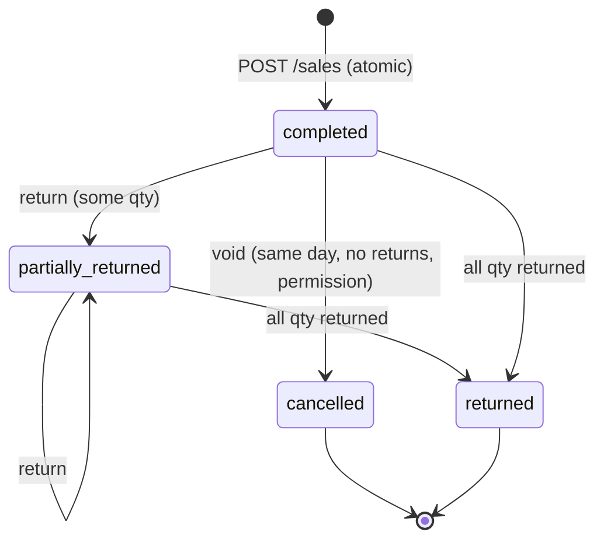
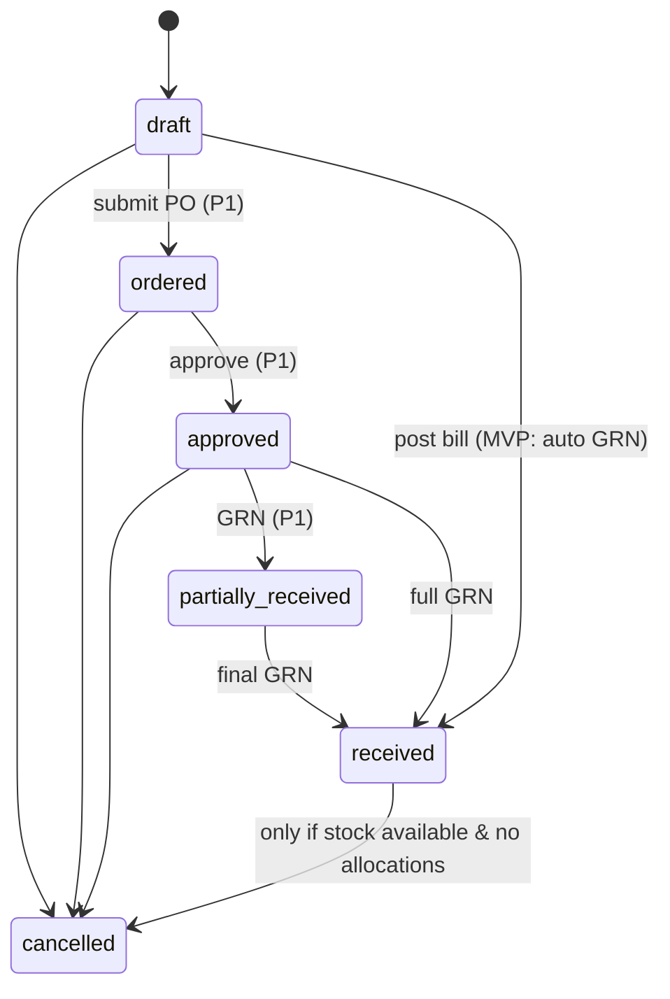
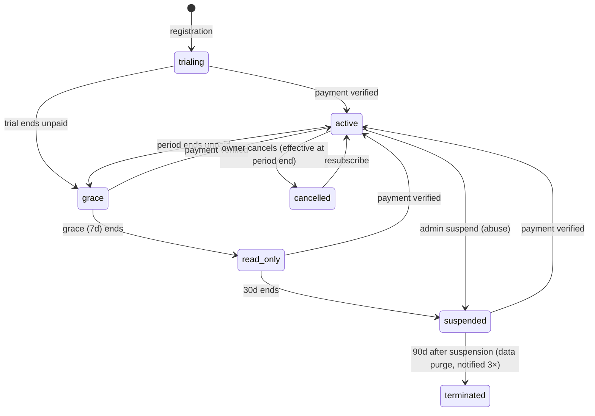

# SaaS POS — Detailed Requirement Analysis

| Field | Value |
|---|---|
| Document | 01 — Requirement Analysis |
| Version | 1.0 (Final draft for approval) |
| Date | 17 October 2026 |
| Source documents | `Docs/saas_pos_software_requirements_specification_srs.md`, `Docs/saas_pos_feature_list.md`, `Docs/developemnt_roudmap.md` |
| Related documents | `02_Development_Roadmap.md`, `03_Database_Design.md` |
| Product | Multi-tenant SaaS POS & Business Management Platform |
| Initial market | Bangladesh (BDT, Asia/Dhaka, Bengali + English) |
| Stack | React + TypeScript + Tailwind CSS · Rust + Actix Web · MySQL 8.4 LTS |

---

## Table of Contents

1. [Purpose and Method](#1-purpose-and-method)
2. [Analysis of the Initial Documents](#2-analysis-of-the-initial-documents)
3. [Decision Register (Resolved Open Questions)](#3-decision-register-resolved-open-questions)
4. [Stakeholders and Personas](#4-stakeholders-and-personas)
5. [Scope and Release Boundaries](#5-scope-and-release-boundaries)
6. [Tenancy and Organisation Model](#6-tenancy-and-organisation-model)
7. [Detailed Functional Requirements by Module](#7-detailed-functional-requirements-by-module)
8. [Calculation Rules](#8-calculation-rules)
9. [State Machines](#9-state-machines)
10. [Roles and Permission Matrix](#10-roles-and-permission-matrix)
11. [Subscription Plans and Entitlements](#11-subscription-plans-and-entitlements)
12. [Non-Functional Requirements (Quantified)](#12-non-functional-requirements-quantified)
13. [API and Integration Requirements](#13-api-and-integration-requirements)
14. [UI/UX Requirements and Screen Inventory](#14-uiux-requirements-and-screen-inventory)
15. [Reports Catalogue](#15-reports-catalogue)
16. [Data Migration and Import Requirements](#16-data-migration-and-import-requirements)
17. [Acceptance Test Scenarios](#17-acceptance-test-scenarios)
18. [Traceability Matrix](#18-traceability-matrix)
19. [Risks, Assumptions, Dependencies](#19-risks-assumptions-dependencies)
20. [Glossary](#20-glossary)
21. [Sign-off](#21-sign-off)

---

## 1. Purpose and Method

### 1.1 Purpose

The initial documents describe *what* the product should do at a high level and leave 15 product decisions open (SRS §15). This document:

1. Consolidates the three initial documents into one consistent requirement baseline.
2. Identifies and resolves contradictions between them.
3. Proposes a concrete answer for every open decision, so development can start. Each answer is marked **Recommended default — needs product owner approval**.
4. Expands each module into user stories, detailed rules and acceptance criteria.
5. Defines calculation formulas, state machines, the permission matrix and plan entitlements. Engineers and QA need these to build and test the system.

### 1.2 Method

| Step | Activity | Output |
|---|---|---|
| 1 | Read all three source documents line by line | Requirement inventory |
| 2 | Compare priorities and phases across documents | Conflict list (§2.2) |
| 3 | Answer open questions using retail-domain practice in Bangladesh and SaaS best practice | Decision register (§3) |
| 4 | Decompose modules into user stories with acceptance criteria | §7 |
| 5 | Formalise money, tax, stock and costing rules | §8 |
| 6 | Model the lifecycle of key documents | §9 |
| 7 | Map requirements to roadmap phases and database tables | §18 |

### 1.3 Priority Scale

These are the same definitions as in the source documents, now applied consistently:

| Priority | Meaning | Release |
|---|---|---|
| **P0** | Required for a safe initial launch (MVP) | MVP (Roadmap Phases 1–5) |
| **P1** | Required for full commercial operation of growing businesses | Release 2 (Phase 6) |
| **P2** | Growth / industry features | Release 3 (Phase 7) |
| **P3** | Industry expansion | Release 3–4 (Phase 7–8) |
| **P4** | Enterprise differentiation | Release 4 (Phase 8) |

---

## 2. Analysis of the Initial Documents

### 2.1 Coverage Summary

| Area | Feature List | SRS | Roadmap | Assessment |
|---|---|---|---|---|
| Tenant isolation | ✔ | ✔ (SRS-TEN-001…006) | ✔ | Strong. Needs a concrete enforcement design → §6, DB doc §3 |
| Auth / RBAC | ✔ | ✔ | ✔ | Permission catalogue missing → §10 |
| Onboarding | ✔ | ✔ | Partial | Wizard steps defined → §7.2 |
| Subscription | ✔ | ✔ | Phase 5 only | Plan limits are needed from Phase 1 (users, products) → moved earlier |
| Products | ✔ | ✔ | ✔ | Variant model undefined → decision D-07 |
| POS | ✔ | ✔ | ✔ | Calculation rules missing → §8 |
| Purchases | ✔ | ✔ | ✔ | Receiving model undefined → D-12 |
| Inventory | ✔ | ✔ | ✔ | Costing method undecided → D-06 |
| Parties | ✔ | ✔ | ✔ | Ledger model undefined → §7.9 |
| Payments | ✔ | ✔ | Partial | Payment vs. allocation model missing → §7.10 |
| Returns | ✔ | P1 | Phase 3 (MVP) | **Conflict** → C-02 |
| Accounting | P1 | P1 | Phase 6 | Feature list §29 says "Advanced accounting = P2". **Conflict** → C-03 |
| Reports | P1 | P0 basic / P1 advanced | Phase 5 | Consistent once split into basic and advanced |
| NFRs | Partial | ✔ | Partial | Need quantified load profile → §12 |

### 2.2 Conflicts Found and Resolutions

| ID | Conflict | Resolution |
|---|---|---|
| C-01 | The feature list module table marks *Purchase management* **P0**. The priority definitions table in the same document lists *Purchases* as a **P1** example. | **P0.** A shop cannot keep correct stock without recording purchases. Purchase *orders*, approval and partial receiving stay P1. |
| C-02 | The SRS marks returns/refunds **P1**. The roadmap Phase 3 delivers a *sales return workflow* in the MVP. | **Basic sale return is promoted to P0.** It covers full or partial return against an invoice, with refund to cash or to the customer balance. Retail shops in Bangladesh handle returns every day. Exchanges, approval workflows and quarantine stay P1. |
| C-03 | Accounting is P1 in the SRS and module table, but the priority table lists "Advanced accounting" as P2. | **P1, delivered in Phase 6.** The MVP still records every money and stock movement in sub-ledgers (party ledger, account transactions, stock movements). The general ledger can then be generated from history later. |
| C-04 | The roadmap Phase 5 holds subscriptions, while Phases 1–4 already need user and product limits. | The **entitlement engine** (plans, features, limits, checks) moves to **Phase 1**. Billing, gateway, renewals and the Super Admin UI stay in Phase 5. |
| C-05 | Branches are P1, but the SRS requires every record to belong to a branch/stock location (Business Rule 1). | The **schema is multi-branch from day one**. Every tenant gets a default branch and a default stock location. The *UI* for multiple branches and transfers is P1, controlled by the `branches.max` entitlement. |
| C-06 | The roadmap Phase 2 lists *product variants* as part of product management (MVP). The SRS marks variants P1. | The **data model supports variants from day one**: every product has ≥1 variant. The variant *UI* (size/colour matrix) is P1. |
| C-07 | Offline POS is "not assumed for MVP" (SRS §2.5), while the feature list mentions an offline queue. | **Out of scope until P2.** Requires a separate design (§5.4). |
| C-08 | The feature list §5 includes coupons. The SRS marks coupons P1. | **P1.** |

### 2.3 Gaps Identified (Not Covered by Initial Documents)

| ID | Gap | Addressed in |
|---|---|---|
| G-01 | No rounding / discount-order / VAT formula | §8 |
| G-02 | No document state machines | §9 |
| G-03 | No permission catalogue | §10 |
| G-04 | No plan entitlement values | §11 |
| G-05 | No load profile for performance targets | §12.1 |
| G-06 | No identity model (can one person work for two businesses?) | D-02 |
| G-07 | No invoice-number format | D-08 |
| G-08 | No handling of the *walk-in customer* | §7.9 |
| G-09 | No cash register / drawer reconciliation detail | §7.6.4 |
| G-10 | No data-retention numbers | D-15 |
| G-11 | No localisation details (number format, Bengali digits, fonts on receipts) | §14.3 |
| G-12 | No API conventions (pagination, errors, idempotency header) | §13 |

---

## 3. Decision Register (Resolved Open Questions)

These answer SRS §15 and Roadmap Phase 0 "Key Business Decisions". **Every row is a recommended default that needs product owner approval.** Changing a decision after Phase 1 has the cost shown in the last column.

| ID | Question | Recommended decision | Rationale | Change cost later |
|---|---|---|---|---|
| D-01 | First launch segment | **General retail**: grocery, fashion, electronics, general stores, small wholesale | Largest market; the core feature set covers it | Low |
| D-02 | Tenant vs. business vs. user | **1 tenant = 1 business.** A *user identity* (phone/email) is global and can be a member of several tenants, with a different role in each. | Accountants and owners with two shops need one login. Simple isolation. | High |
| D-03 | Multiple branches in MVP? | **Schema yes, UI no.** MVP plans allow 1 branch. Multi-branch UI ships in Phase 6. | Avoids a data migration later | Low |
| D-04 | Shared vs. dedicated database | **Shared MySQL 8.4 database, shared schema, `tenant_id` as the first column of every tenant table's primary key.** MySQL has no row-level security, so isolation is enforced by a tenant-scoped data access layer, composite foreign keys, database guard triggers on writes, a CI SQL lint and an automated cross-tenant test suite (DB doc §3). Database-per-tenant is an enterprise option (P4). | Lowest operating cost. Five independent layers give defence-in-depth without RLS. | Very high |
| D-05 | Sell when stock is insufficient? | **Tenant setting `allow_negative_stock`, default `false`.** If `true`, the sale proceeds and the stock goes negative, flagged on the low-stock report. Users with `pos.override_stock` may override per sale when the setting is false. | Some shops sell before entering purchases. Default keeps data clean. | Low |
| D-06 | Inventory costing method | **Moving weighted average cost (WAC) per variant per stock location.** FIFO/batch costing becomes available with batch tracking (P2). | Simple, explainable to SMEs, accepted practice. Needs no layer tables. | Medium |
| D-07 | Product variants | **Product → Variant (1..n).** Every product has a default variant. Stock, prices, barcodes and sales lines reference the *variant*. | One code path for simple and variant products | Very high |
| D-08 | Invoice numbering | **Per tenant, per branch, per document type, gapless within committed transactions.** Format `{PREFIX}-{YY}{MM}-{SEQ:5}`, e.g. `INV-2610-00042`. Prefix and reset period (never / yearly / monthly) are configurable. | Auditors and VAT practice expect sequential numbers per outlet | Medium |
| D-09 | Tax / VAT | **Configurable tax rates per tenant; each product has a default rate. Prices are tax-exclusive by default (`prices_include_tax = false`), switchable per tenant.** Line-level tax calculation. Seed rates: 0%, 5%, 7.5%, 10%, 15% (Bangladesh standard VAT is 15%). A Mushak-6.3-compatible invoice layout is P1, **subject to verification by a qualified VAT professional**. | Many small shops are not VAT-registered; must still work | Medium |
| D-10 | Payment methods / gateway | **MVP: Cash, Card (manual), bKash/Nagad/Rocket (manual reference), Bank transfer, Customer credit (due).** SaaS subscription payments: manual verification in MVP, SSLCommerz/bKash gateway in Phase 5b. | Gateway merchant onboarding takes weeks. Do not block MVP. | Low |
| D-11 | Credit (due) sales | **Allowed only when a named customer is selected (not walk-in).** Customer credit limit is enforced if set; override needs `sales.override_credit_limit`. | Prevents untraceable dues | Low |
| D-12 | Purchase receiving | **MVP: posting a purchase bill receives all items at once (one goods-receipt record is created automatically).** P1: purchase orders, approval, partial receipts. | Matches how small shops work. Keeps the GRN model for later. | Low (model already present) |
| D-13 | Returns / refunds | **MVP: return against an original invoice, full or partial; refund to cash/original method or to the customer balance; returned goods go back to sellable stock or to *damaged*.** Exchanges, approval and quarantine are P1. Return window is a tenant setting (default 7 days; owners can bypass). | See C-02 | Low |
| D-14 | Accounting in MVP? | **No general ledger UI in MVP.** Sub-ledgers are complete. Double-entry posting engine and statements ship in Phase 6 and back-fill journals from history. | Reduces MVP scope by ~6 weeks without losing data | Low (by design) |
| D-15 | Languages / currency / retention | **English + Bengali UI. Default currency BDT (৳), 2 decimal places. Timezone Asia/Dhaka.** Retention: transactional data kept while the account is active **+ 90 days after termination** (export available), then purged. Audit logs: 2 years online, 7 years archived. Backups: daily full + continuous binary logs, 30 days. | Typical SaaS norms; tax records may need longer retention — confirm locally | Low |
| D-16 | Load assumptions | Year 1: **1,000 tenants, 3,000 active users, peak 300 concurrent POS sessions, 150,000 sales/day, avg 4 lines/sale**. Design headroom ×5. | Basis for performance tests | — |
| D-17 | Availability / RPO / RTO | **99.5% monthly** (MVP) → 99.9% (Phase 8). **RPO ≤ 15 min, RTO ≤ 4 h.** | Matches the SRS; achievable with managed MySQL + binary-log PITR | — |
| D-18 | Subscription expiry policy | Trial 14 days → **grace 7 days** (full access + banner) → **read-only 30 days** (view/export, no new transactions) → **suspended** (login shows renewal page only). Data is never deleted while the account is suspended; termination follows D-15. | Protects revenue and customer data | Low |
| D-19 | Authentication tokens | Short-lived **access JWT (15 min)** + **opaque rotating refresh token (30 days, httpOnly Secure cookie, reuse detection)**. Passwords hashed with **Argon2id**. Login by phone or email. OTP via SMS for verification and reset. | Matches the roadmap; secure and stateless API | Medium |
| D-20 | Fiscal year | Default **July–June** (Bangladesh fiscal year). Configurable. | Local practice | Low |

---

## 4. Stakeholders and Personas

### 4.1 Stakeholders

| Stakeholder | Interest | Involvement |
|---|---|---|
| Product owner / SaaS operator | Revenue, retention, scope | Approves requirements, plans, pricing |
| Business owners (tenants) | Accurate stock, money, fast checkout | Pilot users, feedback |
| Cashiers | Speed, simplicity | Usability testing |
| Accountants | Correct ledgers, exports | Report validation |
| Development team | Clear, testable requirements | Build |
| QA | Acceptance criteria | Test design |
| DevOps | Operability, backups | Infrastructure |
| Support staff | Diagnostics, safe tenant access | Super Admin tools |
| Payment providers (bKash, SSLCommerz…) | Integration compliance | Phase 5b |
| Tax advisers | VAT compliance | Review invoice format |

### 4.2 Personas

| Persona | Profile | Primary goals | Pain points to solve |
|---|---|---|---|
| **Rahim — Shop Owner** | Owns a grocery shop in Dhaka, 2 staff, uses a smartphone and a basic laptop | Know daily sales, profit, stock, who owes him | Paper ledgers, theft, stock-outs |
| **Nusrat — Cashier** | 22, fast on keyboard, uses a barcode scanner | Finish each sale in < 30 s, no errors | Slow screens, unclear totals, printer failures |
| **Karim — Store Manager** | Manages purchases and stock for a fashion store | Receive goods, track variants (size/colour), avoid dead stock | Variant chaos, unknown last purchase price |
| **Sadia — Accountant** | Part-time for 3 shops | Customer/supplier statements, cash book, VAT summary | Switching logins, inconsistent data |
| **Platform Admin** | SaaS operator staff | Onboard tenants, verify payments, handle support | Manual billing, no visibility |

---

## 5. Scope and Release Boundaries

### 5.1 MVP (Release 1) — In Scope

"A small shop can register, enter products, receive stock, sell items, print invoices, collect payments, handle returns and review basic reports, under a subscription plan."

| Module | MVP capability |
|---|---|
| Auth & users | Sign-up/in, OTP verification, password reset, invitations, roles, permissions, sessions |
| Onboarding | Business profile, default branch, invoice and tax settings, product CSV import, setup checklist |
| Entitlements | Plans, feature flags, limits checked on the server |
| Catalog | Categories, brands, units, products (single variant UI), barcodes, prices, tax rate, reorder level, archive |
| Inventory | Opening stock, stock ledger, adjustments (with reason), low-stock list, stock valuation (WAC) |
| POS | Search/scan, cart, line and invoice discounts, tax, split payment, partial payment/due, hold/resume, thermal + A4 print, keyboard shortcuts |
| Sales | History, invoice view/reprint, cancellation (permission + reason, same day), basic returns |
| Purchases | Purchase bill (auto-received), supplier payment, due |
| Parties | Customers, suppliers, opening balances, ledgers, statements, payment collection |
| Money | Cash/bank/MFS accounts, payment methods, receipts/payments, account transfers, cash book |
| Expenses | Categories, expense entry |
| Reports | Dashboard, sales (daily/period/product/cashier), purchases, stock, low stock, customer and supplier dues, payment summary, expense summary, profit estimate |
| Super Admin | Tenants list/search, activate/suspend, plans and features, manual subscription payment verification, platform audit |
| Platform | Audit logs, idempotency, backups, monitoring, health checks |

### 5.2 Release 2 (Phase 6) — P1

Multi-branch UI and branch permissions; stock transfers; stock counts; purchase orders, approval, partial receiving; purchase returns; exchanges and return approval; register shifts and cash reconciliation; variants UI (size/colour matrix); multiple units and conversion; price levels (retail/wholesale) and customer groups; double-entry accounting (COA, journals, trial balance, P&L, balance sheet, cash flow, period lock); other income; expense attachments, approval, recurring; advanced report filters, CSV/XLSX/PDF export; notifications (in-app, email, SMS); MFA; coupons, trials automation, payment gateway; MRR/ARR dashboards; Mushak-6.3 invoice layout.

### 5.3 Release 3–4 — P2–P4

Loyalty and promotions, gift cards/store credit, restaurant POS and KDS, pharmacy (batch/expiry), serial/IMEI tracking, HRM/payroll, public API, webhooks, e-commerce sync (WooCommerce), offline POS, white-label, custom domains, dedicated database, custom report builder.

### 5.4 Explicitly Out of Scope for MVP

Offline POS · kitchen display · pharmacy compliance · HRM · white-label/custom domain · dedicated DB per tenant · marketplace integrations · AI forecasting · multi-country tax · native mobile apps (the responsive web app is used on mobile instead).

---

## 6. Tenancy and Organisation Model

```
Platform
 └── Tenant (= Business)            e.g. "Rahim General Store"
      ├── Subscription → Plan → Features/Limits
      ├── Settings (currency, timezone, tax mode, negative-stock policy…)
      ├── Branch (1..n)              e.g. "Mirpur Outlet"   [MVP: exactly 1]
      │    ├── Stock Location (1..n) e.g. "Shop Floor", "Back Store", "Damaged"
      │    ├── Cash Register (P1)
      │    └── Document sequences (INV, PUR, RET, PAY, EXP…)
      ├── Memberships → User (global identity) + Roles (+ branch scope)
      └── Business data (products, parties, sales, purchases, money…)
```

**Rules**

- R-TEN-01: A user may belong to many tenants. After login the user picks an active tenant. The access token carries `tenant_id` and `membership_id`.
- R-TEN-02: The server reads the tenant **only from the verified token**. Any `tenant_id` sent in a URL or body is ignored or rejected.
- R-TEN-03: Each DB transaction is opened through the tenant-scoped data layer. It binds `tenant_id` into every query and sets the session variable `@app_tenant_id`, which the database guard triggers check on every write (see DB doc §3).
- R-TEN-04: Branch scope: a role assignment may be limited to a set of branches. Branch-scoped users see and act only within those branches. Reports default to the user's branches.
- R-TEN-05: Platform staff access to tenant data is read-only by default, requires a recorded reason ("support session"), is time-limited (default 60 min), and is audited. The tenant owner can see these sessions in their audit log.
- R-TEN-06: Cache keys, object-storage paths (`tenants/{tenant_id}/…`), background jobs and exports must include and check `tenant_id`.

---

## 7. Detailed Functional Requirements by Module

Format: **User story** → **Rules** → **Acceptance criteria (AC)**. Requirement IDs extend the SRS IDs. New IDs use the suffix `-Rxx`.

### 7.1 Authentication, Identity and Sessions

**Stories**

- US-AUTH-01: As a new owner, I register with name, mobile number, email (optional) and password, so that I can create my business.
- US-AUTH-02: As a user, I sign in with mobile/email + password and pick a business if I belong to more than one.
- US-AUTH-03: As a user, I reset my password via an SMS/email OTP.
- US-AUTH-04: As an owner, I invite staff by phone/email, assign roles and optionally restrict them to branches.
- US-AUTH-05: As an owner, I see active sessions of my staff and can revoke them.

**Rules**

| ID | Rule |
|---|---|
| AUTH-R01 | Password policy: ≥ 8 characters and not in a common-password list. No forced periodic rotation. |
| AUTH-R02 | Argon2id (memory ≥ 19 MiB, iterations ≥ 2, parallelism 1), per-user salt. |
| AUTH-R03 | Login rate limit: 5 failures per 15 min per identifier + IP → 15 min lockout and an `auth.lockout` audit event. |
| AUTH-R04 | OTP: 6 digits, valid 5 min, max 5 attempts, max 3 sends per 15 min per phone. Stored hashed. |
| AUTH-R05 | Access token 15 min (JWT, EdDSA or HS256 with rotated key), claims: `sub`, `tid`, `mid`, `perms_ver`, `exp`. |
| AUTH-R06 | Refresh token: random 256-bit value, stored as a SHA-256 hash, 30-day sliding expiry, rotated on every use. If an already-used token is presented again, the whole token family is revoked (reuse detection). |
| AUTH-R07 | Permission changes increment `perms_ver`. The API rejects tokens with an old version, which forces a refresh. |
| AUTH-R08 | Deactivating a membership revokes all of its sessions immediately. |
| AUTH-R09 | Invitation links expire after 7 days and can be used once. |
| AUTH-R10 | Security events (login success/failure, reset, MFA change, role change, session revoke) are logged with IP and user agent. |
| AUTH-R11 (P1) | TOTP MFA, optional per user; owners can make it mandatory for roles. |

**AC**

- AC-AUTH-01: Wrong password 5× → 6th attempt returns `429` with a `retry_after`, even with the correct password.
- AC-AUTH-02: A reused refresh token returns `401`, and all sessions in that family become invalid.
- AC-AUTH-03: Removing the `pos.sell` permission from a role blocks sale creation within ≤ 15 min (on the next token refresh, or immediately via `perms_ver`).
- AC-AUTH-04: A user who is a member of tenants A and B, with tenant A active, gets `404` for every tenant-B resource ID.

### 7.2 Business Registration and Onboarding

**Wizard steps**

| # | Step | Fields | Required |
|---|---|---|---|
| 1 | Account | Full name, mobile, email, password, OTP verify | Yes |
| 2 | Business profile | Business name, business type (list), address, district, logo, BIN/VAT reg. no. (optional), trade licence no. (optional) | Name, type |
| 3 | Regional | Currency (BDT), timezone (Asia/Dhaka), language (en/bn), fiscal year start | Defaults pre-filled |
| 4 | Branch | Branch name, address, phone (default branch is created automatically) | Name |
| 5 | Invoice & tax | Invoice prefix, footer text, receipt size (80mm/58mm/A4), VAT registered? price includes tax? default tax rate | Defaults pre-filled |
| 6 | Payment methods | Toggle Cash, Card, bKash, Nagad, Rocket, Bank; link to accounts | Cash always on |
| 7 | Products | Add manually / import CSV / load sample data | Skippable |
| 8 | Staff | Invite cashier(s) | Skippable |

**Rules**

- ONB-R01: Steps 1–2 create the tenant inside **one DB transaction**. That transaction creates the tenant, settings, default branch, default stock locations (`MAIN`, `DAMAGED`), system roles, owner membership, default payment methods and cash account, document sequences, tax rates, walk-in customer, default unit set (pcs, kg, g, L, ml, box, dozen) and a trial subscription.
- ONB-R02: Business slug is unique across the platform and auto-generated from the name.
- ONB-R03: The setup checklist shows progress and remains on the dashboard until it is complete or dismissed.
- ONB-R04: Sample data is tagged `is_sample = true` and can be wiped in one action before the first real sale.

**AC**

- AC-ONB-01: A new owner completes steps 1–6 and makes a test sale in under 10 minutes with no assistance (usability test with 5 users; ≥ 4 succeed).
- AC-ONB-02: If any provisioning insert fails, no tenant rows remain.

### 7.3 Super Admin (Platform)

| ID | Requirement | Pri |
|---|---|---|
| ADM-R01 | Tenant list with search (name, phone, slug), filters (status, plan, created date), counts by status | P0 |
| ADM-R02 | Tenant detail: profile, subscription history, usage vs. limits, owner contact, last activity | P0 |
| ADM-R03 | Activate / suspend / reactivate with mandatory reason → audit | P0 |
| ADM-R04 | Plan CRUD: name, prices per billing cycle, features, limits, visibility (public/private), sort order | P0 |
| ADM-R05 | Manual payment verification: view the payment claim (method, trx ID, amount, screenshot) → approve (extends subscription) / reject (with reason) | P0 |
| ADM-R06 | Per-tenant feature/limit override with expiry date | P0 |
| ADM-R07 | Support session (impersonation, read-only by default) per R-TEN-05 | P1 |
| ADM-R08 | Dashboard: MRR, ARR, active/trial/grace/suspended counts, new sign-ups, churn | P1 |
| ADM-R09 | Announcements (banner to all or selected tenants) | P1 |
| ADM-R10 | Coupons (percent/fixed, validity, max redemptions, plan restriction) | P1 |
| ADM-R11 | Platform staff roles: `platform_owner`, `billing`, `support` (read-only) | P0 |

**MRR definition (ADM-R08):** the sum over all subscriptions with status `active` or `grace` of the monthly-normalised price (annual ÷ 12, quarterly ÷ 3), after recurring discounts, excluding trials and one-off charges. ARR = MRR × 12.

### 7.4 Subscription and Billing

| ID | Requirement | Pri |
|---|---|---|
| SUB-R01 | Each tenant has exactly one *current* subscription row. History is kept in `subscription_events`. | P0 |
| SUB-R02 | States and transitions per §9.5 are enforced by a daily scheduler job plus checks on request. | P0 |
| SUB-R03 | Entitlement check API: `can(feature)` and `within_limit(limit_key, current_count + delta)`. It is called by write endpoints (create user, branch, product, register…) and returns `402 PLAN_LIMIT_REACHED` with the limit details. | P0 |
| SUB-R04 | Downgrades that would exceed new limits are blocked until usage is reduced. Existing data is never deleted. | P0 |
| SUB-R05 | Owner sees plan, renewal date, usage meters and invoice history, and can submit a payment claim (manual). | P0 |
| SUB-R06 | Reminders at T-7, T-3, T-1 days and on expiry (in-app MVP; SMS/email P1). | P0 in-app |
| SUB-R07 | Gateway checkout (SSLCommerz / bKash). Callbacks are verified by signature and by server-to-server validation, and processed idempotently by `gateway_txn_id`. | P1 |
| SUB-R08 | Subscription invoice numbering: `SUB-{YYYY}-{SEQ:6}`, platform-wide. | P0 |
| SUB-R09 | Upgrade mid-cycle: prorated credit of the unused days applied to the new plan. Downgrade: takes effect at the period end. | P1 |

### 7.5 Products and Catalog

**Product fields (MVP)**

| Field | Rules |
|---|---|
| Name (en), name (bn, optional) | 1–200 chars |
| Type | `standard` (stocked), `service` (not stocked), `combo` (P2) |
| SKU | Unique per tenant (variant level). Auto-generated `P{seq:6}` if blank. Allowed `[A-Za-z0-9-_.]`, ≤ 64 |
| Barcode(s) | 0..n per variant, unique per tenant. EAN-13/UPC check digits validated when the format is detected. Free format allowed. |
| Category, brand | Optional. Category tree depth ≤ 3 |
| Base unit | Required. `allow_fraction` comes from the unit (e.g. kg yes, pcs no) |
| Purchase price (default cost) | ≥ 0, used until the first purchase |
| Selling price | ≥ 0 |
| Wholesale price, min selling price | Optional (P1 enforcement) |
| Tax rate | Default from tenant settings |
| Track inventory | Default true for `standard` |
| Reorder level | Optional ≥ 0 |
| Image | ≤ 2 MB, jpg/png/webp, stored in object storage |
| Status | `active` / `archived` (archived = hidden from POS, kept in history) |

**Rules**

- PROD-R01: Products that have transactions **cannot be deleted**, only archived. Products without transactions can be deleted (soft delete).
- PROD-R02: Changing the selling price writes to `product_price_history` (old, new, user, time).
- PROD-R03: Last purchase info (price, date, supplier, qty) is derived from the latest posted purchase item and shown in purchase entry and product detail.
- PROD-R04: Variants (P1 UI): attribute sets (e.g. Size: S/M/L, Colour: Red/Blue) generate a matrix. Each variant has its own SKU, barcode, prices and stock.
- PROD-R05: Multiple units (P1): conversion factor to base unit (e.g. 1 box = 12 pcs). The sale/purchase line stores `unit_id`, `unit_factor`, `quantity` and the derived `base_quantity`.
- PROD-R06: CSV import: template columns `name, sku, barcode, category, brand, unit, purchase_price, selling_price, tax_rate, reorder_level, opening_qty`. See §16.
- PROD-R07: Product search (POS): prefix match + FULLTEXT (ngram) match on name, exact match on SKU/barcode, results in < 150 ms for 50k products.

**AC**

- AC-PROD-01: Creating a second variant with an existing barcode in the same tenant fails with `409 DUPLICATE_BARCODE`. The same barcode in another tenant succeeds.
- AC-PROD-02: Archiving a product removes it from POS search but keeps historical invoices correct.

### 7.6 POS and Sales

#### 7.6.1 Checkout Flow

1. Cashier opens POS (the branch is chosen automatically if the user has only one).
2. Scan/search → line added (scanning the same variant again increments its quantity).
3. Optional: change qty, unit (P1), price (needs permission), line discount.
4. Optional: select customer (default *Walk-in Customer*). `F4` = customer search; quick-add customer by phone.
5. Optional: invoice discount (amount or %).
6. `F8`/Pay → payment dialog: one or more payment lines (method + amount + reference). Remaining amount = due (needs a named customer, D-11). Overpayment in cash → change is shown.
7. Confirm → API `POST /v1/sales` with an `Idempotency-Key` header (UUID generated when the cart is created).
8. Receipt is printed automatically (configurable). The cart is cleared and a new idempotency key is generated.

#### 7.6.2 Rules

| ID | Rule |
|---|---|
| POS-R01 | The server **recalculates all totals** from item IDs, quantities and discount inputs. Totals sent by the client are used only for a mismatch check (`422 TOTAL_MISMATCH` if they differ by more than 0.01). |
| POS-R02 | Price override (unit price ≠ list price) requires `pos.price_override`. Below `min_selling_price` requires `pos.below_min_price` (P1). |
| POS-R03 | Line discount above the role's `max_discount_percent` (role setting, default cashier 10%) requires a manager PIN or permission. |
| POS-R04 | Stock check uses the selected branch's default sale location under the D-05 policy. Concurrent sales of the last item: the first committed sale wins; the second gets `409 INSUFFICIENT_STOCK` with the available qty. |
| POS-R05 | Completing a sale creates the following **atomically**: sale, items, stock movements, stock balance updates, payments, allocations, account transactions, party ledger entries, customer balance cache update, audit log, outbox event. |
| POS-R06 | Repeating a request with the same `Idempotency-Key` + same payload returns the original response (HTTP 200 + original body). Same key + different payload → `422 IDEMPOTENCY_KEY_REUSED`. Keys are kept for 72 h. |
| POS-R07 | Held carts: saved server-side per branch (not per user, so a manager can resume), max 20 per branch, auto-expire after 24 h. Held carts **do not reserve stock**. |
| POS-R08 | Cancellation (void) of a completed sale: only on the **same business day**, only if it has no returns, requires `sales.cancel` + a reason. It creates reversing stock movements, payment reversals and ledger entries. Sale status → `cancelled`. Original records are never deleted. |
| POS-R09 | Reprint: any time, by users with `sales.view`. The receipt is marked "REPRINT" with the reprint count. |
| POS-R10 | A sale is dated with the server timestamp. `business_date` is the date in the tenant's timezone. Back-dating requires `sales.backdate` (P1). |
| POS-R11 | Service products (`track_inventory = false`) create no stock movement. |
| POS-R12 | Each sale line stores a snapshot of name, SKU, unit, tax rate and unit cost at the time of sale. |

#### 7.6.3 Keyboard Shortcuts (Default)

| Key | Action | Key | Action |
|---|---|---|---|
| `F2` | Focus product search | `F8` | Pay |
| `F3` | Change qty of selected line | `F9` | Hold cart |
| `F4` | Customer search | `F10` | Held carts list |
| `F6` | Line discount | `Esc` | Close dialog |
| `F7` | Invoice discount | `Ctrl+Del` | Remove line |
| `↑/↓` | Move line selection | `Ctrl+P` | Reprint last |

#### 7.6.4 Register Shifts (P1)

- Open a shift with an opening cash count. Sales by that user are linked to the open shift.
- Close the shift: the system computes expected cash = opening + cash sales − cash refunds + cash-ins − cash-outs. The cashier enters the counted cash. The difference is stored; a difference over the threshold needs a manager's acknowledgement.
- X-report (mid-shift) and Z-report (end of shift).

#### 7.6.5 Receipts

- 80 mm and 58 mm thermal (browser print with a CSS print stylesheet; printed with the system's print dialog suppressed where kiosk mode is used). A4 invoice.
- Content: business name/logo, branch address, phone, BIN (if VAT registered), invoice no, date/time, cashier, customer (if not walk-in), lines (name, qty × price, discount, total), subtotal, discount, VAT, rounding, grand total, paid by method, change, due, footer text, QR of the invoice number (P1).
- Bengali text must render on thermal printers. Use a bundled Bengali web font (e.g. Noto Sans Bengali) and render the receipt as HTML. Validate on 3 common printer models during pilot.

**AC**

- AC-POS-01: A 5-line cash sale with a barcode scanner completes in ≤ 20 s of user time. Server p95 ≤ 300 ms.
- AC-POS-02: Submitting the same sale twice (network retry) creates one sale, one stock deduction and one payment.
- AC-POS-03: Total ৳10,000, paid ৳7,000 → sale `grand_total = 10000`, `paid_total = 7000`, `due_total = 3000`, `payment_status = partial`, and customer balance +3,000.
- AC-POS-04: A walk-in customer with paid < total → `422 DUE_REQUIRES_CUSTOMER`.
- AC-POS-05: Killing the DB connection mid-transaction leaves no partial records (verified by an integration test with fault injection).

### 7.7 Purchases

| ID | Requirement | Pri |
|---|---|---|
| PUR-R01 | Purchase bill: supplier, supplier invoice no, date, location, lines (variant, qty, unit, unit cost, discount, tax), bill discount, shipping, other charges, notes, attachment | P0 |
| PUR-R02 | Posting the bill: in one transaction create the goods receipt (all lines), stock movements (`purchase_receipt`), WAC update, supplier ledger credit, and optional payment | P0 |
| PUR-R03 | **Landed cost:** shipping + other charges are allocated to lines in proportion to line net value, and included in unit cost for WAC | P0 |
| PUR-R04 | Product picker shows last purchase price, date, supplier, qty, and variance vs. the current entered price (amount and %) | P0 (last), P1 (history/trend) |
| PUR-R05 | Draft purchases can be edited. Posted purchases cannot be edited; correct them by purchase return or cancellation (cancellation only if stock is still available and no payments are allocated, or after unallocating them) | P0 |
| PUR-R06 | Purchase order → approval → partial receiving (multiple GRNs) → bill | P1 |
| PUR-R07 | Purchase return linked to the original bill: qty ≤ received − returned. Reduces stock at current WAC (see §8.5). Debits the supplier ledger | P1 |
| PUR-R08 | Supplier-specific price history | P1 |

**AC**

- AC-PUR-01: Purchase of 10 pcs @ ৳100 + ৳50 shipping, with existing stock of 10 pcs @ WAC ৳90 → new qty 20, new WAC = (900 + 1050) / 20 = ৳97.50.
- AC-PUR-02: Supplier balance increases by the bill total minus the paid amount.

### 7.8 Inventory

| ID | Requirement | Pri |
|---|---|---|
| STK-R01 | Stock balance per (tenant, location, variant): `quantity`, `avg_cost`. Updated only by the inventory service inside the posting transaction. | P0 |
| STK-R02 | Every change writes an **immutable** `stock_movements` row: type, signed base qty, unit cost, balance after, source document, user, timestamp, reason. | P0 |
| STK-R03 | Opening stock: per variant/location qty + unit cost. Allowed any time (creates an `opening` movement). After the first sale of a variant, the user is warned and should use an adjustment instead. | P0 |
| STK-R04 | Stock adjustment document: lines (+/−), reason code (`damaged`, `lost`, `found`, `expired`, `correction`, `internal_use`, `other`) + note. Requires `inventory.adjust`. Adjustment-in uses the current WAC (or an entered cost if the stock is zero). | P0 |
| STK-R05 | Negative stock per D-05. If quantity < 0, WAC stays at the last known value. When stock becomes positive again, normal WAC continues. | P0 |
| STK-R06 | Low stock = `quantity ≤ reorder_level` (and reorder_level > 0). Out of stock = `quantity ≤ 0`. | P0 list, P1 alerts |
| STK-R07 | Stock valuation report = Σ qty × avg_cost per location/category, as of now (P0) or as of a date (P1, rebuilt from movements). | P0/P1 |
| STK-R08 | Reconciliation job (nightly): `stock_balances.quantity` must equal Σ `stock_movements.quantity` per key. Mismatches raise an alert. | P0 |
| STK-R09 | Stock transfer (P1): `draft → dispatched → received` (or `cancelled`). Dispatch deducts from the source; receive adds to the destination at the dispatch cost. Received qty may be lower than dispatched, and the shortfall is posted as an adjustment with reason `transit_loss`. | P1 |
| STK-R10 | Stock count (P1): freeze snapshot → enter counted qty (by scan) → review variances → post as `count_adjustment` movements. | P1 |
| STK-R11 | Batch/expiry and serial numbers (P2) via `product_batches`, `serial_numbers`. FEFO selection for pharmacy. | P2 |

### 7.9 Customers and Suppliers (Parties)

| ID | Requirement | Pri |
|---|---|---|
| PTY-R01 | Customer: code (auto `C{seq:5}`), name, phone (unique per tenant if provided), email, address, group (P1), credit limit, opening balance (receivable), notes, status | P0 |
| PTY-R02 | Supplier: code (`S{seq:5}`), name, contact person, phone, email, address, opening balance (payable), notes, status | P0 |
| PTY-R03 | Each tenant has a system **Walk-in Customer** that cannot be edited or deleted and cannot carry a balance | P0 |
| PTY-R04 | **Party ledger**: an immutable debit/credit entry for every sale, return, payment, purchase, opening balance and adjustment. Balance = Σ debit − Σ credit (customer: positive = they owe us; supplier: shown as payable). | P0 |
| PTY-R05 | Cached `current_balance` on the party row is updated in the same transaction. The nightly reconciliation compares it with the ledger. | P0 |
| PTY-R06 | Statement for a date range: opening balance, entries, running balance, closing balance. Printable/PDF (P1). | P0 view |
| PTY-R07 | Collect payment from customer: amount, method, account. **Allocation**: automatic oldest-first (FIFO) or manual to selected invoices. An unallocated remainder becomes an advance (credit balance). | P0 |
| PTY-R08 | Parties with transactions cannot be deleted, only deactivated | P0 |
| PTY-R09 | Customer groups with price list and default discount (P1); loyalty (P2) | P1/P2 |

### 7.10 Money: Accounts, Payments, Expenses, Income

**Concepts**

- **Payment account**: where money sits: Cash (per branch), Bank account, MFS wallet (bKash merchant…), Card settlement.
- **Payment method**: how the customer pays (Cash, Card, bKash…). Each method maps to a default payment account.
- **Payment**: one money movement in or out, linked to a party (optional) and an account.
- **Allocation**: links a payment to one or more documents (sale, purchase, return, expense). This keeps transaction value, paid amount and outstanding balance distinct (SRS-PAY-003).
- **Account transaction**: a cash/bank book line with a running balance.

| ID | Requirement | Pri |
|---|---|---|
| PAY-R01 | Account CRUD with opening balance. Account types: `cash`, `bank`, `mobile_wallet`, `card` | P0 |
| PAY-R02 | Receipts and payments: from sales, purchases, collections, supplier payments, expenses, other income | P0 |
| PAY-R03 | Account transfer (e.g. bKash → bank, cash → bank deposit) = one transfer record + two account transactions | P0 |
| PAY-R04 | Payments are never edited after posting. They are **voided** with a reason, which creates reversing entries. | P0 |
| PAY-R05 | Cash book / bank book per account per period with running balance | P0 |
| PAY-R06 | Bank reconciliation (mark cleared, statement balance) | P1 |
| EXP-R01 | Expense: category, date, amount, payment account, payee, reference, note, branch | P0 |
| EXP-R02 | Attachments, approval threshold, recurring templates (monthly rent, etc.) | P1 |
| INC-R01 | Other income: category, amount, receiving account, reference | P1 |

### 7.11 Returns and Refunds

| ID | Requirement | Pri |
|---|---|---|
| RET-R01 | Find invoice by number/scan/customer. Only `completed` (not `cancelled`) sales can be returned. | P0 |
| RET-R02 | Select lines and quantities. Return qty ≤ sold qty − already returned qty (enforced with a row lock on the sale items). | P0 |
| RET-R03 | Refund amount per line = the line's net amount (after line and invoice discount, including tax) × return qty ÷ sold qty. | P0 |
| RET-R04 | Item condition: `restock` (back to the sale location at the **original sale unit cost**) or `damaged` (to the DAMAGED location) | P0 |
| RET-R05 | Refund mode: `cash/original method` (creates an outgoing payment) or `credit to customer balance`. If the original sale still has a due, the return first reduces the due. | P0 |
| RET-R06 | Return window per tenant setting (default 7 days). Outside the window it requires `sales.return_override`. | P0 |
| RET-R07 | Return reason is mandatory. A return receipt is printed. | P0 |
| RET-R08 | Exchange = return + new sale in one flow, settling the difference | P1 |
| RET-R09 | Approval when the refund is over a threshold or the user lacks permission | P1 |

### 7.12 Branches and Warehouses (P1)

As in SRS-BRN-001…006, plus:

- BRN-R01: Each branch has its own document sequences, cash account, default sale location and receipt header.
- BRN-R02: Users with all-branch scope can switch branch in the header. POS always requires one specific branch.
- BRN-R03: Branch-specific prices (P2) override the variant price.
- BRN-R04: Consolidated reports sum across the user's permitted branches only.

### 7.13 Accounting (P1)

- ACC-R01: Default chart of accounts is seeded per tenant (see DB doc §9.16) with **system accounts** that cannot be deleted: Cash, Bank, Mobile Wallet, Accounts Receivable, Inventory, Accounts Payable, VAT Payable, VAT Receivable, Owner's Equity, Retained Earnings, Sales, Sales Returns, Sales Discount, COGS, Inventory Adjustment, Other Income, expense accounts.
- ACC-R02: The posting engine maps each business event to a balanced journal (table in §8.7). Journals are written in the same transaction as the business event (once accounting is enabled). A one-time back-fill job creates journals for historic events.
- ACC-R03: Every journal: Σ debit = Σ credit (DB-enforced via deferred constraint trigger).
- ACC-R04: Manual journals require `accounting.journal_create`. Posted journals are reversed, never edited.
- ACC-R05: Fiscal periods (monthly) can be locked. Postings dated in a locked period are rejected (`423 PERIOD_LOCKED`).
- ACC-R06: Reports: trial balance, general ledger, P&L, balance sheet, cash flow (indirect method), all as of/for a date range and branch filter.

### 7.14 Reports and Dashboard

See §15 for the catalogue. General rules:

- REP-R01: Every report header shows date range, timezone, filters, generated-at and generated-by (Business Rule 10).
- REP-R02: Date filters use `business_date` in the tenant timezone.
- REP-R03: Clear definitions: **Revenue** = Σ sale grand_total excl. tax − returns; **Cash received** = Σ incoming payments; **Gross profit** = net sales (excl. tax) − COGS; **Net profit** = gross profit − expenses + other income.
- REP-R04: Large exports (> 10,000 rows) run asynchronously. The user is notified, and the download link expires after 24 h.
- REP-R05: Reports can be viewed only by users with the matching `reports.*` permission, scoped to permitted branches.

### 7.15 Audit and Notifications

- AUD-R01: The audit log records: auth events; create/update/archive of master data (with before/after JSON diffs); every posting, cancellation, void and return; permission and role changes; settings changes; exports; support sessions; subscription changes.
- AUD-R02: The audit table is append-only (DB grants: INSERT/SELECT only for the app role; no UPDATE/DELETE).
- AUD-R03: The owner can view and filter the audit log (user, action, entity, date).
- NOT-R01 (P1): Event types: low stock, customer due reminder, supplier due, subscription expiry, daily sales summary, security alert, approval request. Channels: in-app, email, SMS. Per-user preferences.
- NOT-R02 (P1): Delivery retries with exponential backoff (max 5 tries over 1 h). Failures are logged.

---

## 8. Calculation Rules

All monetary arithmetic uses **decimal** types (Rust `rust_decimal`, MySQL `DECIMAL`). **Never floating point.**

### 8.1 Precision

| Value | Storage | Display |
|---|---|---|
| Money amounts (totals, payments) | `DECIMAL(18,2)` | Currency decimals (BDT = 2) |
| Unit price / unit cost / avg cost | `DECIMAL(18,4)` | 2 |
| Quantity | `DECIMAL(18,3)` | 0 for non-fraction units, up to 3 otherwise |
| Tax / discount rate | `DECIMAL(7,4)` (percent, e.g. 15.0000) | 2 |

Rounding mode: **half-up** (`MidpointAwayFromZero`) at the points listed below. Intermediate values keep full precision.

### 8.2 Sale Line Calculation

For each line *i*:

```
gross_i          = qty_i × unit_price_i
line_discount_i  = (discount_type = percent) ? round2(gross_i × pct / 100) : discount_value
net_before_inv_i = gross_i − line_discount_i                       (must be ≥ 0)
```

Invoice-level discount `D` (amount, or percent of Σ net_before_inv) is **allocated pro-rata** to lines:

```
inv_disc_i = round2(D × net_before_inv_i / Σ net_before_inv)
             (the last line absorbs the rounding residue so that Σ inv_disc_i = D)
taxable_base_i = net_before_inv_i − inv_disc_i
```

Tax per line with rate `r` (e.g. 0.15):

```
Tax-exclusive pricing:  tax_i = round2(taxable_base_i × r)
                        line_total_i = taxable_base_i + tax_i
Tax-inclusive pricing:  tax_i = round2(taxable_base_i × r / (1 + r))
                        line_total_i = taxable_base_i
```

Invoice totals:

```
subtotal          = Σ gross_i
discount_total    = Σ line_discount_i + D
tax_total         = Σ tax_i
pre_round_total   = Σ line_total_i + shipping + other_charges
rounding_adj      = round_to(pre_round_total, tenant.cash_rounding) − pre_round_total
                    (cash_rounding ∈ {none, 0.50, 1.00}; default 1.00 for BDT)
grand_total       = pre_round_total + rounding_adj
paid_total        = Σ allocations from payments (capped at grand_total; excess cash = change)
due_total         = grand_total − paid_total − returned_total_applied_to_due
```

**Worked example (tax-exclusive, 15% VAT, cash rounding 1.00)**

| Line | Qty | Price | Gross | Line disc | Net | Inv disc (৳50) | Taxable | VAT 15% | Line total |
|---|---|---|---|---|---|---|---|---|---|
| Rice 5kg | 2 | 420.00 | 840.00 | 0.00 | 840.00 | 35.00 | 805.00 | 120.75 | 925.75 |
| Oil 1L | 1 | 190.00 | 190.00 | 10.00 | 180.00 | 7.50 | 172.50 | 25.88 | 198.38 |
| Soap | 3 | 60.00 | 180.00 | 0.00 | 180.00 | 7.50 | 172.50 | 25.88 | 198.38 |
| **Σ** | | | **1210.00** | **10.00** | **1200.00** | **50.00** | **1150.00** | **172.51** | **1322.51** |

Inv disc: 50 × 840/1200 = 35.00 and 50 × 180/1200 = 7.50; the last line takes the remainder (50 − 35.00 − 7.50 = 7.50). Rounding adj = +0.49 → **Grand total ৳1,323.00**.
Note that the VAT total is 172.51, not 1150 × 15% = 172.50, because tax is rounded per line (25.875 → 25.88 twice). This is expected with line-level tax. The shared test vectors (Roadmap §17.2) must lock this behaviour.

### 8.3 Cost of Goods Sold

- On sale: `unit_cost_i` = the location's current `avg_cost` of the variant at posting time. `cost_total_i = round2(base_qty_i × unit_cost_i)`.
- Gross profit per line = `taxable_base_i − cost_total_i`.

### 8.4 Moving Weighted Average Cost

On every stock **increase** with a known cost (purchase receipt, opening, adjustment-in, transfer-in, return-restock):

```
if old_qty ≤ 0:
    new_avg = in_unit_cost
else:
    new_avg = round4((old_qty × old_avg + in_qty × in_unit_cost) / (old_qty + in_qty))
new_qty = old_qty + in_qty
```

On a **decrease** (sale, adjustment-out, transfer-out, purchase return): `avg_cost` is unchanged; movement cost = current avg.

**Landed unit cost** for purchases:

```
line_net_j       = qty_j × unit_cost_j − line_discount_j − allocated_bill_discount_j
charge_alloc_j   = (shipping + other_charges) × line_net_j / Σ line_net
landed_unit_j    = (line_net_j + charge_alloc_j) / base_qty_j        (tax excluded if VAT-registered
                                                                     and input VAT recoverable; else included)
```

### 8.5 Returns

- Sale return refund per line = `line_total_i × return_qty / qty_i` (round2). It includes the proportional VAT and discounts.
- Restocked items re-enter at the **original sale line's unit_cost** (keeps COGS reversal exact) and update WAC under §8.4.
- Purchase return reduces stock at the **current WAC**. The difference between the purchase landed cost and WAC is posted to Inventory Adjustment (when accounting is on). The supplier is debited the original line price × qty (pro-rata incl. tax).

### 8.6 Party Balances

```
Customer balance = opening_receivable + Σ sales.grand_total − Σ sale_returns.total
                   − Σ payments_in (customer) + Σ refunds_out (customer) ± adjustments
Supplier balance = opening_payable + Σ purchases.grand_total − Σ purchase_returns.total
                   − Σ payments_out (supplier) + Σ refunds_in (supplier) ± adjustments
```

### 8.7 Accounting Posting Map (P1)

| Event | Debit | Credit |
|---|---|---|
| Cash sale (tax-exclusive) | Cash/Bank/Wallet (paid) + A/R (due) | Sales (taxable base) + VAT Payable (tax) + Rounding (±) |
| — COGS on sale | COGS | Inventory |
| Customer collection | Cash/Bank | A/R |
| Sale return (refund to cash) | Sales Returns + VAT Payable | Cash (or A/R if credited) |
| — restock | Inventory | COGS |
| Purchase bill | Inventory (landed) + VAT Receivable (if recoverable) | A/P |
| Supplier payment | A/P | Cash/Bank |
| Purchase return | A/P | Inventory (+/− Inventory Adjustment) |
| Stock adjustment − | Inventory Adjustment (expense) | Inventory |
| Stock adjustment + | Inventory | Inventory Adjustment |
| Expense | Expense account | Cash/Bank |
| Other income | Cash/Bank | Other Income |
| Account transfer | Destination account | Source account |
| Opening stock | Inventory | Opening Balance Equity |
| Opening customer/supplier balance | A/R / Opening Balance Equity | Opening Balance Equity / A/P |

---

## 9. State Machines

### 9.1 Sale



`payment_status` is tracked separately: `unpaid → partial → paid` (and `refunded`). There is no persisted *draft*. Held carts live in `held_carts`.

### 9.2 Purchase (MVP + P1)



### 9.3 Stock Transfer (P1)

`draft → dispatched → received` · `draft → cancelled` · `dispatched → cancelled` (reverses the dispatch; needs permission).

### 9.4 Stock Adjustment / Stock Count

Adjustment: `draft → posted` (immutable) · `draft → cancelled`.
Count (P1): `draft → in_progress → review → posted` · any non-posted state → `cancelled`.

### 9.5 Subscription



| State | Login | View/export | New transactions | Banner |
|---|---|---|---|---|
| trialing | ✔ | ✔ | ✔ | Trial days left |
| active | ✔ | ✔ | ✔ | — |
| grace | ✔ | ✔ | ✔ | Payment overdue |
| read_only | ✔ | ✔ | ✘ (`402 SUBSCRIPTION_READ_ONLY`) | Renew to continue |
| suspended | Renew page only | ✘ (owner can request export) | ✘ | Suspended |
| cancelled | Same as active until the period end, then read_only | | | |

### 9.6 Payment

`posted → voided` (with reason; creates reversals). Manual subscription payment claims: `pending → approved | rejected`.

### 9.7 Membership

`invited → active → suspended → active` · `invited → expired` · `active → removed`.

---

## 10. Roles and Permission Matrix

### 10.1 Permission Catalogue (Codes)

Permissions use the form `module.action`. System roles are templates; tenants can clone them and create custom roles (P0: custom roles allowed).

| Module | Permissions |
|---|---|
| dashboard | `dashboard.view`, `dashboard.view_financials` |
| pos | `pos.sell`, `pos.price_override`, `pos.discount_over_limit`, `pos.override_stock`, `pos.below_min_price` |
| sales | `sales.view`, `sales.view_all_users`, `sales.cancel`, `sales.return`, `sales.return_override`, `sales.override_credit_limit`, `sales.backdate` |
| products | `products.view`, `products.create`, `products.update`, `products.archive`, `products.import`, `products.view_cost` |
| inventory | `inventory.view`, `inventory.adjust`, `inventory.opening_stock`, `inventory.transfer`, `inventory.transfer_receive`, `inventory.count` |
| purchases | `purchases.view`, `purchases.create`, `purchases.post`, `purchases.approve`, `purchases.cancel`, `purchases.return` |
| customers | `customers.view`, `customers.manage`, `customers.collect_payment` |
| suppliers | `suppliers.view`, `suppliers.manage`, `suppliers.pay` |
| money | `accounts.view`, `accounts.manage`, `payments.void`, `transfers.create`, `expenses.view`, `expenses.create`, `expenses.approve`, `income.create` |
| accounting | `accounting.view`, `accounting.journal_create`, `accounting.period_lock` |
| reports | `reports.sales`, `reports.purchases`, `reports.inventory`, `reports.parties`, `reports.financial`, `reports.export` |
| users | `users.view`, `users.invite`, `users.manage_roles`, `users.revoke_sessions` |
| settings | `settings.view`, `settings.manage`, `branches.manage`, `subscription.manage` |
| audit | `audit.view` |

### 10.2 Default Role Matrix

✔ = granted · B = branch-scoped · — = not granted

| Permission group | Owner | Admin | Branch Mgr | Cashier | Salesperson | Store Mgr | Warehouse | Accountant |
|---|---|---|---|---|---|---|---|---|
| dashboard.view / financials | ✔/✔ | ✔/✔ | B/B | —/— | —/— | ✔/— | —/— | ✔/✔ |
| pos.sell | ✔ | ✔ | B | B | B | — | — | — |
| pos.price_override / discount_over_limit | ✔ | ✔ | B | — | — | — | — | — |
| sales.view (own) / view_all_users | ✔/✔ | ✔/✔ | B/B | B/— | B/— | —/— | —/— | ✔/✔ |
| sales.cancel / return | ✔/✔ | ✔/✔ | B/B | —/B | —/— | —/— | —/— | —/— |
| products.view / manage | ✔/✔ | ✔/✔ | ✔/— | ✔/— | ✔/— | ✔/✔ | ✔/— | ✔/— |
| products.view_cost | ✔ | ✔ | B | — | — | ✔ | — | ✔ |
| inventory.view / adjust | ✔/✔ | ✔/✔ | B/B | B/— | B/— | ✔/✔ | B/B | ✔/— |
| inventory.transfer / receive | ✔/✔ | ✔/✔ | B/B | —/— | —/— | ✔/✔ | B/B | —/— |
| purchases.create / post / approve | ✔/✔/✔ | ✔/✔/✔ | B/B/— | — | — | ✔/✔/— | B/—/— | —/—/— |
| customers.manage / collect | ✔/✔ | ✔/✔ | B/B | B/B | B/— | —/— | —/— | ✔/✔ |
| suppliers.manage / pay | ✔/✔ | ✔/✔ | B/B | —/— | —/— | ✔/— | —/— | ✔/✔ |
| accounts / expenses / transfers | ✔ | ✔ | B | — | — | — | — | ✔ |
| payments.void | ✔ | ✔ | — | — | — | — | — | ✔ |
| accounting.* | ✔ | ✔ | — | — | — | — | — | ✔ |
| reports.* / export | ✔/✔ | ✔/✔ | B/B | —/— | —/— | inv/inv | —/— | ✔/✔ |
| users.* | ✔ | ✔ (not owner) | — | — | — | — | — | — |
| settings.manage / branches | ✔ | ✔ | — | — | — | — | — | — |
| subscription.manage | ✔ | — | — | — | — | — | — | — |
| audit.view | ✔ | ✔ | — | — | — | — | — | — |

Rules: only the Owner can transfer ownership, change the subscription, or remove another Admin. There is always at least one active Owner per tenant.

---

## 11. Subscription Plans and Entitlements

**Illustrative — prices and limits are business decisions (SRS §2.5).**

| Feature key | Type | Trial (14 d) | Starter | Business | Enterprise |
|---|---|---|---|---|---|
| Indicative price (BDT / month) | — | 0 | 990 | 2,490 | Custom |
| `branches.max` | limit | 1 | 1 | 3 | Custom |
| `users.max` | limit | 3 | 3 | 15 | Custom |
| `products.max` | limit | 500 | 2,000 | unlimited | unlimited |
| `registers.max` (P1) | limit | 1 | 1 | 5 | Custom |
| `invoices.monthly_max` | limit | 1,000 | 5,000 | unlimited | unlimited |
| `storage.mb` | limit | 200 | 500 | 5,000 | Custom |
| `pos.core` | flag | ✔ | ✔ | ✔ | ✔ |
| `inventory.adjustments` | flag | ✔ | ✔ | ✔ | ✔ |
| `purchases.orders` (P1) | flag | ✔ | — | ✔ | ✔ |
| `inventory.transfers` (P1) | flag | — | — | ✔ | ✔ |
| `products.variants` (P1) | flag | ✔ | ✔ | ✔ | ✔ |
| `accounting.double_entry` (P1) | flag | ✔ | — | ✔ | ✔ |
| `reports.export` | flag | ✔ | ✔ | ✔ | ✔ |
| `reports.advanced` (P1) | flag | ✔ | — | ✔ | ✔ |
| `notifications.sms` (P1) | flag | — | add-on | ✔ (quota) | ✔ |
| `api.access` (P3) | flag | — | — | — | ✔ |
| `whitelabel` (P4) | flag | — | — | — | ✔ |

Billing cycles: monthly, quarterly (−5%), annual (−15%). Entitlements are resolved as: plan features → overridden by tenant overrides (non-expired). The result is cached per tenant (Redis or in-process, TTL 60 s, invalidated on change).

---

## 12. Non-Functional Requirements (Quantified)

### 12.1 Load Profile (Design Basis, from D-16)

| Metric | Year-1 target | Test target (×5) |
|---|---|---|
| Tenants | 1,000 | 5,000 |
| Peak concurrent POS sessions | 300 | 1,500 |
| Sales / day (platform) | 150,000 | 750,000 |
| Peak sales / second | 15 | 75 |
| Products per large tenant | 50,000 variants | 200,000 |
| Sales history per large tenant | 1 M sales | 5 M |

### 12.2 Performance (p95, server-side, at test target)

| Operation | Target |
|---|---|
| Product search / barcode lookup | ≤ 150 ms |
| Create sale (5 lines) | ≤ 300 ms |
| List pages (paginated, 50 rows) | ≤ 400 ms |
| Dashboard | ≤ 1.5 s |
| Standard reports (≤ 1 month, single branch) | ≤ 3 s |
| POS first load (cached assets, 4G) | ≤ 3 s; subsequent navigation ≤ 1 s |
| Frontend POS JS bundle | ≤ 350 KB gzipped |

### 12.3 Reliability, Security, Operations

| ID | Requirement | Target |
|---|---|---|
| NFR-REL-01 | Availability | 99.5% / month (MVP) |
| NFR-REL-02 | RPO / RTO | ≤ 15 min / ≤ 4 h |
| NFR-REL-03 | Restore drill | Monthly to staging, documented |
| NFR-REL-04 | Zero-downtime deploys | Rolling; migrations backward-compatible (expand → migrate → contract) |
| NFR-SEC-01 | TLS | 1.2+ only, HSTS |
| NFR-SEC-02 | Security headers | CSP, X-Frame-Options DENY, Referrer-Policy, nosniff |
| NFR-SEC-03 | Rate limits | Auth endpoints 10/min/IP; general API 600/min/user; export 10/hour/user |
| NFR-SEC-04 | Dependency scanning | `cargo audit` + `npm audit` in CI, block on critical |
| NFR-SEC-05 | Pen test | Before commercial launch, and yearly |
| NFR-SEC-06 | OWASP ASVS | Level 2 controls for auth, session, access control |
| NFR-SEC-07 | Secrets | Environment / secret manager; rotate JWT signing keys every 90 days |
| NFR-PRIV-01 | Personal data | Customer phone/email visible only to permitted roles; exports audited; tenant data export (ZIP of CSVs) available to the owner |
| NFR-OBS-01 | Logs | JSON structured, with request_id, tenant_id, user_id; no secrets/PII bodies |
| NFR-OBS-02 | Metrics | RED metrics per endpoint; DB pool; job queue depth |
| NFR-OBS-03 | Tracing | OpenTelemetry traces for API → DB |
| NFR-OBS-04 | Alerts | 5xx rate > 1% (5 min), p95 > 2× target, failed jobs, replica lag, disk > 80%, reconciliation mismatch |
| NFR-MAINT-01 | Test coverage | Domain/calculation modules ≥ 90% line coverage; overall backend ≥ 70% |
| NFR-UX-01 | Accessibility | WCAG 2.1 AA for core flows |
| NFR-COMP-01 | Browsers | Latest 2 versions of Chrome, Edge, Firefox, Safari; Chrome on Android 10+ |

---

## 13. API and Integration Requirements

| ID | Convention |
|---|---|
| API-01 | REST, JSON, base path `/api/v1`. OpenAPI 3.1 is generated from code (`utoipa`). |
| API-02 | Resource IDs are UUIDv7 strings. Human numbers (`invoice_no`) are separate fields. |
| API-03 | Pagination: cursor-based (`?limit=50&cursor=…`) for lists. Response: `{ "data": [...], "next_cursor": "…" }`. Max limit 200. |
| API-04 | Filtering `?status=active&from=2026-10-01&to=2026-10-31`, sorting `?sort=-created_at`. |
| API-05 | Errors follow RFC 9457 Problem Details: `{ "type", "title", "status", "code": "INSUFFICIENT_STOCK", "detail", "errors": [{ "field", "code", "message" }], "request_id" }`. |
| API-06 | `Idempotency-Key` header is **required** on: create sale, create return, create payment, post purchase, post adjustment, account transfer, subscription checkout. |
| API-07 | Concurrency control for master-data updates: `If-Match` with a `version` (ETag). A mismatch returns `412`. |
| API-08 | Money is sent as **strings** in JSON (`"1323.00"`) to avoid float loss. |
| API-09 | Timestamps in ISO-8601 UTC (`2026-10-17T08:15:00Z`). Business dates as `YYYY-MM-DD`. |
| API-10 | Versioning: breaking changes → `/v2`. Deprecation is announced 6 months ahead with a `Sunset` header. |
| API-11 | Webhooks (P3): HMAC-SHA256 signature, retries with backoff, event IDs for dedupe. |
| API-12 | Payment gateway callbacks are verified (signature/IPN validation API), idempotent by gateway transaction ID, and the raw payload is stored. |

**Integrations**

| Integration | Purpose | Phase |
|---|---|---|
| SMS gateway (local aggregator, e.g. SSL Wireless / BulkSMSBD) | OTP, reminders | MVP (OTP) |
| Email (SMTP / SES / Postmark) | Verification, reports, invoices | MVP |
| S3-compatible storage (AWS S3 / Cloudflare R2 / MinIO) | Images, attachments, exports | MVP |
| SSLCommerz, bKash PGW | Subscription payments | Phase 5b |
| Barcode scanners (keyboard wedge) | POS | MVP |
| Thermal printers via browser print | Receipts | MVP |
| WooCommerce | Product/stock/order sync | P3 |

---

## 14. UI/UX Requirements and Screen Inventory

### 14.1 Principles

- POS is **keyboard-first** and works fully without a mouse. Touch-friendly on tablets (targets ≥ 44 px).
- One primary action per screen. Destructive and financial actions need confirmation with a summary.
- Loading, empty, error and success states are defined for every list and form.
- Design tokens (colours, spacing, typography) in Tailwind config. Dark mode is optional (P2).

### 14.2 Screen Inventory (MVP)

| Area | Screens |
|---|---|
| Public | Landing (marketing, separate site), Pricing, Sign up, Verify OTP, Login, Forgot/Reset password, Accept invitation, Choose business |
| Onboarding | Setup wizard (8 steps), Setup checklist widget |
| Dashboard | KPI cards (today's sales, cash received, dues, low stock), sales chart 7/30 days, top products, recent sales |
| POS | POS screen, Payment dialog, Customer quick-add, Held carts, Receipt preview, Return screen |
| Sales | Sales list, Sale detail, Returns list, Return detail |
| Products | Product list, Product form, Product detail (stock by location, price history, last purchase), Categories, Brands, Units, Import wizard, Barcode label print (P1) |
| Inventory | Stock list, Stock movements ledger, Adjustments list/form, Opening stock form, Low stock |
| Purchases | Purchase list, Purchase form, Purchase detail |
| Parties | Customer list/form/detail (ledger tab, statement), Supplier list/form/detail, Collect payment, Pay supplier |
| Money | Accounts list/detail (book), Payments list, Transfer form, Expenses list/form, Expense categories |
| Reports | Report hub + each report (§15) |
| Settings | Business profile, Branch, Invoice & receipt, Tax rates, Payment methods, Users & invitations, Roles & permissions, Subscription & billing, Audit log |
| Super Admin | Dashboard, Tenants list/detail, Plans, Features, Payment claims, Platform staff, Platform audit |

### 14.3 Localisation

- `i18next` with `en` and `bn` namespaces. **No hard-coded strings.**
- Number format: Bangladeshi digit grouping (`1,23,456.00`) via `Intl.NumberFormat('en-IN')` / `('bn-BD')`. Option to show Bengali digits.
- Dates `DD/MM/YYYY` by default. Timezone comes from tenant settings.
- Product names may be entered in either script. Search must match both.
- Font: Inter/Noto Sans + Noto Sans Bengali.

---

## 15. Reports Catalogue

| # | Report | Key columns / metrics | Filters | Pri |
|---|---|---|---|---|
| R-01 | Dashboard | Sales today / MTD, cash received, gross profit est., dues, low stock count, top 5 products | Branch, period | P0 |
| R-02 | Daily sales summary | Invoices, gross, discount, tax, net, returns, payments by method | Date, branch, cashier | P0 |
| R-03 | Sales by period | Daily/weekly/monthly totals and trend | Date range, branch | P0 |
| R-04 | Sales by product / category | Qty, net sales, COGS, gross profit, margin % | Date, branch, category | P0 |
| R-05 | Sales by cashier / salesperson | Invoices, net sales, discounts, voids | Date, branch, user | P0 |
| R-06 | Sales register (invoice list) | Invoice, date, customer, total, paid, due, status | Date, status, customer, payment status | P0 |
| R-07 | Purchase register | Bill, supplier, total, paid, due | Date, supplier | P0 |
| R-08 | Purchases by product / supplier | Qty, cost, avg cost, last price | Date, supplier, product | P1 |
| R-09 | Current stock | Qty, avg cost, value, reorder level | Location, category, brand, low only | P0 |
| R-10 | Stock movement ledger | Date, type, ref, in, out, balance | Product, location, date, type | P0 |
| R-11 | Low / out of stock | Qty, reorder level, last supplier, last cost | Location, category | P0 |
| R-12 | Stock valuation | Value by category/location | As-of date (P1), location | P0 |
| R-13 | Fast / slow / non-moving | Qty sold in period, days since last sale | Period, category | P1 |
| R-14 | Customer dues (aging) | Balance, 0–30, 31–60, 61–90, 90+ | Customer group | P0 balance / P1 aging |
| R-15 | Supplier dues (aging) | Same | — | P0 / P1 |
| R-16 | Customer / supplier statement | Ledger with running balance | Party, date | P0 |
| R-17 | Payment summary | In/out by method and account | Date, branch, account | P0 |
| R-18 | Cash/bank book | Running balance | Account, date | P0 |
| R-19 | Expense summary | By category | Date, branch | P0 |
| R-20 | Profit estimate | Net sales − COGS − expenses + other income | Date, branch | P0 |
| R-21 | Returns report | Returns by reason, product, user | Date | P0 |
| R-22 | Discount report | Discounts by user/product | Date, user | P1 |
| R-23 | VAT summary | Output VAT, input VAT, net, by rate | Period | P1 |
| R-24 | Shift (X/Z) report | Expected vs. counted cash | Shift | P1 |
| R-25 | Trial balance, GL, P&L, Balance sheet, Cash flow | Standard | Period, branch | P1 |
| R-26 | Audit log report | User actions | User, action, date | P0 (view) |

Export formats: CSV (P0 for registers), XLSX and PDF (P1).

---

## 16. Data Migration and Import Requirements

| Step | Requirement |
|---|---|
| Template | Downloadable XLSX/CSV template per entity with example rows and a data-dictionary sheet |
| Upload | ≤ 10 MB / 20,000 rows. UTF-8 (Bengali supported). Columns are mapped automatically by header name, with manual mapping UI |
| Validate | Row-level validation: required fields, types, lookups (category/unit by name, created if missing (option)), duplicates within the file and against the DB (SKU, barcode, phone) |
| Preview | Shows valid / warning / error counts and the first 100 rows with issues |
| Duplicate policy | `skip`, `update existing` (by SKU / phone), or `fail` |
| Commit | Background job, processed in batches of 500 rows per transaction. Progress is shown. Opening stock creates `opening` movements. The job can be cancelled between batches |
| Result | Import history entry. Downloadable error report (original row + error column). Audit entry |
| Entities | Products (+opening stock) — P0; Customers, Suppliers (+opening balances) — P1; Opening account balances — P1 |

---

## 17. Acceptance Test Scenarios

These extend SRS §10 and §11.2 with expected results.

| ID | Scenario | Expected result |
|---|---|---|
| AT-01 | Register a business | Tenant + defaults created; trial active 14 days; owner logged in |
| AT-02 | Tenant A user calls `GET /products/{id-of-tenant-B}` | `404` (not 403 — do not reveal existence); audit `security.cross_tenant_attempt` |
| AT-03 | Tenant A user sends `tenant_id` of B in a body | Ignored; record created in A only |
| AT-04 | DB write for tenant A while the session context is tenant B (or unset) | Rejected by the guard trigger (`TENANT_GUARD`); a query on a tenant table without a `tenant_id` filter fails the CI SQL lint |
| AT-05 | Duplicate sale submission (same Idempotency-Key, 2 parallel requests) | 1 sale; second response identical, or `409 REQUEST_IN_PROGRESS` while the first is in flight |
| AT-06 | Two cashiers sell the last unit concurrently (negative stock off) | One succeeds; the other gets `409 INSUFFICIENT_STOCK`; final qty = 0 |
| AT-07 | Return qty > sold − returned | `422 RETURN_QTY_EXCEEDS` |
| AT-08 | Cashier without `pos.price_override` changes a price | `403 PERMISSION_DENIED` |
| AT-09 | Subscription moves to read_only while a user is logged in | Next write returns `402 SUBSCRIPTION_READ_ONLY`; reads still work |
| AT-10 | DB failure injected after the stock update, before the payment insert | Full rollback; no sale, stock unchanged |
| AT-11 | Purchase receipt changes WAC | Matches the §8.4 formula to 4 decimals |
| AT-12 | Import with 3 duplicate SKUs and 2 invalid prices | 5 error rows reported; valid rows imported (policy = skip) |
| AT-13 | Cashier requests a profit report | `403` |
| AT-14 | Restore yesterday's backup to a clean environment | App starts; row counts and reconciliation pass |
| AT-15 | Nightly reconciliation | 0 mismatches between balances and ledgers |
| AT-16 | Plan limit: Starter tenant invites a 4th user | `402 PLAN_LIMIT_REACHED` with `{limit: "users.max", max: 3}` |
| AT-17 | Sale cancellation next day | `422 CANCEL_WINDOW_EXPIRED` |
| AT-18 | Repeated gateway callback (P1) | Subscription extended once |
| AT-19 | Price-inclusive tenant sale | Tax extracted per §8.2; grand total = Σ line totals ± rounding |
| AT-20 | Bengali product name prints on an 80 mm receipt | Readable glyphs on the pilot printers |

---

## 18. Traceability Matrix

| Requirement group | SRS IDs | Roadmap phase | Key DB tables (doc 03) | Test IDs |
|---|---|---|---|---|
| Tenant isolation | SRS-TEN-001…006 | 1 | all (composite keys, guard triggers), `tenants`, `tenant_memberships` | AT-02…04 |
| Auth | SRS-AUTH-001…008 | 1 | `users`, `user_sessions`, `roles`, `role_permissions`, `membership_roles`, `otp_codes` | AC-AUTH-* |
| Onboarding | SRS-ONB-001…007 | 1, 2 | `tenants`, `tenant_settings`, `branches`, `stock_locations`, `import_jobs` | AT-01, AT-12 |
| Super Admin | SRS-ADM-001…007 | 5 | `plans`, `plan_features`, `platform_staff`, `subscription_payment_claims` | AT-16 |
| Subscription | SRS-SUB-001…008 | 1 (entitlements), 5 | `subscriptions`, `subscription_events`, `tenant_feature_overrides` | AT-09, AT-16, AT-18 |
| Products | SRS-PROD-001…009 | 2 | `products`, `product_variants`, `product_barcodes`, `categories`, `units` | AC-PROD-* |
| POS & sales | SRS-POS-001…013 | 3 | `sales`, `sale_items`, `held_carts`, `document_sequences`, `idempotency_keys` | AT-05, AT-06, AT-10, AT-17 |
| Purchases | SRS-PUR-001…008 | 4 | `purchases`, `purchase_items`, `goods_receipts` | AT-11 |
| Inventory | SRS-STK-001…011 | 2 | `stock_balances`, `stock_movements`, `stock_adjustments` | AT-06, AT-15 |
| Parties | SRS-CRM-*, SRS-SUP-* | 4 | `customers`, `suppliers`, `party_ledger_entries` | AC-POS-03 |
| Money | SRS-PAY-*, SRS-EXP-* | 3, 4 | `payment_accounts`, `payment_methods`, `payments`, `payment_allocations`, `account_transactions`, `expenses` | AT-15 |
| Returns | SRS-RET-001…007 | 3 (basic), 6 | `sale_returns`, `sale_return_items` | AT-07 |
| Branches | SRS-BRN-001…006 | 6 | `branches`, `stock_transfers` | — |
| Accounting | SRS-ACC-001…007 | 6 | `ledger_accounts`, `journal_entries`, `journal_lines`, `fiscal_periods` | — |
| Reports | SRS-REP-001…007 | 3–6 | read models over the above, `export_jobs` | AT-13 |
| Audit | SRS-AUD-001…003 | 1 | `audit_logs` | — |
| Notifications | SRS-NOT-001…003 | 6 | `notifications`, `notification_deliveries` | — |

---

## 19. Risks, Assumptions, Dependencies

### 19.1 Risk Register

| ID | Risk | Prob. | Impact | Mitigation | Owner |
|---|---|---|---|---|---|
| RK-01 | Cross-tenant data leak | Low | Critical | Tenant-scoped data layer + composite PK/FKs + guard triggers + CI SQL lint + automated isolation test suite (no RLS in MySQL) | Tech lead |
| RK-02 | Stock/ledger drift | Medium | High | Single posting service, immutable ledgers, nightly reconciliation alerts | Backend |
| RK-03 | Scope creep delays MVP | High | High | Locked MVP list (§5.1), change requests go to the backlog with PO approval | PO |
| RK-04 | Thermal printing / Bengali glyph issues | Medium | Medium | Early printer spike in Phase 3 Sprint 1; HTML receipts with embedded font | Frontend |
| RK-05 | Rust hiring / velocity | Medium | Medium | Modular monolith, code templates, SQLx compile-time checks, pair programming | Tech lead |
| RK-06 | Payment gateway onboarding delay | High | Low (manual fallback) | Manual verification in MVP | PO |
| RK-07 | VAT format non-compliance | Medium | High | Configurable layout; professional review before Mushak feature | PO |
| RK-08 | Poor connectivity at shops | High | Medium | Light bundle, retries with idempotency, clear offline banner; offline POS P2 | Frontend |
| RK-09 | Data loss | Low | Critical | Managed MySQL, binlog PITR, off-site backups, monthly restore drills | DevOps |
| RK-10 | Low adoption by non-technical owners | Medium | High | Wizard, sample data, Bengali UI, video guides, WhatsApp support | Business ops |

### 19.2 Assumptions

- A-01: Shops have a stable internet connection most of the time (4G/broadband).
- A-02: Shops use USB keyboard-wedge barcode scanners and USB/network thermal printers installed as OS printers.
- A-03: The product owner approves the decision register within Phase 0.
- A-04: A managed MySQL 8.4 service with point-in-time recovery is available (e.g. Amazon RDS for MySQL, DigitalOcean Managed MySQL, Google Cloud SQL), or a self-managed setup with Percona XtraBackup + binary logs.

### 19.3 Dependencies

- SMS provider account for OTP before the pilot.
- Merchant accounts (SSLCommerz/bKash) for Phase 5b.
- Tax adviser review for the VAT invoice format (P1).
- Pilot businesses (3–5) recruited by Phase 5.

---

## 20. Glossary

| Term | Meaning |
|---|---|
| Tenant | One business account on the platform; the data isolation boundary |
| Membership | A user's link to a tenant, with roles |
| Variant | A sellable stock unit of a product (e.g. T-shirt / Red / M) |
| Base unit | The unit in which stock is stored (e.g. pcs) |
| Stock location | A physical or logical place that holds stock (shop floor, warehouse, damaged) |
| WAC | Weighted Average Cost |
| GRN | Goods Received Note (goods receipt) |
| COGS | Cost of Goods Sold |
| Party | A customer or supplier |
| Allocation | Assignment of a payment amount to a specific document |
| Business date | The calendar date of a transaction in the tenant's timezone |
| Idempotency key | A client-generated unique key that makes retries safe |
| Guard trigger | MySQL `BEFORE INSERT/UPDATE/DELETE` trigger that rejects writes whose `tenant_id` differs from the session's tenant |
| Entitlement | A feature flag or numeric limit granted by a plan |
| MFS | Mobile Financial Service (bKash, Nagad, Rocket) |
| BIN | Business Identification Number (VAT registration, Bangladesh) |
| Mushak-6.3 | Bangladesh VAT tax invoice form (verify the current requirements with an adviser) |

---

## 21. Sign-off

| Role | Name | Decision register approved | Scope approved | Date |
|---|---|---|---|---|
| Product Owner | | ☐ | ☐ | |
| Technical Lead | | ☐ | ☐ | |
| QA Lead | | ☐ | ☐ | |
| Business Stakeholder | | ☐ | ☐ | |
