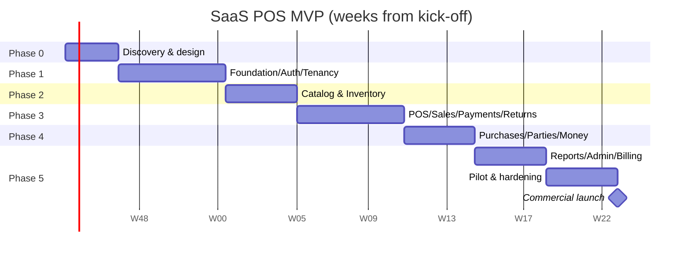
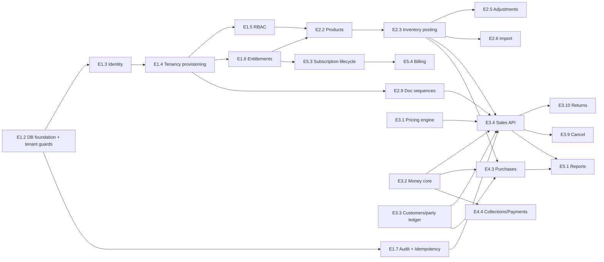

# SaaS POS — Detailed Development Roadmap

| Field | Value |
|---|---|
| Document | 02 — Development Roadmap |
| Version | 1.0 (Final draft for approval) |
| Date | 17 October 2026 |
| Depends on | `01_Requirement_Analysis.md` (decisions D-01…D-20, requirement IDs), `03_Database_Design.md` (tables, migrations) |
| Stack | React 19 + TypeScript 6 + Vite 8 + Tailwind CSS 4 · Rust (stable, edition 2024) + Actix Web 4 + SQLx 0.9 · MySQL 8.4 LTS · Redis 7 · Docker · Nginx |

---

## Table of Contents

1. [Planning Assumptions](#1-planning-assumptions)
2. [Timeline at a Glance](#2-timeline-at-a-glance)
3. [Technical Architecture Baseline](#3-technical-architecture-baseline)
4. [Engineering Standards](#4-engineering-standards)
5. [Phase 0 — Discovery & Design](#phase-0--discovery--design-weeks-13)
6. [Phase 1 — Foundation, Auth, Tenancy, Entitlements](#phase-1--foundation-auth-tenancy-entitlements-weeks-49)
7. [Phase 2 — Catalog & Inventory](#phase-2--catalog--inventory-weeks-1013)
8. [Phase 3 — POS, Sales, Payments, Returns](#phase-3--pos-sales-payments-returns-weeks-1419)
9. [Phase 4 — Purchases, Parties, Money, Expenses](#phase-4--purchases-parties-money-expenses-weeks-2023)
10. [Phase 5 — Reports, Super Admin, Billing, Hardening, Pilot](#phase-5--reports-super-admin-billing-hardening-pilot-weeks-2431)
11. [Phase 6 — Release 2: Multi-Branch, Advanced Ops, Accounting](#phase-6--release-2-multi-branch-advanced-operations-accounting-months-912)
12. [Phase 7 — Release 3: Industry Modules & Integrations](#phase-7--release-3-industry-modules--integrations-months-1318)
13. [Phase 8 — Release 4: Enterprise & Scale](#phase-8--release-4-enterprise--scale-months-19)
14. [Sprint-by-Sprint MVP Plan](#14-sprint-by-sprint-mvp-plan)
15. [Dependency Graph](#15-dependency-graph)
16. [Release Gates](#16-release-gates)
17. [Testing Strategy](#17-testing-strategy)
18. [DevOps & Environments](#18-devops--environments)
19. [Team, Roles, RACI](#19-team-roles-raci)
20. [Risk Management](#20-risk-management)
21. [Success Metrics (KPIs)](#21-success-metrics-kpis)
22. [Immediate Next Steps (First 10 Working Days)](#22-immediate-next-steps-first-10-working-days)

---

## 1. Planning Assumptions

| # | Assumption |
|---|---|
| PA-1 | **Team (core):** 1 Tech Lead (Rust), 2 Backend (Rust), 2 Frontend (React/TS), 1 QA (manual + automation), 1 UI/UX (≈50% until Phase 3, then 25%), 0.5 DevOps, 1 Product Owner. |
| PA-2 | **Sprints** last 2 weeks. Velocity stabilises from Sprint 3. Every sprint has 10–15% buffer for bugs and unknowns. |
| PA-3 | The decision register (Requirement Analysis §3) is approved by the end of Week 2. |
| PA-4 | The MVP scope is as defined in Requirement Analysis §5.1. New scope goes to the backlog through change control (§20.2). |
| PA-5 | Durations are **estimates with ±20% confidence**. Re-plan at every phase gate. |
| PA-6 | With a smaller team (e.g. 1 BE + 1 FE), multiply MVP duration by about 2.2. |

---

## 2. Timeline at a Glance

Week 1 = project kick-off. Dates are relative. If kick-off is on **2 Nov 2026**, the MVP pilot begins around **10 May 2027** (week 28) and commercial launch is around **7 June 2027** (week 32).

| Phase | Name | Weeks | Sprints | Outcome / Milestone |
|---|---|---|---|---|
| 0 | Discovery & Design | 1–3 | S0 (3 wks) | **M0:** Requirements, ERD, wireframes, API conventions approved |
| 1 | Foundation, Auth, Tenancy, Entitlements | 4–9 | S1–S3 | **M1 / Gate 1:** Secure multi-tenant shell |
| 2 | Catalog & Inventory | 10–13 | S4–S5 | **M2:** Products + stock ledger |
| 3 | POS, Sales, Payments, Returns | 14–19 | S6–S8 | **M3 / Gate 2:** First real sale end-to-end |
| 4 | Purchases, Parties, Money, Expenses | 20–23 | S9–S10 | **M4:** Full buy-sell-pay cycle |
| 5 | Reports, Super Admin, Billing, Hardening, Pilot | 24–31 | S11–S14 | **M5 / Gate 3:** Pilot (wk 28) · **M6 / Gate 4:** Commercial launch (wk 32) |
| 6 | Release 2 — Multi-branch, advanced ops, accounting | Months 9–12 | ~8 sprints | **M7 / Gate 5:** Release 2 |
| 7 | Release 3 — Industry modules & integrations | Months 13–18 | ~12 sprints | **M8:** Restaurant, pharmacy, API, e-commerce |
| 8 | Release 4 — Enterprise & scale | Month 19+ | ongoing | **M9:** Enterprise tier |



---

## 3. Technical Architecture Baseline

### 3.1 System Context

```
                ┌────────────────────┐        ┌───────────────────────┐
 Browser (POS / │  React SPA (Vite)  │  HTTPS │   Nginx (TLS, gzip,   │
 Back-office /  │  served from CDN / ├───────►│   rate-limit, static) │
 Super Admin)   │  Nginx static      │        └──────────┬────────────┘
                └────────────────────┘                   │ /api
                                                         ▼
                                     ┌───────────────────────────────────┐
                                     │  pos-api (Actix Web, stateless,   │
                                     │  N replicas)                      │
                                     │  modules: auth, tenancy, catalog, │
                                     │  inventory, sales, purchases,     │
                                     │  parties, money, reports, admin…  │
                                     └──┬────────────┬───────────┬───────┘
                                        │            │           │
                         ┌──────────────▼──┐  ┌──────▼─────┐ ┌───▼──────────────┐
                         │ MySQL 8.4 LTS   │  │  Redis 7   │ │ S3-compatible    │
                         │ primary + read  │  │ cache,     │ │ object storage   │
                         │ replica, PITR   │  │ rate-limit │ │ (images, exports)│
                         └──────▲──────────┘  └────────────┘ └──────────────────┘
                                │ jobs (SKIP LOCKED queue) + outbox
                         ┌──────┴───────────────┐      ┌───────────────────────┐
                         │ pos-worker (Rust)    ├─────►│ SMS / Email / Payment │
                         │ imports, exports,    │      │ gateways              │
                         │ notifications, cron  │      └───────────────────────┘
                         └──────────────────────┘
```

### 3.2 Backend — Rust Cargo Workspace (Modular Monolith)

```
pos-backend/
├── Cargo.toml                    # workspace
├── migrations/                   # SQLx migrations (timestamped, see DB doc §12)
├── crates/
│   ├── api/                      # binary: Actix app, routing, middleware, OpenAPI (utoipa)
│   ├── worker/                   # binary: job runner, scheduler (cron), outbox relay
│   ├── core/                     # shared: config, errors (Problem Details), Money/Qty types,
│   │                             # ids (UUIDv7), pagination, clock, tenant context
│   ├── db/                       # pool, transaction helper that SETs app.tenant_id, test fixtures
│   ├── auth/                     # identity, sessions, JWT, Argon2, OTP, RBAC guard
│   ├── tenancy/                  # tenants, settings, branches, locations, provisioning
│   ├── billing/                  # plans, entitlements, subscriptions, claims, gateways
│   ├── catalog/                  # products, variants, barcodes, categories, units, tax rates
│   ├── inventory/                # stock posting service, WAC, adjustments, transfers, counts
│   ├── sales/                    # POS, pricing engine, sales, returns, held carts
│   ├── purchasing/               # purchases, GRN, purchase returns, POs
│   ├── parties/                  # customers, suppliers, party ledger
│   ├── money/                    # accounts, methods, payments, allocations, transfers, expenses
│   ├── accounting/               # (Phase 6) COA, posting rules, journals, periods
│   ├── reporting/                # read-only queries, export builders
│   ├── notify/                   # (Phase 6) notification rules, channels
│   └── audit/                    # audit writer, idempotency store
└── tests/                        # cross-module integration + tenant-isolation suites
```

**Module rules**

- Each domain crate exposes a **service API** (Rust traits/functions) and owns its tables. Other crates call the service; they do not query those tables directly. Reporting is the only exception (read-only SQL).
- All posting operations go through `db::with_tenant_tx(tenant_ctx, |tx| …)`. It opens the transaction, sets `app.tenant_id` / `app.user_id`, and commits or rolls back.
- `inventory::post_movements(tx, &[MovementInput])` is the **only** code path that changes `stock_balances`.
- `parties::post_ledger(tx, …)` and `money::post_payment(tx, …)` follow the same pattern.

**Key crates:** `actix-web`, `actix-cors`, `sqlx` (mysql, uuid, rust_decimal, chrono/time, json, migrate), `rust_decimal`, `uuid` (v7), `serde`, `validator`, `argon2`, `jsonwebtoken`, `utoipa` + `utoipa-swagger-ui`, `tracing` + `tracing-subscriber` + `opentelemetry`, `redis`/`deadpool-redis`, `aws-sdk-s3` or `object_store`, `lettre`, `reqwest`, `thiserror`/`anyhow`, `tokio-cron-scheduler`, `csv`, `calamine` (XLSX read), `rust_xlsxwriter`.

### 3.3 Frontend — React SPA

```
pos-frontend/
├── src/
│   ├── app/              # router, providers, layout shells (Auth, App, POS, Admin)
│   ├── api/              # generated TS client from OpenAPI (orval / openapi-typescript), query keys
│   ├── features/         # auth, onboarding, dashboard, pos, sales, products, inventory,
│   │                     # purchases, customers, suppliers, money, reports, settings, admin
│   ├── components/ui/    # design system: Button, Input, Select, Table, Dialog, Toast, …
│   ├── lib/              # money (decimal.js), formatting (Intl), permissions, hotkeys, print
│   ├── i18n/             # en/, bn/
│   └── styles/           # tailwind.css, print.css (receipts)
```

**Libraries:** React Router 8 (data router), TanStack Query 5, TanStack Table 8, react-hook-form + zod, i18next, decimal.js (money in the cart), `react-hotkeys-hook`, Headless UI / Radix primitives, Recharts (dashboard), Vitest + Testing Library, Playwright (E2E).

**POS performance:** the POS lives in its own route chunk. The product index is preloaded for small catalogues (< 5k variants, cached in IndexedDB with delta sync by `updated_at`); larger catalogues use server search. Totals are computed locally for display with the same algorithm as the server (shared test vectors), and the server stays authoritative.

### 3.4 Cross-Cutting Decisions

| Concern | Decision |
|---|---|
| IDs | UUIDv7 generated in Rust |
| Money | `rust_decimal` ↔ `DECIMAL`; JSON as strings |
| Time | Store `timestamptz` UTC; `business_date` computed with the tenant tz |
| Tenancy | MySQL has no RLS: `TenantTx` data layer binds `tenant_id` in every query + `PRIMARY KEY (tenant_id, id)` and composite FKs + guard triggers on writes (`@app_tenant_id`) + CI SQL lint + isolation harness (DB doc §3) |
| AuthZ | Middleware extracts `TenantContext {tenant_id, user_id, membership_id, perms, branch_scope}`; handlers declare `#[require("pos.sell")]`-style guards |
| Idempotency | `idempotency_keys` table, checked within the posting transaction |
| Background jobs | MySQL job table with `FOR UPDATE SKIP LOCKED` (no extra infra); move to a dedicated queue only if needed |
| Events | Transactional **outbox** table → worker → notifications / webhooks |
| Caching | Redis for entitlements, rate limits, session deny-list, report caching (short TTL). Keys are prefixed `t:{tenant_id}:` |
| Files | Pre-signed S3 URLs, path `tenants/{tenant_id}/{kind}/{uuid}` |

---

## 4. Engineering Standards

### 4.1 Definition of Ready (story)

- User story + acceptance criteria referencing a requirement ID.
- UI wireframe/design attached (for UI stories).
- API contract drafted (endpoint, request, response, errors).
- DB changes identified (migration names).
- Permissions and entitlements identified.

### 4.2 Definition of Done (story)

- [ ] Code merged to `main` via PR with ≥ 1 approval (2 for posting/finance/auth code).
- [ ] Unit tests for rules and calculations; integration test for each endpoint (happy path + authz + tenant isolation).
- [ ] OpenAPI updated; TS client regenerated.
- [ ] Migrations are reversible or documented as expand-only; run in CI on a fresh DB **and** on a prod-like snapshot (from Phase 5).
- [ ] i18n keys in `en` and `bn`.
- [ ] Audit events emitted where required.
- [ ] No new `cargo clippy -D warnings`, `eslint`, or `tsc` errors.
- [ ] Deployed to staging and verified by QA against the AC.

### 4.3 Git & Review

- Trunk-based development: short-lived feature branches (`feat/POS-123-split-payment`) and squash merge.
- Conventional Commits. Semantic version tags for releases (`v0.x` until commercial launch, `v1.0.0` at launch).
- Feature flags (entitlement-style, platform level) let unfinished work ship dark.
- CODEOWNERS: `crates/auth`, `crates/inventory`, `crates/money`, `migrations/` need Tech Lead review.

### 4.4 API Conventions

As defined in Requirement Analysis §13 (Problem Details errors, cursor pagination, `Idempotency-Key`, money as strings, `If-Match` versions).

---

## Phase 0 — Discovery & Design (Weeks 1–3)

**Goal:** Approved requirements, design, and a ready backlog. Not a big document phase. Output is decisions and prototypes.

| # | Task | Owner | Output |
|---|---|---|---|
| 0.1 | Review & approve Requirement Analysis decision register D-01…D-20 | PO + TL | Signed decision register |
| 0.2 | Freeze MVP scope (§5.1) and write the MVP backlog (epics → stories) | PO | Backlog in tracker (Jira/Linear) |
| 0.3 | Approve database design (doc 03): ERD review session, tenant-isolation approach without RLS | TL + BE | Approved ERD v1 |
| 0.4 | Wireframes: onboarding, POS, payment dialog, product form, purchase form, sale detail, dashboard | UI/UX | Clickable Figma prototype |
| 0.5 | POS usability test on the prototype with 3 real cashiers | UI/UX + PO | Findings + revisions |
| 0.6 | Design system foundations: tokens, typography (Inter + Noto Sans Bengali), components list | UI/UX + FE | Figma library + Tailwind config |
| 0.7 | API conventions + OpenAPI skeleton for auth/tenancy | TL | `docs/api-guidelines.md` |
| 0.8 | **Technical spikes** (time-boxed 2 days each): (a) Actix + SQLx/MySQL `TenantTx` with guard triggers and the pool `after_release` reset of `@app_tenant_id`, plus a prototype of the SQL tenant lint over `.sqlx/`; (b) thermal receipt HTML print with Bengali on 2 printers; (c) UUIDv7 + cursor pagination performance | TL, FE | Spike reports + code |
| 0.9 | Repo setup, CI skeleton, environments plan, cloud account | DevOps | Repos, CI green on hello-world |
| 0.10 | Recruit 3–5 pilot businesses; collect their product lists | PO | Pilot list + sample data |

**Exit criteria (M0):** decision register signed · MVP backlog estimated (story points) · ERD approved · POS prototype tested · spikes succeed (tenant context never leaks across pooled connections, guard triggers fire, receipts print correctly).

---

## Phase 1 — Foundation, Auth, Tenancy, Entitlements (Weeks 4–9)

**Goal:** A secure multi-tenant shell. A business can register; users log in, are invited, and are assigned roles; data access is isolated and plan limits are enforced.

### Epics & Stories

| Epic | Stories | Req IDs | DB migrations (doc 03) |
|---|---|---|---|
| E1.1 Platform skeleton | Config, error model (Problem Details), structured logging, request ID, health `/healthz` `/readyz`, OpenAPI UI, CORS, security headers | NFR-OBS-*, API-05 | `0001_extensions` |
| E1.2 DB foundation | Pool with `after_connect`/`after_release` hooks, `with_tenant_tx` / `with_platform_tx`, guard-trigger generator script, CI schema guards (DB doc §12.3), SQL tenant lint over `.sqlx/`, migration runner in CI, test DB fixtures, factories | SRS-TEN-006 | `0002_platform_core` |
| E1.3 Identity | Register (user + OTP), login (phone/email), refresh rotation, logout, forgot/reset password, sessions list/revoke, rate limits | AUTH-R01…R10 | `0003_identity` |
| E1.4 Tenancy | Tenant provisioning transaction (ONB-R01), tenant settings, default branch + locations, choose-business, tenant status checks | SRS-ONB-001…004 | `0004_tenancy` |
| E1.5 RBAC | Permission catalogue seed, system roles, custom roles CRUD, membership roles with branch scope, invitations, guard middleware, `perms_ver` | SRS-AUTH-004, 006, 008 | `0005_rbac` |
| E1.6 Entitlements | Plans/features seed, trial subscription on sign-up, `can()` / `within_limit()` service, Redis cache, `402` errors, usage meter endpoint | SUB-R01, R03 | `0006_billing_core` |
| E1.7 Audit & idempotency | Audit writer (append-only), idempotency middleware/store, audit log viewer API | SRS-AUD-001…003, POS-R06 | `0007_audit_idempotency` |
| E1.8 Frontend shell | Vite app, routing, auth screens, token refresh interceptor, choose-business, app layout (sidebar, header, branch switcher placeholder), permission-aware menu, i18n setup, design system v1 (Button, Input, Select, Table, Dialog, Toast, Form) | — | — |
| E1.9 Onboarding wizard v1 | Steps 1–6 (Requirement Analysis §7.2), setup checklist | ONB | — |
| E1.10 Users & roles UI | Users list, invite, roles editor (permission tree), sessions | — | — |
| E1.11 Tenant isolation test suite | Generic test harness: for every registered route, create data in tenant A and access it as tenant B; expect 404. Runs in CI. | SRS-TEN-005 | — |
| E1.12 CI/CD | Build, test, lint, `cargo audit`, Docker images, deploy to dev on merge, staging on tag | — | — |

### Deliverables

Working sign-up → onboarding → dashboard shell · invitations and roles · isolation test harness · audit log · entitlement engine · dev + staging environments.

### Exit Criteria — Gate 1 (Foundation Ready)

- AT-01, AT-02, AT-03, AT-04, AT-16 pass in CI.
- Refresh token reuse detection is tested (AC-AUTH-02).
- Migrations run from zero in CI in < 60 s.
- Security checklist reviewed (OWASP ASVS L2 auth/session sections).

---

## Phase 2 — Catalog & Inventory (Weeks 10–13)

**Goal:** Products can be managed, imported and stocked, with a reliable stock ledger.

| Epic | Stories | Req IDs | Migrations |
|---|---|---|---|
| E2.1 Catalog masters | Categories (tree), brands, units (seeded), tax rates (seeded) | SRS-PROD-003 | `0009_catalog` |
| E2.2 Products | Product + default variant CRUD, SKU auto-gen, barcodes (multi, unique), images (S3 pre-signed upload), archive, price history, search (prefix + FULLTEXT ngram) | PROD-R01…R03, R07 | `0009_catalog` |
| E2.3 Inventory core | `post_movements` service (lock order, WAC, negative-stock policy), `stock_balances`, `stock_movements` | STK-R01…R05 | `0010_inventory` |
| E2.4 Opening stock | Opening stock form (bulk grid) + via import | STK-R03 | — |
| E2.5 Adjustments | Adjustment document draft → post, reason codes, permission | STK-R04 | `0010_inventory` |
| E2.6 Product import | Import job (worker), template, mapping, validation, preview, commit in batches, error report | PROD-R06, §16 | `0011_jobs_files` |
| E2.7 Stock views | Stock list (by location), product stock detail, movement ledger, low-stock list | STK-R06, R07 | — |
| E2.8 Reconciliation job | Nightly balance vs. ledger check + alert metric | STK-R08 | — |
| E2.9 Document sequences | Sequence service (row-lock allocation) used by adjustments now, sales later | D-08 | `0004_tenancy` (table) |

**Key tests:** WAC property tests (random sequences of in/out keep `qty = Σ movements` and `avg ≥ 0`); concurrency test with 20 parallel adjustments on the same variant; import of 20k rows < 2 min.

**Exit criteria (M2):** Products and opening stock can be managed by UI and import; stock reports reconcile with the ledger (STK-R08 job reports 0 mismatches on the test dataset); search p95 ≤ 150 ms at 50k variants.

---

## Phase 3 — POS, Sales, Payments, Returns (Weeks 14–19)

**Goal:** A cashier can sell, take payment (split/partial), print a receipt, hold carts, cancel and return. Money lands in accounts.

| Epic | Stories | Req IDs | Migrations |
|---|---|---|---|
| E3.1 Pricing engine | Shared calculation module (Rust) implementing Requirement Analysis §8.2 + JSON **test vectors** consumed by both Rust and TS tests | POS-R01, §8 | — |
| E3.2 Money core (minimal) | Payment accounts (cash default), payment methods, `post_payment`, allocations, account transactions | PAY-R01, R02 | `0012_money` |
| E3.3 Customers (minimal) | Walk-in customer, quick-add, search; party ledger posting | PTY-R01, R03, R04 | `0013_parties` |
| E3.4 Sales API | `POST /sales` atomic posting (DB doc §10.1), idempotency, stock check, numbering, COGS snapshot, credit limit | POS-R04…R06, R10…R12 | `0014_sales` |
| E3.5 POS UI | Search/scan, cart, qty/price/discount edits, customer select, payment dialog (split, change, due), hotkeys, error handling for 409/422, offline banner | §7.6 | — |
| E3.6 Receipts | 80/58 mm + A4 templates, auto-print setting, reprint marker, Bengali font | POS-R09, §7.6.5 | — |
| E3.7 Held carts | Hold/resume/expire | POS-R07 | `0014_sales` |
| E3.8 Sales back-office | Sales list (filters), sale detail (lines, payments, movements, audit), reprint | SRS-POS-008 | — |
| E3.9 Cancellation | Same-day void with reversals | POS-R08 | — |
| E3.10 Returns (basic) | Return screen, qty validation with lock, refund modes, restock/damaged, return receipt | RET-R01…R07 | `0015_returns` |
| E3.11 Dashboard v1 | Today's sales, cash received, top products, recent sales | R-01 | — |
| E3.12 Daily sales report | R-02 | SRS-REP-001 | — |

**Sprint 6 starts with a printer spike follow-up** (RK-04) and the pricing-engine test vectors. The rest of the phase depends on them.

**Exit criteria — Gate 2 (Transaction Integrity):** AT-05, AT-06, AT-07, AT-08, AT-10, AT-17, AT-19, AC-POS-01…05 pass · `POST /sales` p95 ≤ 300 ms at 15 sales/s with 50k-variant tenant · a non-technical tester completes 20 sales in a row without help.

---

## Phase 4 — Purchases, Parties, Money, Expenses (Weeks 20–23)

**Goal:** Complete buy → stock → sell → collect → pay cycle with correct balances.

| Epic | Stories | Req IDs | Migrations |
|---|---|---|---|
| E4.1 Suppliers | CRUD, opening balance (ledger), detail with ledger tab | PTY-R02, R04 | `0013_parties` (ext.) |
| E4.2 Customers full | CRUD, credit limit, opening balance, detail, statement | PTY-R01, R05, R06 | — |
| E4.3 Purchases | Purchase bill form (with last purchase info and variance), landed cost allocation, post → auto GRN + movements + WAC + supplier ledger + optional payment, cancel rules | PUR-R01…R05 | `0016_purchasing` |
| E4.4 Collections & supplier payments | Collect payment with FIFO/manual allocation, advances; pay supplier | PTY-R07 | — |
| E4.5 Accounts & transfers | Accounts CRUD (bank, MFS), opening balances, transfers, cash/bank book | PAY-R01…R05 | `0012_money` (ext.) |
| E4.6 Payment void | Void with reversals | PAY-R04 | — |
| E4.7 Expenses | Categories, expense entry, list | EXP-R01 | `0017_expenses` |
| E4.8 Party reconciliation job | Cached balances vs. ledger, accounts vs. account transactions | PTY-R05 | — |

**Exit criteria (M4):** AT-11, AT-15, AC-PUR-01/02 pass · E2E scenario (Roadmap §17.4) green · supplier and customer statements match hand-calculated fixtures.

---

## Phase 5 — Reports, Super Admin, Billing, Hardening, Pilot (Weeks 24–31)

### 5a. Build (Weeks 24–27, S11–S12)

| Epic | Stories | Req IDs | Migrations |
|---|---|---|---|
| E5.1 Reports MVP | R-03…R-07, R-09…R-12, R-14…R-21 (balances), CSV export, report header standard, async export for large data | §15, REP-R01…R05 | `0018_reporting_indexes`, `0011_jobs_files` |
| E5.2 Super Admin | Platform staff auth (separate role), tenants list/detail, activate/suspend, plans & features editor, overrides | ADM-R01…R06, R11 | `0019_platform_admin` |
| E5.3 Subscription lifecycle | Scheduler job for state transitions (§9.5), banners, read-only enforcement middleware, reminders (in-app) | SUB-R02, R06, D-18 | — |
| E5.4 Billing (manual) | Owner billing page, payment claim submit (with screenshot), admin approve/reject → subscription extended, subscription invoices | SUB-R05, R08, ADM-R05 | `0006_billing_core` (ext.) |
| E5.5 Data export | Owner full-data export (ZIP of CSVs) | NFR-PRIV-01 | — |
| E5.6 Audit viewer UI | Filters, before/after diff | AUD-R03 | — |

### 5b. Harden & Pilot (Weeks 28–31, S13–S14)

| Track | Activities |
|---|---|
| Performance | k6 load tests at the §12.1 test target; fix slow queries (EXPLAIN ANALYZE), add indexes; verify p95 targets |
| Security | Internal security review + external pen test (week 28–29); fix all critical/high findings |
| Reliability | Backup + PITR restore drill (AT-14); chaos test: kill API pod mid-sale; DB failover test |
| Observability | Dashboards (Grafana), alerts (§12.3 NFR-OBS-04), on-call rota, runbooks |
| Pilot | Onboard 3–5 pilot shops in week 28 with hands-on setup; daily check-ins in week 1, then twice a week; feedback board; hot-fix release twice a week |
| Docs | User guide (bn/en), video tutorials (onboarding, POS, purchase), FAQ, support SOP |
| Launch prep | Pricing page, terms of service, privacy policy, payment instructions, support WhatsApp/phone |
| Gateway (5b, optional) | SSLCommerz / bKash checkout if merchant approval is ready (SUB-R07), otherwise post-launch |

**Exit criteria — Gate 3 (Pilot Ready, week 28):** all P0 acceptance tests (AT-01…AT-17, AT-19, AT-20) pass · no open critical defects · restore drill done · user guide available.

**Exit criteria — Gate 4 (Commercial Launch, week 32):** pilot shops have used the system ≥ 3 weeks with no data-integrity incident · pen test critical/high closed · monitoring and on-call active · subscription controls verified · support process staffed.

---

## Phase 6 — Release 2: Multi-Branch, Advanced Operations, Accounting (Months 9–12)

Ordered by customer value. Each block is ~1–2 sprints.

| # | Block | Contents | Req IDs |
|---|---|---|---|
| 6.1 | Multi-branch | Branch CRUD (entitlement), branch-scoped users UI, branch switcher, per-branch sequences/cash/receipt header, consolidated reports | SRS-BRN-001…006 |
| 6.2 | Transfers & counts | Stock transfers (draft→dispatched→received), stock counts with scan entry | STK-R09, R10 |
| 6.3 | Purchase workflow | Purchase orders, approval, partial receiving, purchase returns, supplier price history | PUR-R06…R08 |
| 6.4 | Catalog depth | Variant matrix UI, multiple units & conversions, price levels/customer groups, barcode label printing | PROD-R04, R05, PTY-R09 |
| 6.5 | POS depth | Register shifts + X/Z reports, exchanges, return approval, discount limits per role, manager PIN | §7.6.4, RET-R08, R09 |
| 6.6 | Accounting | COA seed, posting engine (§8.7), back-fill job for history, journals UI, manual journals, period lock, TB/GL/P&L/BS/Cash flow | SRS-ACC-001…007 |
| 6.7 | Money depth | Bank reconciliation, other income, expense attachments/approval/recurring | PAY-R06, EXP-R02, INC-R01 |
| 6.8 | Notifications | Rules engine, in-app center, email, SMS, preferences, delivery retries | NOT-R01, R02 |
| 6.9 | Reports depth | Aging, VAT summary, discount report, fast/slow movers, XLSX/PDF export, as-of stock valuation | R-08, R-13…R-15, R-22, R-23 |
| 6.10 | SaaS depth | Payment gateway (if not done), coupons, proration, MRR/ARR dashboard, announcements, support sessions, MFA | SUB-R07, R09, ADM-R07…R10, AUTH-R11 |
| 6.11 | Compliance | Mushak-6.3-compatible invoice layout (after adviser review) | D-09 |

**Exit criteria — Gate 5 (Release 2 / Expansion Ready):** branch-level and consolidated reports reconcile with source transactions · trial balance balances for all tenants after back-fill · production performance measured, with bottlenecks documented · regression suite green.

---

## Phase 7 — Release 3: Industry Modules & Integrations (Months 13–18)

Each module is behind an entitlement flag and must not regress the core POS (separate regression suite).

| Module | Key features | Data model additions (doc 03 §9.15) |
|---|---|---|
| Restaurant | Tables/floor plan, dine-in/takeaway/delivery orders, KOT, kitchen display (WebSocket), order status, split/merge bills, service charge, modifiers/add-ons, recipes & ingredient deduction, wastage | `restaurant_tables`, `orders`, `order_items`, `kitchen_tickets`, `recipes`, `recipe_items`, `modifiers` |
| Pharmacy | Generic name, strength, manufacturer, batch/expiry, FEFO picking, near-expiry alerts, prescription reference | `product_batches`, `stock_batch_balances`, movement `batch_id` |
| Electronics | Serial/IMEI capture on purchase and sale, warranty lookup | `serial_numbers` |
| Loyalty & promotions | Points earn/burn, tiers, promotions engine (BOGO, % off category, time-bound), gift cards/store credit | `loyalty_accounts`, `loyalty_transactions`, `promotions`, `gift_cards` |
| Public API & webhooks | API keys with scopes, rate limits, request logs, webhook subscriptions, HMAC signing, retries | `api_keys`, `webhook_endpoints`, `webhook_deliveries` |
| E-commerce | WooCommerce plugin/connector: product/price/stock push, order import as sales, refund sync | `integration_connections`, `external_refs` |
| HRM (lite) | Employees, attendance, leave, payroll run, payslips, salary payment → expense | `employees`, `attendance`, `payroll_runs`, … |
| Offline POS (design first) | Service worker, IndexedDB queue, client-generated invoice numbers per device range, conflict rules, sync API | `devices`, `device_number_ranges` |

---

## Phase 8 — Release 4: Enterprise & Scale (Month 19+)

| Track | Items |
|---|---|
| Enterprise features | White-label (logo, colours, email domain), custom domains (TLS via ACME), advanced approval workflows, custom report builder, dashboard customisation, enterprise audit reports, SSO (OIDC) |
| Tenancy options | Dedicated database per enterprise tenant (tenant → `db_shard` routing in the pool layer), data residency |
| Scale | Partitioning of `stock_movements`, `audit_logs`, `party_ledger_entries`, `account_transactions` by month (prepared in doc 03 §11); read replicas for reports; reporting warehouse (e.g. ClickHouse / materialised views) if needed |
| Reliability | 99.9% SLO, multi-AZ, automated failover, DR region, quarterly DR drills |
| Ops | Tenant-level resource quotas, noisy-neighbour detection, cost per tenant analytics |

---

## 14. Sprint-by-Sprint MVP Plan

| Sprint | Weeks | Backend | Frontend | QA / DevOps | Demo at sprint review |
|---|---|---|---|---|---|
| **S0** | 1–3 | Spikes (TenantTx + guard triggers + pool reset, UUIDv7 `BINARY(16)`), API guidelines | Prototype, design system tokens, print spike | Repos, CI skeleton, cloud | Prototype + spike results |
| **S1** | 4–5 | E1.1, E1.2, E1.3 (register/login/refresh/OTP) | E1.8 shell, auth screens, design system v1 | Dev env, test DB in CI | Sign up & log in |
| **S2** | 6–7 | E1.4 provisioning, E1.5 RBAC, E1.7 audit/idempotency | Choose-business, onboarding wizard v1 | Isolation test harness (E1.11) | New tenant with defaults; roles |
| **S3** | 8–9 | E1.6 entitlements, invitations, sessions, password reset | Users & roles UI, setup checklist | Staging env, CD on tag | **Gate 1** review |
| **S4** | 10–11 | E2.1, E2.2, E2.9 sequences | Product list/form, masters screens | Search perf test | Create & search products |
| **S5** | 12–13 | E2.3, E2.4, E2.5, E2.6, E2.8 | Opening stock, adjustments, import wizard, stock views | WAC property tests, import load test | Import 5k products, adjust stock, ledger |
| **S6** | 14–15 | E3.1 pricing engine, E3.2 money core, E3.3 customers min. | POS layout, search/scan, cart, totals (test vectors) | Printer validation on pilot hardware | Cart with live totals |
| **S7** | 16–17 | E3.4 sales API, E3.7 held carts | Payment dialog, receipts, hotkeys, held carts | Concurrency/idempotency tests | **First real sale + receipt** |
| **S8** | 18–19 | E3.9 cancel, E3.10 returns, E3.12 daily report | Sales list/detail, return screen, dashboard v1 | Fault injection, POS perf test | **Gate 2** review |
| **S9** | 20–21 | E4.1, E4.2, E4.3 purchases | Supplier/customer screens, purchase form | Purchase/WAC tests | Purchase → stock → sale |
| **S10** | 22–23 | E4.4, E4.5, E4.6, E4.7, E4.8 | Collect/pay, accounts, book, transfers, expenses | Full E2E suite | Full cycle with balances |
| **S11** | 24–25 | E5.1 reports (part 1), E5.2 Super Admin | Reports hub, admin panel | Report fixtures validation | Reports + admin |
| **S12** | 26–27 | E5.1 (part 2), E5.3, E5.4, E5.5 | Billing page, banners, audit viewer | Load test round 1, backup drill | Subscription lifecycle |
| **S13** | 28–29 | Pilot fixes, perf fixes, pen-test fixes | Pilot UX fixes, docs | Pen test, monitoring, on-call | **Gate 3** → pilot live |
| **S14** | 30–31 | Pilot fixes, gateway (optional) | Pilot UX fixes, videos | Load test round 2, DR drill | **Gate 4** → launch (wk 32) |

**Story-point guidance (for re-planning):** MVP ≈ 520–600 points. Expected team velocity ≈ 45–50 points per sprint after S2.

---

## 15. Dependency Graph



Critical path: **DB/tenant guards → Identity → Tenancy → Products → Inventory posting → Sales API → Reports → Pilot.**

---

## 16. Release Gates

| Gate | When | Criteria (all must pass) | Approvers |
|---|---|---|---|
| **G1 Foundation Ready** | End S3 (wk 9) | Auth works; tenant model implemented; isolation suite green (AT-02…04); migrations repeatable; API conventions in use; entitlement checks live | TL, QA |
| **G2 Transaction Integrity** | End S8 (wk 19) | Sales use one DB transaction; stock traceable; payments reconcile; duplicates handled (AT-05); concurrency (AT-06); unauthorised ops rejected; fault injection (AT-10) | TL, QA, PO |
| **G3 Pilot Ready** | Wk 28 | Core E2E green; no critical/high open; reports match sources; restore tested (AT-14); user docs ready; monitoring live | TL, QA, PO, DevOps |
| **G4 Commercial Launch** | Wk 32 | Subscription controls work; onboarding documented; pen test closed; on-call and support live; pilot acceptance signed; no unresolved critical defects | All + Business |
| **G5 Expansion Ready** | End Release 2 | Prod performance measured; bottlenecks known; new modules pass regression; schema changes backward-compatible; TB balances | TL, QA, PO |

---

## 17. Testing Strategy

### 17.1 Test Pyramid

| Level | Tooling | Scope | Gate |
|---|---|---|---|
| Unit (Rust) | `cargo test`, `proptest` | Pricing engine, WAC, allocation, state machines, permission resolution | Every PR |
| Unit (TS) | Vitest | Cart totals (shared vectors), formatters, hooks | Every PR |
| Integration (API + DB) | `cargo test` + `sqlx::test` (ephemeral DB per test) | Every endpoint: happy path, validation, authz, isolation | Every PR |
| Tenant isolation | Generic harness (E1.11) | All routes × cross-tenant access | Every PR (blocking) |
| Contract | OpenAPI diff check (`oasdiff`) | No unannounced breaking change | Every PR |
| E2E | Playwright | Onboarding, POS sale, split/partial payment, return, purchase, collection, reports, subscription read-only | Nightly + pre-release |
| Performance | k6 | POS sale, search, list, reports at §12.1 test target | Phase gates, pre-release |
| Security | `cargo audit`, `npm audit`, ZAP baseline, external pen test | Dependencies, OWASP Top 10 | CI + G4 |
| Data integrity | Reconciliation jobs on staging after E2E | Balances = ledgers | Nightly |
| Backup/restore | Scripted restore to an ephemeral env + smoke tests | AT-14 | Monthly |
| Device | Manual | Scanners, 3 thermal printer models, Chrome on Android tablets | Pre-pilot |

### 17.2 Shared Calculation Test Vectors

`/test-vectors/pricing/*.json` hold input carts and expected outputs (line and invoice values) for both tax modes, rounding modes, discounts and edge cases (zero price, 100% discount, fractional qty). Both the Rust engine and the TS cart **must** pass the same vectors, so the cashier's screen and the server always agree.

### 17.3 Critical Scenarios (from SRS §11.2)

All 12 scenarios map to AT-05, AT-06, AT-07, AT-08, AT-02/03, AT-09, AT-10, STK transfer test (Release 2), AT-12, AT-13, AT-14, AT-18.

### 17.4 Core E2E Scenario

Register tenant → create products → opening stock → sale (cash) → print → verify stock deduction → credit sale to customer (partial) → verify due → collect payment → verify customer balance → purchase from supplier (partial pay) → verify stock, WAC, supplier balance → return part of a sale → verify stock, refund, balance → run daily report and stock report → values match fixtures.

---

## 18. DevOps & Environments

### 18.1 Environments

| Env | Purpose | Data | Deploy |
|---|---|---|---|
| Local | Dev | Docker Compose (MySQL 8.4, Redis, MinIO, Mailpit) + seed script | — |
| Dev | Integration | Synthetic | Auto on merge to `main` |
| Staging | QA, UAT, demos, load tests | Synthetic + anonymised pilot-like data | On release tag `vX.Y.Z-rc` |
| Production | Customers | Real | Manual approval on tag `vX.Y.Z` |

### 18.2 CI/CD Pipeline

```
PR:      fmt → clippy -D warnings → cargo test (+sqlx::test MySQL service) → schema guards + SQL tenant lint → isolation suite
         → eslint/tsc → vitest → build images → oasdiff → cargo/npm audit
main:    above + push images (sha tag) → deploy Dev → migrations → smoke tests
rc tag:  deploy Staging → migrations → Playwright E2E → (gate) k6 smoke
release: manual approve → backup snapshot → migrations (expand) → rolling deploy API/worker
         → smoke tests → auto-rollback on failed health checks
```

### 18.3 Production Topology (MVP)

| Component | Spec (start) | Scaling |
|---|---|---|
| API | 2 × containers (2 vCPU / 2 GB) behind Nginx/LB | Horizontal (stateless) |
| Worker | 1 × container (1 vCPU / 1 GB) | Add instances (SKIP LOCKED safe) |
| MySQL 8.4 | Managed (e.g. RDS Multi-AZ), 4 vCPU / 16 GB / 200 GB SSD, binlog PITR, 1 read replica | Vertical first, then replica reads for reports |
| Redis | Managed 1 GB | — |
| Object storage | S3/R2 bucket with lifecycle rules (exports expire 7 days) | — |
| CDN | Static SPA assets | — |

Hosting options: AWS (ap-south-1 Mumbai / ap-southeast-1 Singapore), DigitalOcean (BLR1/SGP1), or a local Bangladeshi data centre if data residency becomes a requirement. Choose based on latency tests from Dhaka (target RTT < 60 ms).

### 18.4 Operations

- Backups: binary-log PITR with 30-day retention + daily physical backup (XtraBackup / managed snapshot) + daily logical dump (`mydumper`) to a separate account/region. Monthly restore drill.
- MySQL DDL is not transactional: one logical change per migration file, rehearsed on staging; large-table changes via gh-ost / pt-online-schema-change.
- Migrations: **expand → deploy → migrate data → contract** in separate releases. Never drop or rename a column in the same release as the code change.
- Runbooks: DB failover, restore, stuck jobs, reconciliation mismatch, gateway outage, suspicious login spike, tenant data export request.
- Incident process: severity levels (SEV1 data integrity/outage), status page, post-mortem within 5 days.

---

## 19. Team, Roles, RACI

| Activity | PO | TL | BE | FE | QA | UI/UX | DevOps |
|---|---|---|---|---|---|---|---|
| Requirements & backlog | **A/R** | C | C | C | C | C | I |
| Architecture & DB design | C | **A/R** | R | C | I | I | C |
| API implementation | I | A | **R** | C | C | I | I |
| UI implementation | C | A | C | **R** | C | C | I |
| UX design | A | I | I | C | I | **R** | I |
| Test strategy & automation | C | C | R | R | **A/R** | I | C |
| CI/CD & infra | I | A | C | C | C | I | **R** |
| Security review | I | **A** | R | R | R | I | R |
| Release approval | **A** | R | I | I | R | I | R |
| Pilot management | **A/R** | C | C | C | R | C | I |

(R = Responsible, A = Accountable, C = Consulted, I = Informed)

**Ceremonies:** sprint planning (2 h), daily stand-up (15 min), backlog refinement (1 h/week), sprint review/demo (1 h), retrospective (1 h), architecture review (as needed, mandatory for migrations touching posting tables).

---

## 20. Risk Management

### 20.1 Delivery Risks

| Risk | Trigger | Response |
|---|---|---|
| Rust learning curve slows the team | Velocity < 35 pts by S3 | Pair programming, code templates per module, drop a non-critical P0 report to P1 |
| POS printing issues | Spike fails on pilot printers | Fallback: PDF receipt + recommended printer list; QZ Tray integration (P1) |
| Tenant leak through a read query (no RLS in MySQL) | Isolation test or SQL lint failure | `TenantTx` as the only data path, CI lint + isolation harness block merges, CODEOWNERS review of `crates/db`, pen test before launch |
| Scope creep from pilots | > 20% new stories in S13–S14 | Triage: only data-integrity and blocking UX fixes before launch |
| Gateway approval late | Not approved by wk 28 | Launch with manual verification (D-10) |
| Key person dependency | Absence > 1 week | Docs-as-code, ADRs, two reviewers per critical module |

### 20.2 Change Control

1. Change request logged (what, why, requirement ID).
2. Impact estimate (points, risk, schema impact) by TL within 2 days.
3. PO decides: *now* (swap equal points out), *next release*, or *reject*.
4. Decision register and backlog updated.

---

## 21. Success Metrics (KPIs)

| Area | KPI | Target (6 months after launch) |
|---|---|---|
| Activation | Sign-up → first sale within 24 h | ≥ 50% |
| Onboarding | Median time to first sale | ≤ 15 min |
| Conversion | Trial → paid | ≥ 20% |
| Retention | Monthly logo churn | ≤ 4% |
| Usage | Active tenants with ≥ 20 sales/week | ≥ 60% of paid |
| Performance | POS sale p95 server time | ≤ 300 ms |
| Reliability | Monthly availability | ≥ 99.5% |
| Quality | Data-integrity incidents (balance drift) | 0 |
| Quality | Escaped critical defects per release | 0 |
| Support | First response time (business hours) | ≤ 1 h |
| Satisfaction | NPS of paying owners | ≥ 30 |

---

## 22. Immediate Next Steps (First 10 Working Days)

| Day | Action | Owner |
|---|---|---|
| 1 | Kick-off; walk through docs 01–03; assign decision owners | PO, TL |
| 1–2 | Create repos (`pos-backend`, `pos-frontend`, `pos-infra`), tracker, Figma project | TL, DevOps, UI/UX |
| 2–4 | Spikes: SQLx/MySQL `TenantTx` + guard triggers + pool reset; thermal Bengali receipt; UUIDv7 `BINARY(16)` pagination | TL, FE |
| 3–5 | Wireframes for POS + onboarding; usability session booked with cashiers | UI/UX |
| 5 | Decision register review meeting → sign D-01…D-20 | PO + stakeholders |
| 6–8 | ERD walkthrough → approve doc 03 v1; write migrations `0001`–`0003` | TL, BE |
| 6–9 | Backlog: epics E1–E5 broken into stories with AC; estimate S1–S3 | PO, team |
| 8–10 | CI pipeline green with lint/test/build; local Docker Compose | DevOps |
| 10 | Phase 0 review → start Sprint 1 | All |

---

> **Guiding principle (from the initial roadmap):** The primary priority is not the number of features. It is reliable transactions, correct inventory, consistent financial records and strong tenant isolation. Every gate above enforces this.
