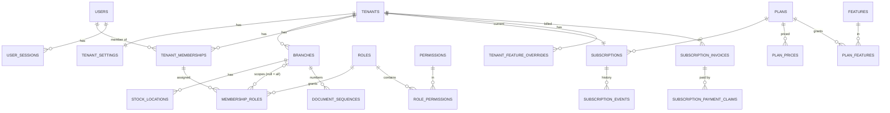
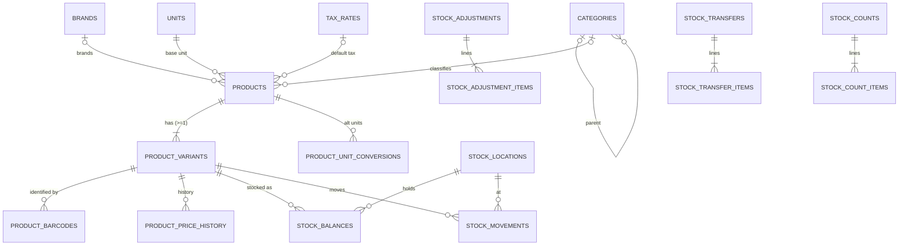
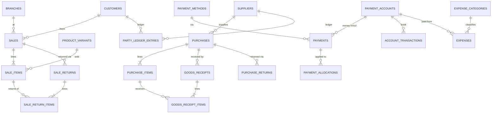

# SaaS POS — Database Design (MySQL)

| Field | Value |
|---|---|
| Document | 03 — Database Design |
| Version | 2.0 (MySQL edition, replaces the PostgreSQL draft v1.0) |
| Date | 17 October 2026 |
| DBMS | **MySQL 8.4 LTS** (InnoDB). The schema uses only features available since MySQL 8.0.16, so it also runs on managed services that are still on 8.0 (e.g. Amazon Aurora MySQL 3). MariaDB is **not** supported (different JSON, CHECK and window-function behaviour). |
| Access layer | Rust + SQLx (`mysql` feature, compile-time checked queries), migrations via `sqlx migrate` |
| Depends on | `01_Requirement_Analysis.md` (decisions D-04, D-06, D-07, D-08, calculation rules §8), `02_Development_Roadmap.md` (migration order per phase) |

---

## Table of Contents

1. [Design Principles](#1-design-principles)
2. [Conventions & MySQL Server Settings](#2-conventions--mysql-server-settings)
3. [Multi-Tenancy & Isolation (without RLS)](#3-multi-tenancy--isolation-without-rls)
4. [Database Users, Roles & Privileges](#4-database-users-roles--privileges)
5. [Domain Map](#5-domain-map)
6. [Entity-Relationship Diagrams](#6-entity-relationship-diagrams)
7. [Enumerations (Allowed Values)](#7-enumerations-allowed-values)
8. [Database Setup](#8-database-setup)
9. [Table Definitions (DDL)](#9-table-definitions-ddl)
   - 9.1 Platform & Plans · 9.2 Identity · 9.3 Tenancy & Organisation · 9.4 RBAC · 9.5 Subscriptions · 9.6 Audit, Idempotency, Outbox · 9.7 Catalog · 9.8 Inventory · 9.9 Files & Jobs · 9.10 Money · 9.11 Parties · 9.12 Sales & Returns · 9.13 Purchasing · 9.14 Expenses & Income · 9.15 Platform Admin · 9.16 Accounting (Release 2) · 9.17 Notifications (Release 2) · 9.18 Guard Triggers · 9.19 Future Modules (Release 3+)
10. [Transactional Workflows (Posting Logic)](#10-transactional-workflows-posting-logic)
11. [Indexing, Partitioning & Performance](#11-indexing-partitioning--performance)
12. [Migration Plan](#12-migration-plan)
13. [Seed & Provisioning Data](#13-seed--provisioning-data)
14. [Data Integrity & Reconciliation Queries](#14-data-integrity--reconciliation-queries)
15. [Reporting Queries (Examples)](#15-reporting-queries-examples)
16. [Backup, Retention & Data Lifecycle](#16-backup-retention--data-lifecycle)
17. [Capacity Estimates](#17-capacity-estimates)
18. [Table Inventory Summary](#18-table-inventory-summary)
19. [PostgreSQL → MySQL Change Log](#19-postgresql--mysql-change-log)

---

## 1. Design Principles

| # | Principle | Implementation in MySQL |
|---|---|---|
| P1 | **Tenant isolation is structural** | `tenant_id` is the **first column of the primary key** of every tenant table: `PRIMARY KEY (tenant_id, id)`. Composite foreign keys `(tenant_id, x_id)` stop a child row from pointing at another tenant's parent. Guard triggers reject writes for the wrong tenant. All reads go through a tenant-scoped data layer (§3). |
| P2 | **Ledgers are the source of truth** | `stock_movements`, `party_ledger_entries`, `account_transactions` (and `journal_lines` in Release 2) are append-only, enforced by triggers. Balance tables are *caches*, updated in the same transaction and checked nightly. |
| P3 | **Posted documents are immutable** | Amounts and lines are never updated after posting. Corrections use cancellation, return, void or adjustment documents that reference the original. |
| P4 | **Snapshots on documents** | Sale and purchase lines copy name, SKU, unit, tax rate and cost at posting time. |
| P5 | **Exact arithmetic** | `DECIMAL` for all money and quantities. Never `FLOAT`/`DOUBLE`. |
| P6 | **Multi-branch ready from day one** | Every document carries `branch_id`; every stock row carries `location_id`. |
| P7 | **Variant-centric stock** | Every product has ≥ 1 variant. Stock, barcodes, prices and lines reference `variant_id` (D-07). |
| P8 | **Idempotent writes** | `idempotency_keys` checked inside the posting transaction, plus unique keys on `(tenant_id, idempotency_key)` on documents. |
| P9 | **Evolvable** | Status values use `VARCHAR` + `CHECK` (not `ENUM`, which needs a table rebuild in some changes). Flexible data uses `JSON`. |
| P10 | **InnoDB-friendly keys** | UUIDv7 ids are time-ordered, so inserts append to the end of each tenant's key range. Clustering by `(tenant_id, id)` keeps one tenant's rows physically close, which makes tenant-scoped scans fast. |

---

## 2. Conventions & MySQL Server Settings

### 2.1 Conventions

| Item | Convention |
|---|---|
| Naming | `snake_case`, plural tables (`sales`, `sale_items`), singular FK column (`sale_id`). No MySQL reserved words as column names (e.g. `idem_key` not `key`, `item_condition` not `condition`). |
| Character set | Database default `utf8mb4` / `utf8mb4_0900_ai_ci` (full Unicode including Bengali; case- and accent-insensitive comparisons and uniqueness, e.g. SKU `abc` = `ABC`) |
| Primary key | Tenant tables: `PRIMARY KEY (tenant_id, id)`. Global tables: `PRIMARY KEY (id)` |
| Id type | `BINARY(16)` holding a **UUIDv7** generated by the application (`uuid` crate, `Uuid::now_v7()`). SQLx maps `uuid::Uuid` ↔ `BINARY(16)`. For manual SQL use `UUID_TO_BIN('…')` / `BIN_TO_UUID(id)` (no swap flag; v7 is already time-ordered) |
| Human numbers | `*_no VARCHAR(40)`, unique within `(tenant_id, branch_id)` |
| Money | `DECIMAL(18,2)` · unit price/cost `DECIMAL(18,4)` · quantity `DECIMAL(18,3)` · rates `DECIMAL(7,4)` (percent) |
| Time | `DATETIME(6)` holding **UTC** (connection `time_zone = '+00:00'`). `TIMESTAMP` is avoided (2038 limit). Business day = `business_date DATE` in the tenant timezone, computed by the application |
| Audit columns | `created_at DATETIME(6) DEFAULT CURRENT_TIMESTAMP(6)`, `updated_at … ON UPDATE CURRENT_TIMESTAMP(6)` (no trigger needed), `created_by`, `updated_by` |
| Optimistic lock | `version INT NOT NULL DEFAULT 1` on master data (API `If-Match`) |
| Soft delete | `deleted_at DATETIME(6)` on master data only. Documents are never deleted |
| Booleans | `BOOLEAN` (`TINYINT(1)`), `NOT NULL DEFAULT` |
| JSON | `JSON` columns. Defaults use expressions: `DEFAULT (JSON_OBJECT())` / `DEFAULT (JSON_ARRAY())` |
| Text | `VARCHAR(n)` for anything indexed or defaulted; `TEXT` for free notes (no default, not indexed) |
| IP address | `VARBINARY(16)` (`INET6_ATON()` / `INET6_NTOA()`) |
| Checks | `CHECK` constraints are enforced (MySQL ≥ 8.0.16). Every amount ≥ 0 unless signed by design |
| Partial uniqueness | MySQL has no partial indexes. Use a **virtual generated "key" column** that is `NULL` when the rule does not apply, plus a `UNIQUE` index. MySQL allows many `NULL`s in a unique index (pattern in §11.1) |
| Index names | `idx_{table}_{cols}`, unique `uq_{table}_{cols}` |

### 2.2 Required Server / Session Settings

| Setting | Value | Why |
|---|---|---|
| `default_storage_engine` | `InnoDB` | Transactions, row locks, FKs |
| `character_set_server` / `collation_server` | `utf8mb4` / `utf8mb4_0900_ai_ci` | Bengali + emoji, consistent collation |
| `transaction_isolation` | `READ-COMMITTED` | Fewer gap locks than the default REPEATABLE READ. Correctness relies on explicit `SELECT … FOR UPDATE` |
| `binlog_format` | `ROW` (default) | Required for READ COMMITTED + replication + PITR |
| `binlog_expire_logs_seconds` | `2592000` (30 days) | Point-in-time recovery window |
| `sql_mode` | `STRICT_TRANS_TABLES,NO_ZERO_DATE,NO_ZERO_IN_DATE,ERROR_FOR_DIVISION_BY_ZERO,ONLY_FULL_GROUP_BY,NO_ENGINE_SUBSTITUTION` | No silent truncation or bad dates |
| `time_zone` (per connection) | `'+00:00'` | All `DATETIME` values are UTC |
| `innodb_lock_wait_timeout` | `5` (app sessions) | Fail fast, then the client retries with the same idempotency key |
| `max_execution_time` | `5000` ms for API SELECTs (session); unlimited for worker/report user | Protects the OLTP database from runaway reads |
| `innodb_buffer_pool_size` | ~70% of RAM | Working set in memory |
| `innodb_flush_log_at_trx_commit` / `sync_binlog` | `1` / `1` | Durability of financial data |
| `log_bin_trust_function_creators` | `1` (or a user with `TRIGGER` + `SUPER`/`SYSTEM_VARIABLES_ADMIN`) | Needed to create triggers when binary logging is on (managed services expose this as a parameter) |
| `ngram_token_size` | `2` (default) | FULLTEXT ngram search for product names in Bengali and English |
| `performance_schema` / slow query log | ON, `long_query_time = 0.5` | Query monitoring |

SQLx connection options: `MySqlConnectOptions::new().charset("utf8mb4").timezone(Some("+00:00".into()))` plus `.pipes_as_concat(false)`, and pool hooks described in §3.3.

---

## 3. Multi-Tenancy & Isolation (without RLS)

### 3.1 Model

**Shared database, shared schema, `tenant_id` on every tenant row** (D-04).

MySQL has **no Row-Level Security**, so the database cannot hide other tenants' rows from a query that forgets its filter. Isolation is therefore built from five layers. Layers 1, 3 and 4 protect **reads**; layers 2 and 5 protect **writes** at database level.

| # | Layer | Protects | Where |
|---|---|---|---|
| L1 | **Tenant-scoped data access layer.** The only way to reach tenant tables is through a `TenantTx` object created from the verified JWT. Every query binds `tenant_id` from it. Raw pool access is private to the `db` crate. | Reads + writes | Rust (`crates/db`) |
| L2 | **Composite primary and foreign keys** `(tenant_id, id)`. A row can only reference parents of the same tenant. A lookup by `id` alone cannot use the primary key, which makes a missing tenant filter easy to spot in `EXPLAIN` and code review. | Writes (links) | Schema |
| L3 | **Static SQL lint in CI.** Every query in the SQLx offline cache (`.sqlx/*.json`) and in `migrations/` that touches a tenant table must contain a `tenant_id = ?` predicate for each tenant table alias. The build fails otherwise. | Reads + writes | CI |
| L4 | **Automated cross-tenant test harness.** For every API route: create data in tenant A, call as tenant B, expect `404`. It runs on every PR and blocks the merge. | Reads + writes | CI |
| L5 | **Guard triggers** on every tenant table. `BEFORE INSERT/UPDATE/DELETE`: the row's `tenant_id` must equal the session variable `@app_tenant_id`, otherwise the statement fails with `TENANT_GUARD`. | Writes | Schema (§9.18) |

**Residual risk (accepted, documented).** A new read query that forgets `tenant_id` *and* evades the lint *and* is not covered by the harness could leak data. Mitigations: code review checklist, `CODEOWNERS` on the `db` crate, a production slow-query/`performance_schema` digest review that flags statements on tenant tables without `tenant_id`, and an external pen test before launch. If stronger physical isolation is ever required, the enterprise option is **database-per-tenant** (§3.6).

### 3.2 The `TenantTx` Pattern (Rust)

```rust
// crates/db — the only public way to touch tenant data
pub struct TenantCtx { pub tenant_id: Uuid, pub user_id: Uuid, pub request_id: String }

pub async fn with_tenant_tx<T, F>(pool: &MySqlPool, ctx: &TenantCtx, f: F) -> Result<T, AppError>
where F: for<'c> FnOnce(&'c mut TenantTx<'_>) -> BoxFuture<'c, Result<T, AppError>>
{
    let mut tx = pool.begin().await?;
    sqlx::query("SET @app_tenant_id = ?, @app_user_id = ?, @app_platform = NULL")
        .bind(ctx.tenant_id).bind(ctx.user_id).execute(&mut *tx).await?;
    let mut ttx = TenantTx { tx, tenant_id: ctx.tenant_id };
    let out = f(&mut ttx).await;
    match out { Ok(v) => { ttx.tx.commit().await?; Ok(v) }  Err(e) => { ttx.tx.rollback().await?; Err(e) } }
}

// Repositories receive &mut TenantTx and must bind ttx.tenant_id:
sqlx::query_as!(Product,
    "SELECT ... FROM products WHERE tenant_id = ? AND id = ?", ttx.tenant_id, id)
```

### 3.3 Session Context and Pooled Connections

MySQL user variables (`@app_tenant_id`) live for the whole **connection**, not the transaction. To make sure a pooled connection never carries a previous request's tenant:

1. `with_tenant_tx` **always sets** `@app_tenant_id`, `@app_user_id` and clears `@app_platform` as the first statement of each transaction.
2. The SQLx pool's `after_release` hook runs `SET @app_tenant_id = NULL, @app_user_id = NULL, @app_platform = NULL`. A connection that fails the reset is closed.
3. Code outside `with_tenant_tx` (e.g. login, platform jobs) cannot write tenant tables, because the guard triggers see `@app_tenant_id = NULL`.

If ProxySQL is introduced later: it tracks user variables and disables multiplexing for connections that set them. This is safe but reduces multiplexing. Use ProxySQL for read routing only, or not at all, until it is needed.

### 3.4 Special Cases

| Case | Solution |
|---|---|
| Login: list the tenants a user belongs to (no tenant yet) | Dedicated query in the `auth` crate (allow-listed in the SQL lint): `SELECT … FROM tenant_memberships m JOIN tenants t … WHERE m.user_id = ?`. Returns only the caller's memberships |
| Tenant provisioning | The app generates `tenant_id`, opens `with_tenant_tx` with it, then inserts `tenants` and all defaults in one transaction |
| Super Admin / platform jobs | `with_platform_tx` sets `@app_platform = 1`, which the guard triggers accept. Only the `admin` crate and specific worker jobs can call it (crate visibility), and every use writes an audit record |
| Background jobs | The job row stores `tenant_id`. The worker processes each job inside `with_tenant_tx(job.tenant_id)` |
| Read replica (reports) | Same data layer and lint; reports use a separate pool pointing at the replica |
| Global tables | `users`, `user_sessions`, `otp_codes`, `auth_events`, `plans`, `features`, `permissions`, `platform_*` hold no business data |

### 3.5 Isolation Tests (DB level)

```sql
-- Guard trigger: tenant B context cannot insert a tenant A row
SET @app_tenant_id = UUID_TO_BIN('22222222-2222-2222-2222-222222222222');
INSERT INTO units (tenant_id, id, name, short_name)
VALUES (UUID_TO_BIN('11111111-1111-1111-1111-111111111111'), UUID_TO_BIN(UUID()), 'x', 'x');
-- ERROR 1644 (45000): TENANT_GUARD

-- Composite FK: tenant B product cannot reference tenant A unit
INSERT INTO products (tenant_id, id, name, base_unit_id, search_name)
VALUES (@b, UUID_TO_BIN(UUID()), 'p', @unit_of_tenant_a, 'p');
-- ERROR 1452: Cannot add or update a child row: a foreign key constraint fails
```

CI also runs the schema guard queries in §12.3.

### 3.6 Enterprise Option: Database-per-Tenant (Release 4)

The same schema can be deployed as one MySQL database (schema) per enterprise tenant. The `db` crate resolves `tenant_id → connection pool` from a routing table (`tenant_db_routes`). Migrations run per database through a migration orchestrator. Composite keys stay unchanged, so data can move between the shared and dedicated layouts with no schema change.

---

## 4. Database Users, Roles & Privileges

MySQL 8 roles:

| Role | Used by | Privileges |
|---|---|---|
| `pos_migrator` | CI/CD migration runner | `ALL` on `pos.*` (DDL, `TRIGGER`, `REFERENCES`) |
| `pos_app` | API + worker | `SELECT, INSERT, UPDATE, DELETE, EXECUTE` on `pos.*` |
| `pos_readonly` | Read replica, BI, support diagnostics | `SELECT` on `pos.*` |
| `pos_maintenance` | Data-lifecycle purge jobs (§16) | `SELECT, DELETE` + may set `@app_maintenance = 1` |

```sql
CREATE ROLE IF NOT EXISTS pos_migrator, pos_app, pos_readonly, pos_maintenance;
GRANT ALL PRIVILEGES ON pos.* TO pos_migrator;
GRANT SELECT, INSERT, UPDATE, DELETE, EXECUTE ON pos.* TO pos_app;
GRANT SELECT ON pos.* TO pos_readonly;
GRANT SELECT, DELETE ON pos.* TO pos_maintenance;

CREATE USER 'pos_api'@'%' IDENTIFIED BY '<secret>' DEFAULT ROLE pos_app;
-- TLS required for all application users:
ALTER USER 'pos_api'@'%' REQUIRE SSL;
```

**Append-only tables.** MySQL cannot revoke a single table's UPDATE/DELETE from a schema-level grant (without `partial_revokes`, which only works at schema level). Append-only is therefore enforced with `BEFORE UPDATE` / `BEFORE DELETE` triggers that raise an error unless `@app_maintenance = 1` (§9.18). Covered tables: `stock_movements`, `party_ledger_entries`, `account_transactions`, `audit_logs`, `subscription_events`, `auth_events`, `journal_lines` (R2).

---

## 5. Domain Map

| Domain | Tables | Phase |
|---|---|---|
| Platform & Plans | `tenants`, `plans`, `plan_prices`, `features`, `plan_features`, `platform_settings`, `platform_sequences` | P1 |
| Identity | `users`, `user_sessions`, `otp_codes`, `auth_events` | P1 |
| Tenancy | `tenant_settings`, `branches`, `stock_locations`, `tenant_memberships`, `invitations`, `document_sequences` | P1 |
| RBAC | `permissions`, `roles`, `role_permissions`, `membership_roles` | P1 |
| Subscriptions | `subscriptions`, `subscription_events`, `tenant_feature_overrides`, `subscription_invoices`, `subscription_payment_claims`, `coupons`*, `gateway_transactions`* | P1 / P5 / *R2 |
| Audit & infra | `audit_logs`, `idempotency_keys`, `outbox_events`, `background_jobs`, `files`, `data_imports`, `data_exports` | P1–P2 |
| Catalog | `tax_rates`, `units`, `categories`, `brands`, `products`, `product_variants`, `product_barcodes`, `product_unit_conversions`*, `product_price_history`, `price_lists`*, `price_list_items`* | P2 / *R2 |
| Inventory | `stock_balances`, `stock_movements`, `stock_adjustments`, `stock_adjustment_items`, `stock_transfers`*, `stock_transfer_items`*, `stock_counts`*, `stock_count_items`* | P2 / *R2 |
| Money | `payment_accounts`, `payment_methods`, `payments`, `payment_allocations`, `account_transactions`, `account_transfers` | P3–P4 |
| Parties | `customer_groups`*, `customers`, `suppliers`, `party_ledger_entries` | P3–P4 |
| Sales | `sales`, `sale_items`, `held_carts`, `sale_returns`, `sale_return_items`, `cash_registers`*, `register_shifts`* | P3 / *R2 |
| Purchasing | `purchases`, `purchase_items`, `goods_receipts`, `goods_receipt_items`, `purchase_returns`*, `purchase_return_items`* | P4 / *R2 |
| Expenses & income | `expense_categories`, `expenses`, `income_categories`*, `other_incomes`* | P4 / *R2 |
| Platform admin | `platform_staff`, `support_sessions`*, `announcements`* | P5 / *R2 |
| Accounting (R2) | `ledger_accounts`, `fiscal_periods`, `journal_entries`, `journal_lines` | R2 |
| Notifications (R2) | `notifications`, `notification_preferences`, `notification_deliveries` | R2 |

---

## 6. Entity-Relationship Diagrams

### 6.1 Platform, Identity, Tenancy, RBAC, Subscription



### 6.2 Catalog & Inventory



### 6.3 Sales, Purchases, Parties, Money



`payment_allocations`, `party_ledger_entries`, `account_transactions` and `stock_movements` use **polymorphic references** (`reference_type`, `reference_id`) to their source documents. Integrity is guaranteed by the posting services and verified by the reconciliation queries (§14). The two partitioned tables (`stock_movements`, `audit_logs`) have **no foreign keys**, because MySQL does not support foreign keys on partitioned InnoDB tables (§11.2).

---

## 7. Enumerations (Allowed Values)

Implemented as `VARCHAR` + `CHECK`.

| Column | Values |
|---|---|
| `tenants.status` | `provisioning`, `active`, `suspended`, `terminated` |
| `tenants.business_type` | `retail`, `grocery`, `fashion`, `electronics`, `wholesale`, `pharmacy`, `restaurant`, `other` |
| `users.status` | `active`, `disabled` |
| `tenant_memberships.status` | `invited`, `active`, `suspended`, `removed` |
| `stock_locations.location_type` | `store`, `warehouse`, `damaged`, `quarantine`, `transit` |
| `subscriptions.status` | `trialing`, `active`, `grace`, `read_only`, `suspended`, `cancelled`, `terminated` |
| `subscriptions.billing_cycle` | `monthly`, `quarterly`, `annual`, `custom` |
| `features.kind` | `flag`, `limit` |
| `products.product_type` | `standard`, `service`, `combo` |
| `products.status` / `product_variants.status` | `active`, `archived` |
| `stock_movements.movement_type` | `opening`, `purchase_receipt`, `purchase_return`, `sale`, `sale_cancel`, `sale_return`, `adjustment`, `transfer_out`, `transfer_in`, `count_adjustment`, `damage_move` |
| `stock_adjustments.reason` | `damaged`, `lost`, `found`, `expired`, `correction`, `internal_use`, `transit_loss`, `other` |
| `stock_transfers.status` | `draft`, `dispatched`, `received`, `cancelled` |
| `sales.status` | `completed`, `partially_returned`, `returned`, `cancelled` |
| `*.payment_status` | `unpaid`, `partial`, `paid`, `refunded` |
| `purchases.status` | `draft`, `ordered`, `approved`, `partially_received`, `received`, `cancelled` |
| `discount_type` | `amount`, `percent` |
| `payment_accounts.account_type` | `cash`, `bank`, `mobile_wallet`, `card` |
| `payment_methods.method_type` | `cash`, `card`, `mobile_wallet`, `bank_transfer`, `cheque`, `customer_credit`, `other` |
| `payments.direction` | `in`, `out` |
| `payments.status` | `posted`, `voided` |
| `party_type` | `customer`, `supplier` |
| `party_ledger_entries.entry_type` | `opening`, `sale`, `sale_cancel`, `sale_return`, `purchase`, `purchase_cancel`, `purchase_return`, `payment_in`, `payment_out`, `payment_void`, `refund_out`, `refund_in`, `adjustment` |
| `account_transactions.txn_type` | `opening`, `payment_in`, `payment_out`, `payment_void`, `transfer_in`, `transfer_out`, `expense`, `income`, `adjustment` |
| `sale_return_items.item_condition` | `restock`, `damaged` |
| `sale_returns.refund_mode` | `cash`, `original_method`, `customer_credit` |
| `background_jobs.status` | `queued`, `running`, `succeeded`, `failed`, `cancelled` |

---

## 8. Database Setup

```sql
-- Migration 0001_setup (run by pos_migrator)
CREATE DATABASE IF NOT EXISTS pos
  CHARACTER SET utf8mb4 COLLATE utf8mb4_0900_ai_ci;
USE pos;
-- Roles and grants: see §4
```

There are no extensions or stored functions. All tables inherit the database charset and collation, so table options are omitted below (`ENGINE=InnoDB` is the server default). Guard and append-only triggers are listed in §9.18.

---

## 9. Table Definitions (DDL)

> Every tenant table ends with the composite primary key `(tenant_id, id)` and `FOREIGN KEY (tenant_id) REFERENCES tenants(id)`. Child tables reference parents through `(tenant_id, parent_id)`. Each tenant table also gets the guard triggers from §9.18 (generated, not repeated here).

### 9.1 Platform & Plans (global)

```sql
CREATE TABLE tenants (
    id                BINARY(16)   NOT NULL,
    slug              VARCHAR(63)  NOT NULL,
    name              VARCHAR(200) NOT NULL,
    legal_name        VARCHAR(200),
    business_type     VARCHAR(20)  NOT NULL DEFAULT 'retail',
    status            VARCHAR(20)  NOT NULL DEFAULT 'provisioning',
    country_code      CHAR(2)      NOT NULL DEFAULT 'BD',
    currency_code     CHAR(3)      NOT NULL DEFAULT 'BDT',
    timezone          VARCHAR(64)  NOT NULL DEFAULT 'Asia/Dhaka',
    locale            VARCHAR(10)  NOT NULL DEFAULT 'en',
    phone             VARCHAR(20),
    email             VARCHAR(254),
    address           VARCHAR(500),
    district          VARCHAR(100),
    bin_number        VARCHAR(30),                 -- VAT registration (BIN)
    trade_license_no  VARCHAR(50),
    logo_file_id      BINARY(16),
    is_sample_data    BOOLEAN      NOT NULL DEFAULT FALSE,
    suspended_reason  VARCHAR(500),
    terminated_at     DATETIME(6),
    created_at        DATETIME(6)  NOT NULL DEFAULT CURRENT_TIMESTAMP(6),
    updated_at        DATETIME(6)  NOT NULL DEFAULT CURRENT_TIMESTAMP(6) ON UPDATE CURRENT_TIMESTAMP(6),
    PRIMARY KEY (id),
    UNIQUE KEY uq_tenants_slug (slug),
    CONSTRAINT ck_tenants_slug   CHECK (REGEXP_LIKE(slug, '^[a-z0-9][a-z0-9-]{2,62}$', 'c')),
    CONSTRAINT ck_tenants_name   CHECK (CHAR_LENGTH(name) >= 2),
    CONSTRAINT ck_tenants_type   CHECK (business_type IN ('retail','grocery','fashion','electronics',
                                                          'wholesale','pharmacy','restaurant','other')),
    CONSTRAINT ck_tenants_status CHECK (status IN ('provisioning','active','suspended','terminated'))
);

CREATE TABLE plans (
    id            BINARY(16)   NOT NULL,
    code          VARCHAR(40)  NOT NULL,           -- 'trial','starter','business','enterprise'
    name          VARCHAR(100) NOT NULL,
    description   TEXT,
    is_public     BOOLEAN      NOT NULL DEFAULT TRUE,
    is_trial      BOOLEAN      NOT NULL DEFAULT FALSE,
    trial_days    INT,
    sort_order    INT          NOT NULL DEFAULT 0,
    status        VARCHAR(20)  NOT NULL DEFAULT 'active',
    created_at    DATETIME(6)  NOT NULL DEFAULT CURRENT_TIMESTAMP(6),
    updated_at    DATETIME(6)  NOT NULL DEFAULT CURRENT_TIMESTAMP(6) ON UPDATE CURRENT_TIMESTAMP(6),
    PRIMARY KEY (id),
    UNIQUE KEY uq_plans_code (code),
    CONSTRAINT ck_plans_trial  CHECK (trial_days IS NULL OR trial_days > 0),
    CONSTRAINT ck_plans_status CHECK (status IN ('active','retired'))
);

CREATE TABLE plan_prices (
    id             BINARY(16)    NOT NULL,
    plan_id        BINARY(16)    NOT NULL,
    billing_cycle  VARCHAR(20)   NOT NULL,
    currency_code  CHAR(3)       NOT NULL DEFAULT 'BDT',
    amount         DECIMAL(18,2) NOT NULL,
    is_active      BOOLEAN       NOT NULL DEFAULT TRUE,
    created_at     DATETIME(6)   NOT NULL DEFAULT CURRENT_TIMESTAMP(6),
    PRIMARY KEY (id),
    UNIQUE KEY uq_plan_prices (plan_id, billing_cycle, currency_code),
    CONSTRAINT fk_plan_prices_plan FOREIGN KEY (plan_id) REFERENCES plans (id),
    CONSTRAINT ck_plan_prices_cycle  CHECK (billing_cycle IN ('monthly','quarterly','annual')),
    CONSTRAINT ck_plan_prices_amount CHECK (amount >= 0)
);

CREATE TABLE features (
    code         VARCHAR(60)  NOT NULL,            -- 'branches.max', 'accounting.double_entry'
    name         VARCHAR(100) NOT NULL,
    kind         VARCHAR(10)  NOT NULL,
    description  TEXT,
    created_at   DATETIME(6)  NOT NULL DEFAULT CURRENT_TIMESTAMP(6),
    PRIMARY KEY (code),
    CONSTRAINT ck_features_kind CHECK (kind IN ('flag','limit'))
);

CREATE TABLE plan_features (
    plan_id       BINARY(16)  NOT NULL,
    feature_code  VARCHAR(60) NOT NULL,
    enabled       BOOLEAN     NOT NULL DEFAULT TRUE,  -- for flags
    limit_value   BIGINT,                             -- for limits; NULL = unlimited
    PRIMARY KEY (plan_id, feature_code),
    CONSTRAINT fk_plan_features_plan    FOREIGN KEY (plan_id) REFERENCES plans (id) ON DELETE CASCADE,
    CONSTRAINT fk_plan_features_feature FOREIGN KEY (feature_code) REFERENCES features (code),
    CONSTRAINT ck_plan_features_limit   CHECK (limit_value IS NULL OR limit_value >= 0)
);

CREATE TABLE platform_settings (
    setting_key  VARCHAR(100) NOT NULL,
    value        JSON         NOT NULL,
    updated_at   DATETIME(6)  NOT NULL DEFAULT CURRENT_TIMESTAMP(6) ON UPDATE CURRENT_TIMESTAMP(6),
    updated_by   BINARY(16),
    PRIMARY KEY (setting_key)
);

CREATE TABLE platform_sequences (                 -- platform-wide counters (e.g. subscription invoices)
    name        VARCHAR(50) NOT NULL,
    next_value  BIGINT      NOT NULL DEFAULT 1,
    PRIMARY KEY (name)
);
```

### 9.2 Identity (global)

```sql
CREATE TABLE users (
    id                  BINARY(16)   NOT NULL,
    full_name           VARCHAR(150) NOT NULL,
    phone               VARCHAR(16),                 -- E.164
    email               VARCHAR(254),                -- ci collation → case-insensitive unique
    password_hash       VARCHAR(255) NOT NULL,       -- Argon2id PHC string
    status              VARCHAR(20)  NOT NULL DEFAULT 'active',
    phone_verified_at   DATETIME(6),
    email_verified_at   DATETIME(6),
    locale              VARCHAR(10)  NOT NULL DEFAULT 'en',
    mfa_totp_secret_enc VARBINARY(255),              -- R2, encrypted at app level
    mfa_enabled         BOOLEAN      NOT NULL DEFAULT FALSE,
    failed_login_count  INT          NOT NULL DEFAULT 0,
    locked_until        DATETIME(6),
    last_login_at       DATETIME(6),
    created_at          DATETIME(6)  NOT NULL DEFAULT CURRENT_TIMESTAMP(6),
    updated_at          DATETIME(6)  NOT NULL DEFAULT CURRENT_TIMESTAMP(6) ON UPDATE CURRENT_TIMESTAMP(6),
    PRIMARY KEY (id),
    UNIQUE KEY uq_users_phone (phone),
    UNIQUE KEY uq_users_email (email),
    CONSTRAINT ck_users_phone   CHECK (phone IS NULL OR REGEXP_LIKE(phone, '^\\+?[0-9]{8,15}$')),
    CONSTRAINT ck_users_contact CHECK (phone IS NOT NULL OR email IS NOT NULL),
    CONSTRAINT ck_users_status  CHECK (status IN ('active','disabled'))
);

CREATE TABLE user_sessions (
    id                  BINARY(16)   NOT NULL,
    user_id             BINARY(16)   NOT NULL,
    tenant_id           BINARY(16),                  -- active tenant for this session
    family_id           BINARY(16)   NOT NULL,       -- refresh-token rotation family
    refresh_token_hash  BINARY(32)   NOT NULL,       -- SHA-256 of the opaque token
    replaced_by_id      BINARY(16),
    ip_address          VARBINARY(16),
    user_agent          VARCHAR(500),
    expires_at          DATETIME(6)  NOT NULL,
    last_used_at        DATETIME(6)  NOT NULL DEFAULT CURRENT_TIMESTAMP(6),
    revoked_at          DATETIME(6),
    revoked_reason      VARCHAR(40),                 -- 'logout','reuse_detected','admin','membership_removed'
    created_at          DATETIME(6)  NOT NULL DEFAULT CURRENT_TIMESTAMP(6),
    PRIMARY KEY (id),
    UNIQUE KEY uq_user_sessions_token (refresh_token_hash),
    KEY idx_user_sessions_user (user_id, revoked_at),
    KEY idx_user_sessions_family (family_id),
    CONSTRAINT fk_user_sessions_user   FOREIGN KEY (user_id)   REFERENCES users (id) ON DELETE CASCADE,
    CONSTRAINT fk_user_sessions_tenant FOREIGN KEY (tenant_id) REFERENCES tenants (id)
);

CREATE TABLE otp_codes (
    id           BINARY(16)   NOT NULL,
    user_id      BINARY(16),
    destination  VARCHAR(254) NOT NULL,              -- phone or email
    purpose      VARCHAR(20)  NOT NULL,
    code_hash    BINARY(32)   NOT NULL,
    attempts     SMALLINT     NOT NULL DEFAULT 0,
    expires_at   DATETIME(6)  NOT NULL,
    consumed_at  DATETIME(6),
    created_at   DATETIME(6)  NOT NULL DEFAULT CURRENT_TIMESTAMP(6),
    PRIMARY KEY (id),
    KEY idx_otp_destination (destination, purpose, created_at),
    CONSTRAINT fk_otp_user FOREIGN KEY (user_id) REFERENCES users (id) ON DELETE CASCADE,
    CONSTRAINT ck_otp_purpose CHECK (purpose IN ('verify_phone','verify_email','reset_password','login_mfa'))
);

CREATE TABLE auth_events (                          -- append-only
    id          BINARY(16)   NOT NULL,
    user_id     BINARY(16),
    tenant_id   BINARY(16),
    event       VARCHAR(40)  NOT NULL,   -- 'login.success','login.failure','lockout','password.reset','session.revoked'
    identifier  VARCHAR(254),            -- phone/email attempted (failures)
    ip_address  VARBINARY(16),
    user_agent  VARCHAR(500),
    metadata    JSON         NOT NULL DEFAULT (JSON_OBJECT()),
    created_at  DATETIME(6)  NOT NULL DEFAULT CURRENT_TIMESTAMP(6),
    PRIMARY KEY (id),
    KEY idx_auth_events_user (user_id, created_at),
    KEY idx_auth_events_tenant (tenant_id, created_at)
);
```

### 9.3 Tenancy & Organisation

```sql
CREATE TABLE tenant_settings (
    tenant_id                BINARY(16)    NOT NULL,
    currency_decimals        TINYINT       NOT NULL DEFAULT 2,
    cash_rounding            DECIMAL(6,2)  NOT NULL DEFAULT 1.00,
    prices_include_tax       BOOLEAN       NOT NULL DEFAULT FALSE,
    is_vat_registered        BOOLEAN       NOT NULL DEFAULT FALSE,
    default_tax_rate_id      BINARY(16),                          -- FK added in 0008
    allow_negative_stock     BOOLEAN       NOT NULL DEFAULT FALSE,
    costing_method           VARCHAR(20)   NOT NULL DEFAULT 'weighted_average',
    return_window_days       INT           NOT NULL DEFAULT 7,
    cashier_max_discount_pct DECIMAL(7,4)  NOT NULL DEFAULT 10,
    fiscal_year_start_month  TINYINT       NOT NULL DEFAULT 7,
    receipt_paper            VARCHAR(10)   NOT NULL DEFAULT '80mm',
    receipt_footer           VARCHAR(500),
    auto_print_receipt       BOOLEAN       NOT NULL DEFAULT TRUE,
    show_bengali_digits      BOOLEAN       NOT NULL DEFAULT FALSE,
    extra                    JSON          NOT NULL DEFAULT (JSON_OBJECT()),
    version                  INT           NOT NULL DEFAULT 1,
    updated_at               DATETIME(6)   NOT NULL DEFAULT CURRENT_TIMESTAMP(6) ON UPDATE CURRENT_TIMESTAMP(6),
    updated_by               BINARY(16),
    PRIMARY KEY (tenant_id),
    CONSTRAINT fk_tenant_settings_tenant FOREIGN KEY (tenant_id) REFERENCES tenants (id),
    CONSTRAINT ck_ts_decimals  CHECK (currency_decimals BETWEEN 0 AND 4),
    CONSTRAINT ck_ts_rounding  CHECK (cash_rounding IN (0, 0.50, 1.00)),
    CONSTRAINT ck_ts_costing   CHECK (costing_method IN ('weighted_average','fifo')),
    CONSTRAINT ck_ts_return    CHECK (return_window_days >= 0),
    CONSTRAINT ck_ts_discount  CHECK (cashier_max_discount_pct BETWEEN 0 AND 100),
    CONSTRAINT ck_ts_fy        CHECK (fiscal_year_start_month BETWEEN 1 AND 12),
    CONSTRAINT ck_ts_paper     CHECK (receipt_paper IN ('58mm','80mm','a4'))
);

CREATE TABLE branches (
    tenant_id            BINARY(16)   NOT NULL,
    id                   BINARY(16)   NOT NULL,
    code                 VARCHAR(10)  NOT NULL,
    name                 VARCHAR(150) NOT NULL,
    address              VARCHAR(500),
    phone                VARCHAR(20),
    is_default           BOOLEAN      NOT NULL DEFAULT FALSE,
    default_key          TINYINT      AS (IF(is_default, 1, NULL)) VIRTUAL,   -- one default per tenant
    status               VARCHAR(20)  NOT NULL DEFAULT 'active',
    default_location_id  BINARY(16),                                          -- FK added after stock_locations
    receipt_header       VARCHAR(500),
    version              INT          NOT NULL DEFAULT 1,
    created_at           DATETIME(6)  NOT NULL DEFAULT CURRENT_TIMESTAMP(6),
    updated_at           DATETIME(6)  NOT NULL DEFAULT CURRENT_TIMESTAMP(6) ON UPDATE CURRENT_TIMESTAMP(6),
    created_by           BINARY(16),
    PRIMARY KEY (tenant_id, id),
    UNIQUE KEY uq_branches_code (tenant_id, code),
    UNIQUE KEY uq_branches_default (tenant_id, default_key),
    CONSTRAINT fk_branches_tenant FOREIGN KEY (tenant_id) REFERENCES tenants (id),
    CONSTRAINT ck_branches_code   CHECK (REGEXP_LIKE(code, '^[A-Z0-9]{1,10}$', 'c')),
    CONSTRAINT ck_branches_status CHECK (status IN ('active','inactive'))
);

CREATE TABLE stock_locations (
    tenant_id     BINARY(16)   NOT NULL,
    id            BINARY(16)   NOT NULL,
    branch_id     BINARY(16)   NOT NULL,
    code          VARCHAR(20)  NOT NULL,
    name          VARCHAR(100) NOT NULL,
    location_type VARCHAR(20)  NOT NULL DEFAULT 'store',
    is_sellable   BOOLEAN      NOT NULL DEFAULT TRUE,
    status        VARCHAR(20)  NOT NULL DEFAULT 'active',
    created_at    DATETIME(6)  NOT NULL DEFAULT CURRENT_TIMESTAMP(6),
    updated_at    DATETIME(6)  NOT NULL DEFAULT CURRENT_TIMESTAMP(6) ON UPDATE CURRENT_TIMESTAMP(6),
    PRIMARY KEY (tenant_id, id),
    UNIQUE KEY uq_stock_locations_code (tenant_id, code),
    CONSTRAINT fk_stock_locations_tenant FOREIGN KEY (tenant_id) REFERENCES tenants (id),
    CONSTRAINT fk_stock_locations_branch FOREIGN KEY (tenant_id, branch_id) REFERENCES branches (tenant_id, id),
    CONSTRAINT ck_stock_locations_type   CHECK (location_type IN ('store','warehouse','damaged','quarantine','transit')),
    CONSTRAINT ck_stock_locations_status CHECK (status IN ('active','inactive'))
);
-- Circular reference: MySQL has no deferrable constraints, so provisioning inserts the branch
-- with default_location_id = NULL, inserts the locations, then UPDATEs the branch.
ALTER TABLE branches ADD CONSTRAINT fk_branches_default_location
    FOREIGN KEY (tenant_id, default_location_id) REFERENCES stock_locations (tenant_id, id);

CREATE TABLE tenant_memberships (
    tenant_id     BINARY(16)   NOT NULL,
    id            BINARY(16)   NOT NULL,
    user_id       BINARY(16)   NOT NULL,
    status        VARCHAR(20)  NOT NULL DEFAULT 'active',
    is_owner      BOOLEAN      NOT NULL DEFAULT FALSE,
    perms_version INT          NOT NULL DEFAULT 1,     -- bumped on role/permission change (AUTH-R07)
    display_name  VARCHAR(150),
    pin_hash      VARCHAR(255),                        -- optional manager PIN for POS overrides
    joined_at     DATETIME(6),
    created_at    DATETIME(6)  NOT NULL DEFAULT CURRENT_TIMESTAMP(6),
    updated_at    DATETIME(6)  NOT NULL DEFAULT CURRENT_TIMESTAMP(6) ON UPDATE CURRENT_TIMESTAMP(6),
    created_by    BINARY(16),
    PRIMARY KEY (tenant_id, id),
    UNIQUE KEY uq_memberships_user (tenant_id, user_id),
    KEY idx_memberships_user (user_id, status),          -- login: list my tenants
    CONSTRAINT fk_memberships_tenant FOREIGN KEY (tenant_id) REFERENCES tenants (id),
    CONSTRAINT fk_memberships_user   FOREIGN KEY (user_id)   REFERENCES users (id),
    CONSTRAINT ck_memberships_status CHECK (status IN ('invited','active','suspended','removed'))
);

CREATE TABLE invitations (
    tenant_id     BINARY(16)   NOT NULL,
    id            BINARY(16)   NOT NULL,
    destination   VARCHAR(254) NOT NULL,               -- phone or email
    token_hash    BINARY(32)   NOT NULL,
    role_ids      JSON         NOT NULL,               -- ["<uuid>", ...]
    branch_ids    JSON,                                -- NULL = all branches
    status        VARCHAR(20)  NOT NULL DEFAULT 'pending',
    expires_at    DATETIME(6)  NOT NULL,
    accepted_by   BINARY(16),
    created_at    DATETIME(6)  NOT NULL DEFAULT CURRENT_TIMESTAMP(6),
    created_by    BINARY(16)   NOT NULL,
    PRIMARY KEY (tenant_id, id),
    UNIQUE KEY uq_invitations_token (token_hash),
    CONSTRAINT fk_invitations_tenant FOREIGN KEY (tenant_id) REFERENCES tenants (id),
    CONSTRAINT fk_invitations_user   FOREIGN KEY (accepted_by) REFERENCES users (id),
    CONSTRAINT ck_invitations_status CHECK (status IN ('pending','accepted','revoked','expired'))
);

CREATE TABLE document_sequences (
    tenant_id       BINARY(16)  NOT NULL,
    id              BINARY(16)  NOT NULL,
    branch_id       BINARY(16),                         -- NULL = tenant-wide sequence
    branch_key      BINARY(16)  AS (COALESCE(branch_id, 0x00000000000000000000000000000000)) VIRTUAL,
    doc_type        VARCHAR(30) NOT NULL,
    prefix          VARCHAR(10) NOT NULL,               -- 'INV', 'RET', 'PUR', ...
    include_period  BOOLEAN     NOT NULL DEFAULT TRUE,  -- adds {YY}{MM}
    reset_period    VARCHAR(10) NOT NULL DEFAULT 'never',
    period_key      VARCHAR(7),                         -- '2026' or '2026-10'
    padding         TINYINT     NOT NULL DEFAULT 5,
    next_value      BIGINT      NOT NULL DEFAULT 1,
    updated_at      DATETIME(6) NOT NULL DEFAULT CURRENT_TIMESTAMP(6) ON UPDATE CURRENT_TIMESTAMP(6),
    PRIMARY KEY (tenant_id, id),
    UNIQUE KEY uq_document_sequences (tenant_id, branch_key, doc_type),
    CONSTRAINT fk_docseq_tenant FOREIGN KEY (tenant_id) REFERENCES tenants (id),
    CONSTRAINT fk_docseq_branch FOREIGN KEY (tenant_id, branch_id) REFERENCES branches (tenant_id, id),
    CONSTRAINT ck_docseq_type   CHECK (doc_type IN ('sale','sale_return','purchase','purchase_return',
                         'goods_receipt','payment_in','payment_out','expense','income','adjustment',
                         'transfer','count','journal','customer','supplier','product')),
    CONSTRAINT ck_docseq_reset  CHECK (reset_period IN ('never','yearly','monthly')),
    CONSTRAINT ck_docseq_pad    CHECK (padding BETWEEN 3 AND 10),
    CONSTRAINT ck_docseq_next   CHECK (next_value >= 1)
);
```

Number format: `{prefix}-{YY}{MM}-{LPAD(seq, padding, '0')}` → `INV-2610-00042`. The allocation logic is in §10.1.

### 9.4 RBAC

```sql
CREATE TABLE permissions (                           -- global catalogue, seeded by migration
    code          VARCHAR(60)  NOT NULL,             -- 'pos.sell'
    module        VARCHAR(30)  NOT NULL,
    description   VARCHAR(255) NOT NULL,
    is_sensitive  BOOLEAN      NOT NULL DEFAULT FALSE,
    PRIMARY KEY (code)
);

CREATE TABLE roles (
    tenant_id         BINARY(16)   NOT NULL,
    id                BINARY(16)   NOT NULL,
    code              VARCHAR(40)  NOT NULL,         -- 'owner','admin','cashier', or custom slug
    name              VARCHAR(100) NOT NULL,
    description       VARCHAR(255),
    is_system         BOOLEAN      NOT NULL DEFAULT FALSE,
    max_discount_pct  DECIMAL(7,4),
    version           INT          NOT NULL DEFAULT 1,
    created_at        DATETIME(6)  NOT NULL DEFAULT CURRENT_TIMESTAMP(6),
    updated_at        DATETIME(6)  NOT NULL DEFAULT CURRENT_TIMESTAMP(6) ON UPDATE CURRENT_TIMESTAMP(6),
    PRIMARY KEY (tenant_id, id),
    UNIQUE KEY uq_roles_code (tenant_id, code),
    CONSTRAINT fk_roles_tenant FOREIGN KEY (tenant_id) REFERENCES tenants (id),
    CONSTRAINT ck_roles_discount CHECK (max_discount_pct IS NULL OR max_discount_pct BETWEEN 0 AND 100)
);

CREATE TABLE role_permissions (
    tenant_id        BINARY(16)  NOT NULL,
    role_id          BINARY(16)  NOT NULL,
    permission_code  VARCHAR(60) NOT NULL,
    PRIMARY KEY (tenant_id, role_id, permission_code),
    CONSTRAINT fk_role_perms_role FOREIGN KEY (tenant_id, role_id) REFERENCES roles (tenant_id, id) ON DELETE CASCADE,
    CONSTRAINT fk_role_perms_perm FOREIGN KEY (permission_code) REFERENCES permissions (code)
);

CREATE TABLE membership_roles (
    tenant_id      BINARY(16)  NOT NULL,
    id             BINARY(16)  NOT NULL,
    membership_id  BINARY(16)  NOT NULL,
    role_id        BINARY(16)  NOT NULL,
    branch_id      BINARY(16),                      -- NULL = all branches
    branch_key     BINARY(16)  AS (COALESCE(branch_id, 0x00000000000000000000000000000000)) VIRTUAL,
    created_at     DATETIME(6) NOT NULL DEFAULT CURRENT_TIMESTAMP(6),
    created_by     BINARY(16),
    PRIMARY KEY (tenant_id, id),
    UNIQUE KEY uq_membership_roles (tenant_id, membership_id, role_id, branch_key),
    CONSTRAINT fk_mr_membership FOREIGN KEY (tenant_id, membership_id) REFERENCES tenant_memberships (tenant_id, id) ON DELETE CASCADE,
    CONSTRAINT fk_mr_role       FOREIGN KEY (tenant_id, role_id)       REFERENCES roles (tenant_id, id),
    CONSTRAINT fk_mr_branch     FOREIGN KEY (tenant_id, branch_id)     REFERENCES branches (tenant_id, id)
);
```

**Effective permissions** (cached in Redis, keyed by `perms_version`):

```sql
SELECT rp.permission_code, mr.branch_id
FROM membership_roles mr
JOIN role_permissions rp ON rp.tenant_id = mr.tenant_id AND rp.role_id = mr.role_id
WHERE mr.tenant_id = ? AND mr.membership_id = ?;
```

### 9.5 Subscriptions & Billing

```sql
CREATE TABLE subscriptions (
    tenant_id             BINARY(16)    NOT NULL,
    id                    BINARY(16)    NOT NULL,
    plan_id               BINARY(16)    NOT NULL,
    status                VARCHAR(20)   NOT NULL,
    billing_cycle         VARCHAR(20)   NOT NULL DEFAULT 'monthly',
    price_amount          DECIMAL(18,2) NOT NULL DEFAULT 0,
    currency_code         CHAR(3)       NOT NULL DEFAULT 'BDT',
    trial_ends_at         DATETIME(6),
    current_period_start  DATETIME(6),
    current_period_end    DATETIME(6),
    grace_ends_at         DATETIME(6),
    read_only_ends_at     DATETIME(6),
    cancel_at_period_end  BOOLEAN       NOT NULL DEFAULT FALSE,
    cancelled_at          DATETIME(6),
    pending_plan_id       BINARY(16),               -- scheduled downgrade
    version               INT           NOT NULL DEFAULT 1,
    created_at            DATETIME(6)   NOT NULL DEFAULT CURRENT_TIMESTAMP(6),
    updated_at            DATETIME(6)   NOT NULL DEFAULT CURRENT_TIMESTAMP(6) ON UPDATE CURRENT_TIMESTAMP(6),
    PRIMARY KEY (tenant_id, id),
    UNIQUE KEY uq_subscriptions_tenant (tenant_id),  -- one current subscription per tenant
    KEY idx_subscriptions_due (status, current_period_end),
    CONSTRAINT fk_subscriptions_tenant  FOREIGN KEY (tenant_id) REFERENCES tenants (id),
    CONSTRAINT fk_subscriptions_plan    FOREIGN KEY (plan_id) REFERENCES plans (id),
    CONSTRAINT fk_subscriptions_pending FOREIGN KEY (pending_plan_id) REFERENCES plans (id),
    CONSTRAINT ck_subscriptions_status  CHECK (status IN ('trialing','active','grace','read_only',
                                                         'suspended','cancelled','terminated')),
    CONSTRAINT ck_subscriptions_cycle   CHECK (billing_cycle IN ('monthly','quarterly','annual','custom'))
);

CREATE TABLE subscription_events (                  -- append-only
    tenant_id        BINARY(16)  NOT NULL,
    id               BINARY(16)  NOT NULL,
    subscription_id  BINARY(16)  NOT NULL,
    event_type       VARCHAR(40) NOT NULL,   -- 'created','activated','renewed','plan_changed','entered_grace',...
    from_status      VARCHAR(20),
    to_status        VARCHAR(20),
    from_plan_id     BINARY(16),
    to_plan_id       BINARY(16),
    actor_type       VARCHAR(20) NOT NULL,
    actor_id         BINARY(16),
    reason           VARCHAR(500),
    metadata         JSON        NOT NULL DEFAULT (JSON_OBJECT()),
    created_at       DATETIME(6) NOT NULL DEFAULT CURRENT_TIMESTAMP(6),
    PRIMARY KEY (tenant_id, id),
    CONSTRAINT fk_sub_events_sub FOREIGN KEY (tenant_id, subscription_id) REFERENCES subscriptions (tenant_id, id),
    CONSTRAINT ck_sub_events_actor CHECK (actor_type IN ('system','tenant_user','platform_staff'))
);

CREATE TABLE tenant_feature_overrides (
    tenant_id     BINARY(16)   NOT NULL,
    id            BINARY(16)   NOT NULL,
    feature_code  VARCHAR(60)  NOT NULL,
    enabled       BOOLEAN,
    limit_value   BIGINT,
    expires_at    DATETIME(6),
    reason        VARCHAR(500) NOT NULL,
    created_by    BINARY(16)   NOT NULL,             -- platform staff user
    created_at    DATETIME(6)  NOT NULL DEFAULT CURRENT_TIMESTAMP(6),
    PRIMARY KEY (tenant_id, id),
    UNIQUE KEY uq_feature_overrides (tenant_id, feature_code),
    CONSTRAINT fk_overrides_tenant  FOREIGN KEY (tenant_id) REFERENCES tenants (id),
    CONSTRAINT fk_overrides_feature FOREIGN KEY (feature_code) REFERENCES features (code),
    CONSTRAINT ck_overrides_limit   CHECK (limit_value IS NULL OR limit_value >= 0)
);

CREATE TABLE subscription_invoices (
    tenant_id        BINARY(16)    NOT NULL,
    id               BINARY(16)    NOT NULL,
    invoice_no       VARCHAR(30)   NOT NULL,         -- 'SUB-2026-000123' (platform-wide)
    plan_id          BINARY(16)    NOT NULL,
    billing_cycle    VARCHAR(20)   NOT NULL,
    period_start     DATETIME(6)   NOT NULL,
    period_end       DATETIME(6)   NOT NULL,
    subtotal         DECIMAL(18,2) NOT NULL,
    discount_amount  DECIMAL(18,2) NOT NULL DEFAULT 0,
    tax_amount       DECIMAL(18,2) NOT NULL DEFAULT 0,
    total            DECIMAL(18,2) NOT NULL,
    status           VARCHAR(10)   NOT NULL DEFAULT 'open',
    coupon_id        BINARY(16),
    paid_at          DATETIME(6),
    created_at       DATETIME(6)   NOT NULL DEFAULT CURRENT_TIMESTAMP(6),
    PRIMARY KEY (tenant_id, id),
    UNIQUE KEY uq_sub_invoices_no (invoice_no),
    CONSTRAINT fk_sub_invoices_tenant FOREIGN KEY (tenant_id) REFERENCES tenants (id),
    CONSTRAINT fk_sub_invoices_plan   FOREIGN KEY (plan_id) REFERENCES plans (id),
    CONSTRAINT ck_sub_invoices_amts   CHECK (subtotal >= 0 AND discount_amount >= 0 AND tax_amount >= 0 AND total >= 0),
    CONSTRAINT ck_sub_invoices_status CHECK (status IN ('open','paid','void'))
);

CREATE TABLE subscription_payment_claims (          -- manual verification (MVP)
    tenant_id          BINARY(16)    NOT NULL,
    id                 BINARY(16)    NOT NULL,
    invoice_id         BINARY(16)    NOT NULL,
    method             VARCHAR(20)   NOT NULL,
    amount             DECIMAL(18,2) NOT NULL,
    transaction_ref    VARCHAR(60)   NOT NULL,
    payer_account      VARCHAR(60),
    proof_file_id      BINARY(16),
    status             VARCHAR(20)   NOT NULL DEFAULT 'pending',
    reviewed_by        BINARY(16),
    reviewed_at        DATETIME(6),
    rejection_reason   VARCHAR(500),
    submitted_by       BINARY(16)    NOT NULL,
    created_at         DATETIME(6)   NOT NULL DEFAULT CURRENT_TIMESTAMP(6),
    PRIMARY KEY (tenant_id, id),
    UNIQUE KEY uq_claims_txn (method, transaction_ref),  -- an MFS trx id cannot be claimed twice
    CONSTRAINT fk_claims_invoice FOREIGN KEY (tenant_id, invoice_id) REFERENCES subscription_invoices (tenant_id, id),
    CONSTRAINT ck_claims_method  CHECK (method IN ('bkash','nagad','rocket','bank_transfer','cash','other')),
    CONSTRAINT ck_claims_amount  CHECK (amount > 0),
    CONSTRAINT ck_claims_status  CHECK (status IN ('pending','approved','rejected'))
);

-- Release 2
CREATE TABLE coupons (
    id               BINARY(16)    NOT NULL,
    code             VARCHAR(40)   NOT NULL,
    discount_type    VARCHAR(10)   NOT NULL,
    discount_value   DECIMAL(18,4) NOT NULL,
    valid_from       DATETIME(6),
    valid_to         DATETIME(6),
    max_redemptions  INT,
    redeemed_count   INT           NOT NULL DEFAULT 0,
    plan_ids         JSON,
    duration_cycles  INT,                            -- NULL = forever
    is_active        BOOLEAN       NOT NULL DEFAULT TRUE,
    created_at       DATETIME(6)   NOT NULL DEFAULT CURRENT_TIMESTAMP(6),
    PRIMARY KEY (id),
    UNIQUE KEY uq_coupons_code (code),
    CONSTRAINT ck_coupons_type  CHECK (discount_type IN ('amount','percent')),
    CONSTRAINT ck_coupons_value CHECK (discount_value > 0)
);

CREATE TABLE gateway_transactions (
    tenant_id         BINARY(16)    NOT NULL,
    id                BINARY(16)    NOT NULL,
    invoice_id        BINARY(16)    NOT NULL,
    gateway           VARCHAR(20)   NOT NULL,
    gateway_txn_id    VARCHAR(100)  NOT NULL,
    amount            DECIMAL(18,2) NOT NULL,
    status            VARCHAR(20)   NOT NULL,
    raw_payload       JSON          NOT NULL DEFAULT (JSON_OBJECT()),
    validated_at      DATETIME(6),
    created_at        DATETIME(6)   NOT NULL DEFAULT CURRENT_TIMESTAMP(6),
    updated_at        DATETIME(6)   NOT NULL DEFAULT CURRENT_TIMESTAMP(6) ON UPDATE CURRENT_TIMESTAMP(6),
    PRIMARY KEY (tenant_id, id),
    UNIQUE KEY uq_gateway_txn (gateway, gateway_txn_id),  -- idempotent callbacks (SUB-R07)
    CONSTRAINT fk_gateway_invoice FOREIGN KEY (tenant_id, invoice_id) REFERENCES subscription_invoices (tenant_id, id),
    CONSTRAINT ck_gateway_name   CHECK (gateway IN ('sslcommerz','bkash','nagad')),
    CONSTRAINT ck_gateway_status CHECK (status IN ('initiated','succeeded','failed','cancelled','refunded'))
);
```

**Subscription invoice number** (platform-wide):

```sql
UPDATE platform_sequences SET next_value = LAST_INSERT_ID(next_value + 1) WHERE name = 'subscription_invoice';
SELECT LAST_INSERT_ID() - 1 AS seq;     -- connection-local, safe under concurrency
```

**Entitlement resolution**

```sql
SELECT f.code, f.kind,
       COALESCE(o.enabled,     pf.enabled)     AS enabled,
       COALESCE(o.limit_value, pf.limit_value) AS limit_value
FROM features f
JOIN subscriptions s ON s.tenant_id = ?
LEFT JOIN plan_features pf ON pf.plan_id = s.plan_id AND pf.feature_code = f.code
LEFT JOIN tenant_feature_overrides o
       ON o.tenant_id = s.tenant_id AND o.feature_code = f.code
      AND (o.expires_at IS NULL OR o.expires_at > UTC_TIMESTAMP(6));
```

### 9.6 Audit, Idempotency, Outbox

```sql
CREATE TABLE audit_logs (                            -- append-only, partitioned by month, no FKs
    id            BINARY(16)   NOT NULL,
    created_at    DATETIME(6)  NOT NULL DEFAULT CURRENT_TIMESTAMP(6),
    tenant_id     BINARY(16),                        -- NULL for platform-level actions
    actor_type    VARCHAR(20)  NOT NULL,
    actor_id      BINARY(16),
    action        VARCHAR(60)  NOT NULL,             -- 'sale.created','product.updated','role.permissions_changed'
    entity_type   VARCHAR(40),
    entity_id     BINARY(16),
    branch_id     BINARY(16),
    before_data   JSON,
    after_data    JSON,
    reason        VARCHAR(500),
    ip_address    VARBINARY(16),
    user_agent    VARCHAR(500),
    request_id    VARCHAR(64),
    PRIMARY KEY (id, created_at),
    KEY idx_audit_tenant_time (tenant_id, created_at),
    KEY idx_audit_entity (tenant_id, entity_type, entity_id),
    KEY idx_audit_actor (tenant_id, actor_id, created_at),
    CONSTRAINT ck_audit_actor CHECK (actor_type IN ('user','platform_staff','system','api_key'))
)
PARTITION BY RANGE COLUMNS (created_at) (
    PARTITION p2026_11 VALUES LESS THAN ('2026-12-01'),
    PARTITION p2026_12 VALUES LESS THAN ('2027-01-01'),
    PARTITION p2027_01 VALUES LESS THAN ('2027-02-01'),
    PARTITION pmax     VALUES LESS THAN (MAXVALUE)
);

CREATE TABLE idempotency_keys (
    tenant_id        BINARY(16)   NOT NULL,
    idem_key         BINARY(16)   NOT NULL,          -- client-generated UUID
    user_id          BINARY(16)   NOT NULL,
    endpoint         VARCHAR(100) NOT NULL,          -- 'POST /v1/sales'
    request_hash     BINARY(32)   NOT NULL,          -- SHA-256 of the canonical body
    status           VARCHAR(20)  NOT NULL DEFAULT 'in_progress',
    response_status  SMALLINT,
    response_body    JSON,
    resource_type    VARCHAR(40),
    resource_id      BINARY(16),
    created_at       DATETIME(6)  NOT NULL DEFAULT CURRENT_TIMESTAMP(6),
    expires_at       DATETIME(6)  NOT NULL,          -- app sets created_at + 72 h
    PRIMARY KEY (tenant_id, idem_key),
    KEY idx_idempotency_expiry (expires_at),
    CONSTRAINT fk_idempotency_tenant FOREIGN KEY (tenant_id) REFERENCES tenants (id),
    CONSTRAINT ck_idempotency_status CHECK (status IN ('in_progress','completed'))
);

CREATE TABLE outbox_events (                         -- transactional outbox
    tenant_id       BINARY(16)  NOT NULL,
    id              BINARY(16)  NOT NULL,
    event_type      VARCHAR(60) NOT NULL,            -- 'sale.completed','stock.low','subscription.expiring'
    aggregate_type  VARCHAR(40) NOT NULL,
    aggregate_id    BINARY(16)  NOT NULL,
    payload         JSON        NOT NULL,
    created_at      DATETIME(6) NOT NULL DEFAULT CURRENT_TIMESTAMP(6),
    published_at    DATETIME(6),
    attempts        INT         NOT NULL DEFAULT 0,
    last_error      VARCHAR(1000),
    PRIMARY KEY (tenant_id, id),
    KEY idx_outbox_unpublished (published_at, created_at),
    CONSTRAINT fk_outbox_tenant FOREIGN KEY (tenant_id) REFERENCES tenants (id)
);
```

The outbox relay reads `WHERE published_at IS NULL ORDER BY created_at LIMIT 100 FOR UPDATE SKIP LOCKED` in a platform transaction, then processes each event inside its tenant's context.

### 9.7 Catalog

```sql
CREATE TABLE tax_rates (
    tenant_id   BINARY(16)   NOT NULL,
    id          BINARY(16)   NOT NULL,
    name        VARCHAR(50)  NOT NULL,               -- 'VAT 15%'
    rate_pct    DECIMAL(7,4) NOT NULL,
    is_default  BOOLEAN      NOT NULL DEFAULT FALSE,
    status      VARCHAR(20)  NOT NULL DEFAULT 'active',
    created_at  DATETIME(6)  NOT NULL DEFAULT CURRENT_TIMESTAMP(6),
    updated_at  DATETIME(6)  NOT NULL DEFAULT CURRENT_TIMESTAMP(6) ON UPDATE CURRENT_TIMESTAMP(6),
    PRIMARY KEY (tenant_id, id),
    UNIQUE KEY uq_tax_rates_name (tenant_id, name),
    CONSTRAINT fk_tax_rates_tenant FOREIGN KEY (tenant_id) REFERENCES tenants (id),
    CONSTRAINT ck_tax_rates_rate   CHECK (rate_pct BETWEEN 0 AND 100),
    CONSTRAINT ck_tax_rates_status CHECK (status IN ('active','inactive'))
);
ALTER TABLE tenant_settings ADD CONSTRAINT fk_settings_default_tax
    FOREIGN KEY (tenant_id, default_tax_rate_id) REFERENCES tax_rates (tenant_id, id);

CREATE TABLE units (
    tenant_id       BINARY(16)  NOT NULL,
    id              BINARY(16)  NOT NULL,
    name            VARCHAR(50) NOT NULL,            -- 'Kilogram'
    short_name      VARCHAR(10) NOT NULL,            -- 'kg'
    allow_fraction  BOOLEAN     NOT NULL DEFAULT FALSE,
    status          VARCHAR(20) NOT NULL DEFAULT 'active',
    created_at      DATETIME(6) NOT NULL DEFAULT CURRENT_TIMESTAMP(6),
    updated_at      DATETIME(6) NOT NULL DEFAULT CURRENT_TIMESTAMP(6) ON UPDATE CURRENT_TIMESTAMP(6),
    PRIMARY KEY (tenant_id, id),
    UNIQUE KEY uq_units_short (tenant_id, short_name),
    CONSTRAINT fk_units_tenant FOREIGN KEY (tenant_id) REFERENCES tenants (id),
    CONSTRAINT ck_units_status CHECK (status IN ('active','inactive'))
);

CREATE TABLE categories (
    tenant_id   BINARY(16)   NOT NULL,
    id          BINARY(16)   NOT NULL,
    parent_id   BINARY(16),
    parent_key  BINARY(16)   AS (COALESCE(parent_id, 0x00000000000000000000000000000000)) VIRTUAL,
    name        VARCHAR(100) NOT NULL,
    depth       TINYINT      NOT NULL DEFAULT 0,     -- max 3 levels (0..2)
    sort_order  INT          NOT NULL DEFAULT 0,
    status      VARCHAR(20)  NOT NULL DEFAULT 'active',
    version     INT          NOT NULL DEFAULT 1,
    created_at  DATETIME(6)  NOT NULL DEFAULT CURRENT_TIMESTAMP(6),
    updated_at  DATETIME(6)  NOT NULL DEFAULT CURRENT_TIMESTAMP(6) ON UPDATE CURRENT_TIMESTAMP(6),
    deleted_at  DATETIME(6),
    live_name   VARCHAR(100) AS (IF(deleted_at IS NULL, name, NULL)) VIRTUAL,
    PRIMARY KEY (tenant_id, id),
    UNIQUE KEY uq_categories_name (tenant_id, parent_key, live_name),  -- ci collation = case-insensitive
    CONSTRAINT fk_categories_tenant FOREIGN KEY (tenant_id) REFERENCES tenants (id),
    CONSTRAINT fk_categories_parent FOREIGN KEY (tenant_id, parent_id) REFERENCES categories (tenant_id, id),
    CONSTRAINT ck_categories_depth  CHECK (depth BETWEEN 0 AND 2),
    CONSTRAINT ck_categories_status CHECK (status IN ('active','inactive'))
);

CREATE TABLE brands (
    tenant_id   BINARY(16)   NOT NULL,
    id          BINARY(16)   NOT NULL,
    name        VARCHAR(100) NOT NULL,
    status      VARCHAR(20)  NOT NULL DEFAULT 'active',
    created_at  DATETIME(6)  NOT NULL DEFAULT CURRENT_TIMESTAMP(6),
    updated_at  DATETIME(6)  NOT NULL DEFAULT CURRENT_TIMESTAMP(6) ON UPDATE CURRENT_TIMESTAMP(6),
    deleted_at  DATETIME(6),
    live_name   VARCHAR(100) AS (IF(deleted_at IS NULL, name, NULL)) VIRTUAL,
    PRIMARY KEY (tenant_id, id),
    UNIQUE KEY uq_brands_name (tenant_id, live_name),
    CONSTRAINT fk_brands_tenant FOREIGN KEY (tenant_id) REFERENCES tenants (id)
);

CREATE TABLE products (
    tenant_id        BINARY(16)   NOT NULL,
    id               BINARY(16)   NOT NULL,
    product_type     VARCHAR(20)  NOT NULL DEFAULT 'standard',
    name             VARCHAR(200) NOT NULL,
    name_bn          VARCHAR(200),
    search_name      VARCHAR(400) NOT NULL,          -- name + name_bn (app-maintained)
    description      TEXT,
    category_id      BINARY(16),
    brand_id         BINARY(16),
    base_unit_id     BINARY(16)   NOT NULL,
    tax_rate_id      BINARY(16),
    track_inventory  BOOLEAN      NOT NULL DEFAULT TRUE,
    has_variants     BOOLEAN      NOT NULL DEFAULT FALSE,
    image_file_id    BINARY(16),
    attributes       JSON         NOT NULL DEFAULT (JSON_OBJECT()),  -- industry fields
    status           VARCHAR(20)  NOT NULL DEFAULT 'active',
    is_sample        BOOLEAN      NOT NULL DEFAULT FALSE,
    version          INT          NOT NULL DEFAULT 1,
    created_at       DATETIME(6)  NOT NULL DEFAULT CURRENT_TIMESTAMP(6),
    updated_at       DATETIME(6)  NOT NULL DEFAULT CURRENT_TIMESTAMP(6) ON UPDATE CURRENT_TIMESTAMP(6),
    created_by       BINARY(16),
    updated_by       BINARY(16),
    deleted_at       DATETIME(6),
    PRIMARY KEY (tenant_id, id),
    KEY idx_products_category (tenant_id, category_id),
    KEY idx_products_name (tenant_id, name),
    CONSTRAINT fk_products_tenant   FOREIGN KEY (tenant_id) REFERENCES tenants (id),
    CONSTRAINT fk_products_category FOREIGN KEY (tenant_id, category_id)  REFERENCES categories (tenant_id, id),
    CONSTRAINT fk_products_brand    FOREIGN KEY (tenant_id, brand_id)     REFERENCES brands (tenant_id, id),
    CONSTRAINT fk_products_unit     FOREIGN KEY (tenant_id, base_unit_id) REFERENCES units (tenant_id, id),
    CONSTRAINT fk_products_tax      FOREIGN KEY (tenant_id, tax_rate_id)  REFERENCES tax_rates (tenant_id, id),
    CONSTRAINT ck_products_type     CHECK (product_type IN ('standard','service','combo')),
    CONSTRAINT ck_products_status   CHECK (status IN ('active','archived')),
    CONSTRAINT ck_products_service  CHECK (product_type <> 'service' OR track_inventory = FALSE)
);

CREATE TABLE product_variants (
    tenant_id              BINARY(16)    NOT NULL,
    id                     BINARY(16)    NOT NULL,
    product_id             BINARY(16)    NOT NULL,
    sku                    VARCHAR(64)   NOT NULL,
    variant_name           VARCHAR(100),             -- NULL for default variant; 'Red / M'
    option_values          JSON          NOT NULL DEFAULT (JSON_OBJECT()),
    is_default             BOOLEAN       NOT NULL DEFAULT FALSE,
    purchase_price         DECIMAL(18,4) NOT NULL DEFAULT 0,
    selling_price          DECIMAL(18,4) NOT NULL DEFAULT 0,
    wholesale_price        DECIMAL(18,4),
    min_selling_price      DECIMAL(18,4),
    reorder_level          DECIMAL(18,3),
    search_text            VARCHAR(500)  NOT NULL,   -- product name + name_bn + variant + sku (app-maintained)
    -- denormalised "last purchase" (PUR-R04), updated on purchase posting
    last_purchase_price    DECIMAL(18,4),
    last_purchase_date     DATE,
    last_purchase_qty      DECIMAL(18,3),
    last_supplier_id       BINARY(16),
    last_purchase_item_id  BINARY(16),
    status                 VARCHAR(20)   NOT NULL DEFAULT 'active',
    version                INT           NOT NULL DEFAULT 1,
    created_at             DATETIME(6)   NOT NULL DEFAULT CURRENT_TIMESTAMP(6),
    updated_at             DATETIME(6)   NOT NULL DEFAULT CURRENT_TIMESTAMP(6) ON UPDATE CURRENT_TIMESTAMP(6),
    deleted_at             DATETIME(6),
    live_sku               VARCHAR(64)   AS (IF(deleted_at IS NULL, sku, NULL)) VIRTUAL,
    default_key            TINYINT       AS (IF(is_default, 1, NULL)) VIRTUAL,
    PRIMARY KEY (tenant_id, id),
    UNIQUE KEY uq_variants_sku (tenant_id, live_sku),
    UNIQUE KEY uq_variants_default (tenant_id, product_id, default_key),
    KEY idx_variants_product (tenant_id, product_id),
    KEY idx_variants_search_prefix (tenant_id, search_text(64)),
    FULLTEXT KEY ft_variants_search (search_text) WITH PARSER ngram,
    CONSTRAINT fk_variants_tenant  FOREIGN KEY (tenant_id) REFERENCES tenants (id),
    CONSTRAINT fk_variants_product FOREIGN KEY (tenant_id, product_id) REFERENCES products (tenant_id, id),
    CONSTRAINT ck_variants_sku     CHECK (REGEXP_LIKE(sku, '^[A-Za-z0-9._-]{1,64}$')),
    CONSTRAINT ck_variants_prices  CHECK (purchase_price >= 0 AND selling_price >= 0
                                          AND (wholesale_price IS NULL OR wholesale_price >= 0)
                                          AND (min_selling_price IS NULL OR min_selling_price >= 0)
                                          AND (reorder_level IS NULL OR reorder_level >= 0)),
    CONSTRAINT ck_variants_status  CHECK (status IN ('active','archived'))
);

CREATE TABLE product_barcodes (
    tenant_id   BINARY(16)  NOT NULL,
    id          BINARY(16)  NOT NULL,
    variant_id  BINARY(16)  NOT NULL,
    barcode     VARCHAR(64) NOT NULL,
    symbology   VARCHAR(10),
    unit_id     BINARY(16),                          -- barcode for a pack unit (P1); NULL = base unit
    is_primary  BOOLEAN     NOT NULL DEFAULT FALSE,
    created_at  DATETIME(6) NOT NULL DEFAULT CURRENT_TIMESTAMP(6),
    PRIMARY KEY (tenant_id, id),
    UNIQUE KEY uq_barcodes (tenant_id, barcode),    -- AC-PROD-01
    KEY idx_barcodes_variant (tenant_id, variant_id),
    CONSTRAINT fk_barcodes_variant FOREIGN KEY (tenant_id, variant_id) REFERENCES product_variants (tenant_id, id) ON DELETE CASCADE,
    CONSTRAINT fk_barcodes_unit    FOREIGN KEY (tenant_id, unit_id)    REFERENCES units (tenant_id, id),
    CONSTRAINT ck_barcodes_symbology CHECK (symbology IS NULL OR symbology IN ('ean13','ean8','upca','code128','qr','other'))
);

-- Release 2: alternative units
CREATE TABLE product_unit_conversions (
    tenant_id            BINARY(16)    NOT NULL,
    id                   BINARY(16)    NOT NULL,
    product_id           BINARY(16)    NOT NULL,
    unit_id              BINARY(16)    NOT NULL,
    factor               DECIMAL(18,6) NOT NULL,     -- 1 unit = factor × base unit
    is_purchase_default  BOOLEAN       NOT NULL DEFAULT FALSE,
    is_sale_default      BOOLEAN       NOT NULL DEFAULT FALSE,
    selling_price        DECIMAL(18,4),
    PRIMARY KEY (tenant_id, id),
    UNIQUE KEY uq_unit_conversions (tenant_id, product_id, unit_id),
    CONSTRAINT fk_uc_product FOREIGN KEY (tenant_id, product_id) REFERENCES products (tenant_id, id) ON DELETE CASCADE,
    CONSTRAINT fk_uc_unit    FOREIGN KEY (tenant_id, unit_id)    REFERENCES units (tenant_id, id),
    CONSTRAINT ck_uc_factor  CHECK (factor > 0)
);

CREATE TABLE product_price_history (
    tenant_id    BINARY(16)    NOT NULL,
    id           BINARY(16)    NOT NULL,
    variant_id   BINARY(16)    NOT NULL,
    price_field  VARCHAR(20)   NOT NULL,
    old_value    DECIMAL(18,4),
    new_value    DECIMAL(18,4),
    changed_by   BINARY(16),
    changed_at   DATETIME(6)   NOT NULL DEFAULT CURRENT_TIMESTAMP(6),
    PRIMARY KEY (tenant_id, id),
    KEY idx_price_history_variant (tenant_id, variant_id, changed_at),
    CONSTRAINT fk_price_history_variant FOREIGN KEY (tenant_id, variant_id) REFERENCES product_variants (tenant_id, id),
    CONSTRAINT ck_price_history_field CHECK (price_field IN ('selling_price','purchase_price','wholesale_price','min_selling_price'))
);

-- Release 2: price levels
CREATE TABLE price_lists (
    tenant_id   BINARY(16)   NOT NULL,
    id          BINARY(16)   NOT NULL,
    name        VARCHAR(100) NOT NULL,               -- 'Wholesale', 'VIP'
    status      VARCHAR(20)  NOT NULL DEFAULT 'active',
    created_at  DATETIME(6)  NOT NULL DEFAULT CURRENT_TIMESTAMP(6),
    PRIMARY KEY (tenant_id, id),
    UNIQUE KEY uq_price_lists_name (tenant_id, name),
    CONSTRAINT fk_price_lists_tenant FOREIGN KEY (tenant_id) REFERENCES tenants (id)
);
CREATE TABLE price_list_items (
    tenant_id      BINARY(16)    NOT NULL,
    price_list_id  BINARY(16)    NOT NULL,
    variant_id     BINARY(16)    NOT NULL,
    price          DECIMAL(18,4) NOT NULL,
    PRIMARY KEY (tenant_id, price_list_id, variant_id),
    CONSTRAINT fk_pli_list    FOREIGN KEY (tenant_id, price_list_id) REFERENCES price_lists (tenant_id, id) ON DELETE CASCADE,
    CONSTRAINT fk_pli_variant FOREIGN KEY (tenant_id, variant_id)    REFERENCES product_variants (tenant_id, id),
    CONSTRAINT ck_pli_price   CHECK (price >= 0)
);
```

**POS search queries**

```sql
-- 1) exact barcode / SKU (PK-prefix + unique index → ~1 ms)
SELECT v.id, v.sku, v.selling_price, p.name, p.tax_rate_id
FROM product_barcodes b
JOIN product_variants v ON v.tenant_id = b.tenant_id AND v.id = b.variant_id
JOIN products p         ON p.tenant_id = v.tenant_id AND p.id = v.product_id
WHERE b.tenant_id = ? AND b.barcode = ? AND v.status = 'active';

-- 2) prefix search (uses idx_variants_search_prefix)
SELECT v.id, v.sku, v.search_text, v.selling_price
FROM product_variants v
WHERE v.tenant_id = ? AND v.status = 'active' AND v.deleted_at IS NULL
  AND v.search_text LIKE CONCAT(?, '%')
ORDER BY v.search_text LIMIT 20;

-- 3) contains / fuzzy search (FULLTEXT ngram; works for Bengali and English)
SELECT v.id, v.sku, v.search_text, v.selling_price,
       MATCH(v.search_text) AGAINST (? IN BOOLEAN MODE) AS score
FROM product_variants v
WHERE MATCH(v.search_text) AGAINST (? IN BOOLEAN MODE)
  AND v.tenant_id = ? AND v.status = 'active' AND v.deleted_at IS NULL
ORDER BY score DESC LIMIT 20;
```

**Search scaling note.** A MySQL FULLTEXT index cannot include `tenant_id`. Query 3 first finds matches across all tenants, then filters to one tenant. This is fine up to a few million variants. Beyond that, or if p95 > 150 ms: (a) the POS already caches catalogues < 5k variants in the browser (Roadmap §3.3), and (b) add **Meilisearch/OpenSearch** with a `tenant_id` filter (Release 2–4), fed from the outbox. Barcode/SKU lookups always stay in MySQL.

### 9.8 Inventory

```sql
CREATE TABLE stock_balances (                         -- cache; source of truth = stock_movements
    tenant_id         BINARY(16)    NOT NULL,
    location_id       BINARY(16)    NOT NULL,
    variant_id        BINARY(16)    NOT NULL,
    quantity          DECIMAL(18,3) NOT NULL DEFAULT 0,   -- may be negative if allowed
    avg_cost          DECIMAL(18,4) NOT NULL DEFAULT 0,
    last_movement_at  DATETIME(6),
    updated_at        DATETIME(6)   NOT NULL DEFAULT CURRENT_TIMESTAMP(6) ON UPDATE CURRENT_TIMESTAMP(6),
    PRIMARY KEY (tenant_id, location_id, variant_id),
    KEY idx_stock_balances_variant (tenant_id, variant_id),
    CONSTRAINT fk_stock_balances_tenant   FOREIGN KEY (tenant_id) REFERENCES tenants (id),
    CONSTRAINT fk_stock_balances_location FOREIGN KEY (tenant_id, location_id) REFERENCES stock_locations (tenant_id, id),
    CONSTRAINT fk_stock_balances_variant  FOREIGN KEY (tenant_id, variant_id)  REFERENCES product_variants (tenant_id, id),
    CONSTRAINT ck_stock_balances_cost     CHECK (avg_cost >= 0)
);

CREATE TABLE stock_movements (                        -- append-only, partitioned by month, no FKs (§11.2)
    tenant_id          BINARY(16)    NOT NULL,
    variant_id         BINARY(16)    NOT NULL,
    location_id        BINARY(16)    NOT NULL,
    created_at         DATETIME(6)   NOT NULL DEFAULT CURRENT_TIMESTAMP(6),
    id                 BINARY(16)    NOT NULL,
    branch_id          BINARY(16)    NOT NULL,
    movement_type      VARCHAR(20)   NOT NULL,
    quantity           DECIMAL(18,3) NOT NULL,       -- signed, base unit
    unit_cost          DECIMAL(18,4) NOT NULL,
    total_cost         DECIMAL(18,2) NOT NULL,       -- signed = ROUND(qty × unit_cost, 2)
    balance_qty_after  DECIMAL(18,3) NOT NULL,
    avg_cost_after     DECIMAL(18,4) NOT NULL,
    reference_type     VARCHAR(30)   NOT NULL,       -- 'sale','sale_return','goods_receipt','stock_adjustment',...
    reference_id       BINARY(16)    NOT NULL,
    reference_line_id  BINARY(16),
    reason             VARCHAR(255),
    batch_id           BINARY(16),                   -- Release 3 (pharmacy)
    business_date      DATE          NOT NULL,
    created_by         BINARY(16),
    -- clustered by tenant → variant → location → time: a product's ledger is one contiguous range scan
    PRIMARY KEY (tenant_id, variant_id, location_id, created_at, id),
    KEY idx_movements_reference (tenant_id, reference_type, reference_id),
    KEY idx_movements_date (tenant_id, business_date),
    CONSTRAINT ck_movements_type CHECK (movement_type IN ('opening','purchase_receipt','purchase_return',
                         'sale','sale_cancel','sale_return','adjustment','transfer_out','transfer_in',
                         'count_adjustment','damage_move')),
    CONSTRAINT ck_movements_qty  CHECK (quantity <> 0),
    CONSTRAINT ck_movements_cost CHECK (unit_cost >= 0)
)
PARTITION BY RANGE COLUMNS (created_at) (
    PARTITION p2026_11 VALUES LESS THAN ('2026-12-01'),
    PARTITION p2026_12 VALUES LESS THAN ('2027-01-01'),
    PARTITION p2027_01 VALUES LESS THAN ('2027-02-01'),
    PARTITION pmax     VALUES LESS THAN (MAXVALUE)
);

CREATE TABLE stock_adjustments (
    tenant_id      BINARY(16)    NOT NULL,
    id             BINARY(16)    NOT NULL,
    branch_id      BINARY(16)    NOT NULL,
    location_id    BINARY(16)    NOT NULL,
    adjustment_no  VARCHAR(40),                      -- assigned on posting
    business_date  DATE          NOT NULL,
    reason         VARCHAR(20)   NOT NULL,
    note           TEXT,
    status         VARCHAR(20)   NOT NULL DEFAULT 'draft',
    total_value    DECIMAL(18,2) NOT NULL DEFAULT 0, -- signed
    posted_at      DATETIME(6),
    posted_by      BINARY(16),
    created_at     DATETIME(6)   NOT NULL DEFAULT CURRENT_TIMESTAMP(6),
    updated_at     DATETIME(6)   NOT NULL DEFAULT CURRENT_TIMESTAMP(6) ON UPDATE CURRENT_TIMESTAMP(6),
    created_by     BINARY(16),
    PRIMARY KEY (tenant_id, id),
    UNIQUE KEY uq_adjustments_no (tenant_id, branch_id, adjustment_no),
    CONSTRAINT fk_adjustments_branch   FOREIGN KEY (tenant_id, branch_id)   REFERENCES branches (tenant_id, id),
    CONSTRAINT fk_adjustments_location FOREIGN KEY (tenant_id, location_id) REFERENCES stock_locations (tenant_id, id),
    CONSTRAINT ck_adjustments_reason   CHECK (reason IN ('damaged','lost','found','expired','correction',
                                                         'internal_use','transit_loss','other')),
    CONSTRAINT ck_adjustments_status   CHECK (status IN ('draft','posted','cancelled'))
);

CREATE TABLE stock_adjustment_items (
    tenant_id      BINARY(16)    NOT NULL,
    id             BINARY(16)    NOT NULL,
    adjustment_id  BINARY(16)    NOT NULL,
    variant_id     BINARY(16)    NOT NULL,
    quantity       DECIMAL(18,3) NOT NULL,           -- + in / − out
    unit_cost      DECIMAL(18,4),                    -- required for + when stock is 0
    note           VARCHAR(255),
    PRIMARY KEY (tenant_id, id),
    CONSTRAINT fk_adj_items_adjustment FOREIGN KEY (tenant_id, adjustment_id) REFERENCES stock_adjustments (tenant_id, id) ON DELETE CASCADE,
    CONSTRAINT fk_adj_items_variant    FOREIGN KEY (tenant_id, variant_id)    REFERENCES product_variants (tenant_id, id),
    CONSTRAINT ck_adj_items_qty        CHECK (quantity <> 0)
);

-- Release 2: transfers
CREATE TABLE stock_transfers (
    tenant_id         BINARY(16)  NOT NULL,
    id                BINARY(16)  NOT NULL,
    transfer_no       VARCHAR(40),
    from_location_id  BINARY(16)  NOT NULL,
    to_location_id    BINARY(16)  NOT NULL,
    status            VARCHAR(20) NOT NULL DEFAULT 'draft',
    note              TEXT,
    dispatched_at     DATETIME(6),
    dispatched_by     BINARY(16),
    received_at       DATETIME(6),
    received_by       BINARY(16),
    created_at        DATETIME(6) NOT NULL DEFAULT CURRENT_TIMESTAMP(6),
    updated_at        DATETIME(6) NOT NULL DEFAULT CURRENT_TIMESTAMP(6) ON UPDATE CURRENT_TIMESTAMP(6),
    created_by        BINARY(16),
    PRIMARY KEY (tenant_id, id),
    CONSTRAINT fk_transfers_from FOREIGN KEY (tenant_id, from_location_id) REFERENCES stock_locations (tenant_id, id),
    CONSTRAINT fk_transfers_to   FOREIGN KEY (tenant_id, to_location_id)   REFERENCES stock_locations (tenant_id, id),
    CONSTRAINT ck_transfers_locs   CHECK (from_location_id <> to_location_id),
    CONSTRAINT ck_transfers_status CHECK (status IN ('draft','dispatched','received','cancelled'))
);
CREATE TABLE stock_transfer_items (
    tenant_id          BINARY(16)    NOT NULL,
    id                 BINARY(16)    NOT NULL,
    transfer_id        BINARY(16)    NOT NULL,
    variant_id         BINARY(16)    NOT NULL,
    quantity_sent      DECIMAL(18,3) NOT NULL,
    quantity_received  DECIMAL(18,3),
    unit_cost          DECIMAL(18,4),                -- source WAC at dispatch
    PRIMARY KEY (tenant_id, id),
    CONSTRAINT fk_transfer_items_transfer FOREIGN KEY (tenant_id, transfer_id) REFERENCES stock_transfers (tenant_id, id) ON DELETE CASCADE,
    CONSTRAINT fk_transfer_items_variant  FOREIGN KEY (tenant_id, variant_id)  REFERENCES product_variants (tenant_id, id),
    CONSTRAINT ck_transfer_items_qty      CHECK (quantity_sent > 0 AND (quantity_received IS NULL OR quantity_received >= 0))
);

-- Release 2: counts
CREATE TABLE stock_counts (
    tenant_id    BINARY(16)  NOT NULL,
    id           BINARY(16)  NOT NULL,
    count_no     VARCHAR(40),
    location_id  BINARY(16)  NOT NULL,
    scope        JSON        NOT NULL DEFAULT (JSON_OBJECT()),   -- {"category_ids":[...]} or full
    status       VARCHAR(20) NOT NULL DEFAULT 'draft',
    snapshot_at  DATETIME(6),
    posted_at    DATETIME(6),
    posted_by    BINARY(16),
    created_at   DATETIME(6) NOT NULL DEFAULT CURRENT_TIMESTAMP(6),
    created_by   BINARY(16),
    PRIMARY KEY (tenant_id, id),
    CONSTRAINT fk_counts_location FOREIGN KEY (tenant_id, location_id) REFERENCES stock_locations (tenant_id, id),
    CONSTRAINT ck_counts_status   CHECK (status IN ('draft','in_progress','review','posted','cancelled'))
);
CREATE TABLE stock_count_items (
    tenant_id     BINARY(16)    NOT NULL,
    id            BINARY(16)    NOT NULL,
    count_id      BINARY(16)    NOT NULL,
    variant_id    BINARY(16)    NOT NULL,
    system_qty    DECIMAL(18,3) NOT NULL,
    counted_qty   DECIMAL(18,3),
    variance_qty  DECIMAL(18,3) AS (counted_qty - system_qty) STORED,
    unit_cost     DECIMAL(18,4),
    PRIMARY KEY (tenant_id, id),
    UNIQUE KEY uq_count_items (tenant_id, count_id, variant_id),
    CONSTRAINT fk_count_items_count   FOREIGN KEY (tenant_id, count_id)   REFERENCES stock_counts (tenant_id, id) ON DELETE CASCADE,
    CONSTRAINT fk_count_items_variant FOREIGN KEY (tenant_id, variant_id) REFERENCES product_variants (tenant_id, id)
);
```

### 9.9 Files & Background Jobs

```sql
CREATE TABLE files (
    tenant_id        BINARY(16)   NOT NULL,          -- platform files use the platform tenant row (§13.1)
    id               BINARY(16)   NOT NULL,
    storage_key      VARCHAR(300) NOT NULL,          -- 'tenants/{tenant_id}/products/{uuid}.webp'
    file_name        VARCHAR(255) NOT NULL,
    content_type     VARCHAR(100) NOT NULL,
    size_bytes       BIGINT       NOT NULL,
    checksum_sha256  BINARY(32),
    purpose          VARCHAR(20)  NOT NULL,
    entity_type      VARCHAR(40),
    entity_id        BINARY(16),
    uploaded_by      BINARY(16),
    created_at       DATETIME(6)  NOT NULL DEFAULT CURRENT_TIMESTAMP(6),
    expires_at       DATETIME(6),                    -- exports/imports auto-expire
    PRIMARY KEY (tenant_id, id),
    UNIQUE KEY uq_files_storage_key (storage_key),
    CONSTRAINT fk_files_tenant  FOREIGN KEY (tenant_id) REFERENCES tenants (id),
    CONSTRAINT ck_files_size    CHECK (size_bytes > 0),
    CONSTRAINT ck_files_purpose CHECK (purpose IN ('product_image','logo','attachment','import','export','payment_proof'))
);
ALTER TABLE tenants ADD CONSTRAINT fk_tenants_logo FOREIGN KEY (id, logo_file_id) REFERENCES files (tenant_id, id);

CREATE TABLE background_jobs (                       -- MySQL-backed queue (SKIP LOCKED)
    id            BINARY(16)   NOT NULL,
    tenant_id     BINARY(16),                        -- NULL for platform jobs
    queue         VARCHAR(30)  NOT NULL DEFAULT 'default',
    job_type      VARCHAR(50)  NOT NULL,             -- 'product_import','report_export','subscription_sweep',...
    payload       JSON         NOT NULL,
    status        VARCHAR(20)  NOT NULL DEFAULT 'queued',
    priority      SMALLINT     NOT NULL DEFAULT 5,
    attempts      SMALLINT     NOT NULL DEFAULT 0,
    max_attempts  SMALLINT     NOT NULL DEFAULT 5,
    run_at        DATETIME(6)  NOT NULL DEFAULT CURRENT_TIMESTAMP(6),
    locked_at     DATETIME(6),
    locked_by     VARCHAR(100),
    last_error    VARCHAR(2000),
    dedupe_key    VARCHAR(150),
    active_dedupe VARCHAR(150) AS (IF(status IN ('queued','running'), dedupe_key, NULL)) VIRTUAL,
    created_at    DATETIME(6)  NOT NULL DEFAULT CURRENT_TIMESTAMP(6),
    finished_at   DATETIME(6),
    PRIMARY KEY (id),
    KEY idx_jobs_ready (queue, status, priority, run_at),
    KEY idx_jobs_tenant (tenant_id, created_at),
    UNIQUE KEY uq_jobs_dedupe (active_dedupe),
    CONSTRAINT fk_jobs_tenant FOREIGN KEY (tenant_id) REFERENCES tenants (id),
    CONSTRAINT ck_jobs_status CHECK (status IN ('queued','running','succeeded','failed','cancelled'))
);

CREATE TABLE data_imports (
    tenant_id         BINARY(16)  NOT NULL,
    id                BINARY(16)  NOT NULL,
    entity            VARCHAR(30) NOT NULL,
    source_file_id    BINARY(16)  NOT NULL,
    column_mapping    JSON        NOT NULL DEFAULT (JSON_OBJECT()),
    duplicate_policy  VARCHAR(10) NOT NULL DEFAULT 'skip',
    status            VARCHAR(20) NOT NULL DEFAULT 'uploaded',
    total_rows        INT,
    valid_rows        INT,
    error_rows        INT,
    imported_rows     INT,
    error_file_id     BINARY(16),
    job_id            BINARY(16),
    created_by        BINARY(16)  NOT NULL,
    created_at        DATETIME(6) NOT NULL DEFAULT CURRENT_TIMESTAMP(6),
    finished_at       DATETIME(6),
    PRIMARY KEY (tenant_id, id),
    CONSTRAINT fk_imports_file FOREIGN KEY (tenant_id, source_file_id) REFERENCES files (tenant_id, id),
    CONSTRAINT fk_imports_job  FOREIGN KEY (job_id) REFERENCES background_jobs (id),
    CONSTRAINT ck_imports_entity CHECK (entity IN ('products','customers','suppliers','opening_stock','opening_balances')),
    CONSTRAINT ck_imports_dup    CHECK (duplicate_policy IN ('skip','update','fail')),
    CONSTRAINT ck_imports_status CHECK (status IN ('uploaded','validating','validated','importing','completed','failed','cancelled'))
);

CREATE TABLE data_exports (
    tenant_id     BINARY(16)  NOT NULL,
    id            BINARY(16)  NOT NULL,
    export_type   VARCHAR(60) NOT NULL,              -- 'report:sales_register','full_tenant_export'
    parameters    JSON        NOT NULL DEFAULT (JSON_OBJECT()),   -- filters (audited)
    format        VARCHAR(10) NOT NULL,
    status        VARCHAR(20) NOT NULL DEFAULT 'queued',
    file_id       BINARY(16),
    row_count     INT,
    job_id        BINARY(16),
    requested_by  BINARY(16)  NOT NULL,
    created_at    DATETIME(6) NOT NULL DEFAULT CURRENT_TIMESTAMP(6),
    finished_at   DATETIME(6),
    PRIMARY KEY (tenant_id, id),
    CONSTRAINT fk_exports_tenant FOREIGN KEY (tenant_id) REFERENCES tenants (id),
    CONSTRAINT fk_exports_job    FOREIGN KEY (job_id) REFERENCES background_jobs (id),
    CONSTRAINT ck_exports_format CHECK (format IN ('csv','xlsx','pdf','zip')),
    CONSTRAINT ck_exports_status CHECK (status IN ('queued','running','completed','failed'))
);
```

**Dequeue** (MySQL 8 `SKIP LOCKED`):

```sql
START TRANSACTION;
SELECT id FROM background_jobs
WHERE queue = ? AND status = 'queued' AND run_at <= UTC_TIMESTAMP(6)
ORDER BY priority, run_at
LIMIT 1
FOR UPDATE SKIP LOCKED;
UPDATE background_jobs
   SET status = 'running', locked_at = UTC_TIMESTAMP(6), locked_by = ?, attempts = attempts + 1
 WHERE id = ?;
COMMIT;
```

### 9.10 Money

```sql
CREATE TABLE payment_accounts (
    tenant_id          BINARY(16)    NOT NULL,
    id                 BINARY(16)    NOT NULL,
    branch_id          BINARY(16),                   -- NULL = shared across branches
    account_type       VARCHAR(20)   NOT NULL,
    name               VARCHAR(100)  NOT NULL,       -- 'Cash - Mirpur', 'DBBL Current', 'bKash Merchant'
    account_number     VARCHAR(50),
    bank_name          VARCHAR(100),
    opening_balance    DECIMAL(18,2) NOT NULL DEFAULT 0,
    current_balance    DECIMAL(18,2) NOT NULL DEFAULT 0,   -- cache of account_transactions
    ledger_account_id  BINARY(16),                         -- R2: link to chart of accounts
    is_default         BOOLEAN       NOT NULL DEFAULT FALSE,
    status             VARCHAR(20)   NOT NULL DEFAULT 'active',
    version            INT           NOT NULL DEFAULT 1,
    created_at         DATETIME(6)   NOT NULL DEFAULT CURRENT_TIMESTAMP(6),
    updated_at         DATETIME(6)   NOT NULL DEFAULT CURRENT_TIMESTAMP(6) ON UPDATE CURRENT_TIMESTAMP(6),
    PRIMARY KEY (tenant_id, id),
    UNIQUE KEY uq_payment_accounts_name (tenant_id, name),
    CONSTRAINT fk_payment_accounts_branch FOREIGN KEY (tenant_id, branch_id) REFERENCES branches (tenant_id, id),
    CONSTRAINT ck_payment_accounts_type   CHECK (account_type IN ('cash','bank','mobile_wallet','card')),
    CONSTRAINT ck_payment_accounts_status CHECK (status IN ('active','inactive'))
);

CREATE TABLE payment_methods (
    tenant_id           BINARY(16)  NOT NULL,
    id                  BINARY(16)  NOT NULL,
    name                VARCHAR(50) NOT NULL,        -- 'Cash','Card','bKash','Nagad'
    method_type         VARCHAR(20) NOT NULL,
    default_account_id  BINARY(16),
    requires_reference  BOOLEAN     NOT NULL DEFAULT FALSE,  -- e.g. MFS trx id
    sort_order          INT         NOT NULL DEFAULT 0,
    is_active           BOOLEAN     NOT NULL DEFAULT TRUE,
    created_at          DATETIME(6) NOT NULL DEFAULT CURRENT_TIMESTAMP(6),
    updated_at          DATETIME(6) NOT NULL DEFAULT CURRENT_TIMESTAMP(6) ON UPDATE CURRENT_TIMESTAMP(6),
    PRIMARY KEY (tenant_id, id),
    UNIQUE KEY uq_payment_methods_name (tenant_id, name),
    CONSTRAINT fk_payment_methods_account FOREIGN KEY (tenant_id, default_account_id) REFERENCES payment_accounts (tenant_id, id),
    CONSTRAINT ck_payment_methods_type    CHECK (method_type IN ('cash','card','mobile_wallet','bank_transfer',
                                                                 'cheque','customer_credit','other'))
);

CREATE TABLE payments (
    tenant_id           BINARY(16)    NOT NULL,
    id                  BINARY(16)    NOT NULL,
    branch_id           BINARY(16)    NOT NULL,
    payment_no          VARCHAR(40)   NOT NULL,      -- 'RCV-2610-00012' / 'PMT-2610-00004'
    direction           VARCHAR(3)    NOT NULL,
    payment_date        DATETIME(6)   NOT NULL DEFAULT CURRENT_TIMESTAMP(6),
    business_date       DATE          NOT NULL,
    party_type          VARCHAR(10),
    party_id            BINARY(16),
    account_id          BINARY(16)    NOT NULL,
    payment_method_id   BINARY(16)    NOT NULL,
    amount              DECIMAL(18,2) NOT NULL,
    unallocated_amount  DECIMAL(18,2) NOT NULL DEFAULT 0,   -- advances
    reference           VARCHAR(100),                       -- MFS trx id, cheque no, card last-4
    note                VARCHAR(500),
    source              VARCHAR(20)   NOT NULL,
    status              VARCHAR(10)   NOT NULL DEFAULT 'posted',
    voided_at           DATETIME(6),
    voided_by           BINARY(16),
    void_reason         VARCHAR(500),
    register_shift_id   BINARY(16),                         -- R2
    created_by          BINARY(16)    NOT NULL,
    created_at          DATETIME(6)   NOT NULL DEFAULT CURRENT_TIMESTAMP(6),
    PRIMARY KEY (tenant_id, id),
    UNIQUE KEY uq_payments_no (tenant_id, branch_id, payment_no),
    KEY idx_payments_party (tenant_id, party_type, party_id, payment_date),
    KEY idx_payments_date (tenant_id, branch_id, business_date),
    KEY idx_payments_account (tenant_id, account_id, business_date),
    CONSTRAINT fk_payments_branch  FOREIGN KEY (tenant_id, branch_id)         REFERENCES branches (tenant_id, id),
    CONSTRAINT fk_payments_account FOREIGN KEY (tenant_id, account_id)        REFERENCES payment_accounts (tenant_id, id),
    CONSTRAINT fk_payments_method  FOREIGN KEY (tenant_id, payment_method_id) REFERENCES payment_methods (tenant_id, id),
    CONSTRAINT ck_payments_direction CHECK (direction IN ('in','out')),
    CONSTRAINT ck_payments_party     CHECK ((party_type IS NULL) = (party_id IS NULL)
                                            AND (party_type IS NULL OR party_type IN ('customer','supplier'))),
    CONSTRAINT ck_payments_amount    CHECK (amount > 0 AND unallocated_amount >= 0 AND unallocated_amount <= amount),
    CONSTRAINT ck_payments_source    CHECK (source IN ('pos','collection','supplier_payment','refund','expense','income','manual')),
    CONSTRAINT ck_payments_status    CHECK (status IN ('posted','voided'))
);

CREATE TABLE payment_allocations (
    tenant_id      BINARY(16)    NOT NULL,
    id             BINARY(16)    NOT NULL,
    payment_id     BINARY(16)    NOT NULL,
    document_type  VARCHAR(20)   NOT NULL,
    document_id    BINARY(16)    NOT NULL,
    amount         DECIMAL(18,2) NOT NULL,
    created_at     DATETIME(6)   NOT NULL DEFAULT CURRENT_TIMESTAMP(6),
    reversed_at    DATETIME(6),                      -- set when the payment is voided
    PRIMARY KEY (tenant_id, id),
    KEY idx_allocations_document (tenant_id, document_type, document_id),
    KEY idx_allocations_payment (tenant_id, payment_id),
    CONSTRAINT fk_allocations_payment FOREIGN KEY (tenant_id, payment_id) REFERENCES payments (tenant_id, id),
    CONSTRAINT ck_allocations_doc     CHECK (document_type IN ('sale','purchase','sale_return','purchase_return',
                                                               'expense','other_income','opening_balance')),
    CONSTRAINT ck_allocations_amount  CHECK (amount > 0)
);

CREATE TABLE account_transactions (                   -- append-only cash/bank book
    tenant_id       BINARY(16)    NOT NULL,
    id              BINARY(16)    NOT NULL,
    account_id      BINARY(16)    NOT NULL,
    branch_id       BINARY(16),
    txn_type        VARCHAR(20)   NOT NULL,
    amount          DECIMAL(18,2) NOT NULL,          -- signed: + in, − out
    balance_after   DECIMAL(18,2) NOT NULL,
    business_date   DATE          NOT NULL,
    reference_type  VARCHAR(30)   NOT NULL,
    reference_id    BINARY(16)    NOT NULL,
    note            VARCHAR(500),
    created_by      BINARY(16),
    created_at      DATETIME(6)   NOT NULL DEFAULT CURRENT_TIMESTAMP(6),
    PRIMARY KEY (tenant_id, id),
    KEY idx_account_txn_book (tenant_id, account_id, business_date, created_at),
    KEY idx_account_txn_ref (tenant_id, reference_type, reference_id),
    CONSTRAINT fk_account_txn_account FOREIGN KEY (tenant_id, account_id) REFERENCES payment_accounts (tenant_id, id),
    CONSTRAINT ck_account_txn_type    CHECK (txn_type IN ('opening','payment_in','payment_out','payment_void',
                                                          'transfer_in','transfer_out','expense','income','adjustment')),
    CONSTRAINT ck_account_txn_amount  CHECK (amount <> 0)
);

CREATE TABLE account_transfers (
    tenant_id        BINARY(16)    NOT NULL,
    id               BINARY(16)    NOT NULL,
    transfer_no      VARCHAR(40)   NOT NULL,
    from_account_id  BINARY(16)    NOT NULL,
    to_account_id    BINARY(16)    NOT NULL,
    amount           DECIMAL(18,2) NOT NULL,
    fee_amount       DECIMAL(18,2) NOT NULL DEFAULT 0,   -- e.g. MFS cash-out fee → expense
    business_date    DATE          NOT NULL,
    reference        VARCHAR(100),
    note             VARCHAR(500),
    status           VARCHAR(10)   NOT NULL DEFAULT 'posted',
    created_by       BINARY(16)    NOT NULL,
    created_at       DATETIME(6)   NOT NULL DEFAULT CURRENT_TIMESTAMP(6),
    PRIMARY KEY (tenant_id, id),
    UNIQUE KEY uq_account_transfers_no (tenant_id, transfer_no),
    CONSTRAINT fk_acc_transfers_from FOREIGN KEY (tenant_id, from_account_id) REFERENCES payment_accounts (tenant_id, id),
    CONSTRAINT fk_acc_transfers_to   FOREIGN KEY (tenant_id, to_account_id)   REFERENCES payment_accounts (tenant_id, id),
    CONSTRAINT ck_acc_transfers_accts  CHECK (from_account_id <> to_account_id),
    CONSTRAINT ck_acc_transfers_amount CHECK (amount > 0 AND fee_amount >= 0),
    CONSTRAINT ck_acc_transfers_status CHECK (status IN ('posted','voided'))
);
```

### 9.11 Parties

```sql
-- Release 2 (created in 0102; customers.customer_group_id FK added then)
CREATE TABLE customer_groups (
    tenant_id             BINARY(16)   NOT NULL,
    id                    BINARY(16)   NOT NULL,
    name                  VARCHAR(100) NOT NULL,
    price_list_id         BINARY(16),
    default_discount_pct  DECIMAL(7,4),
    created_at            DATETIME(6)  NOT NULL DEFAULT CURRENT_TIMESTAMP(6),
    PRIMARY KEY (tenant_id, id),
    UNIQUE KEY uq_customer_groups_name (tenant_id, name),
    CONSTRAINT fk_customer_groups_list FOREIGN KEY (tenant_id, price_list_id) REFERENCES price_lists (tenant_id, id),
    CONSTRAINT ck_customer_groups_disc CHECK (default_discount_pct IS NULL OR default_discount_pct BETWEEN 0 AND 100)
);

CREATE TABLE customers (
    tenant_id          BINARY(16)    NOT NULL,
    id                 BINARY(16)    NOT NULL,
    code               VARCHAR(20)   NOT NULL,       -- 'C00042'
    name               VARCHAR(150)  NOT NULL,
    phone              VARCHAR(20),
    email              VARCHAR(254),
    address            VARCHAR(500),
    customer_group_id  BINARY(16),
    credit_limit       DECIMAL(18,2),                -- NULL = no limit
    opening_balance    DECIMAL(18,2) NOT NULL DEFAULT 0,   -- + receivable / − advance
    current_balance    DECIMAL(18,2) NOT NULL DEFAULT 0,   -- cache of party ledger
    is_walk_in         BOOLEAN       NOT NULL DEFAULT FALSE,
    notes              TEXT,
    status             VARCHAR(20)   NOT NULL DEFAULT 'active',
    is_sample          BOOLEAN       NOT NULL DEFAULT FALSE,
    version            INT           NOT NULL DEFAULT 1,
    created_at         DATETIME(6)   NOT NULL DEFAULT CURRENT_TIMESTAMP(6),
    updated_at         DATETIME(6)   NOT NULL DEFAULT CURRENT_TIMESTAMP(6) ON UPDATE CURRENT_TIMESTAMP(6),
    created_by         BINARY(16),
    deleted_at         DATETIME(6),
    live_phone         VARCHAR(20)   AS (IF(deleted_at IS NULL, phone, NULL)) VIRTUAL,
    walk_in_key        TINYINT       AS (IF(is_walk_in, 1, NULL)) VIRTUAL,
    PRIMARY KEY (tenant_id, id),
    UNIQUE KEY uq_customers_code (tenant_id, code),
    UNIQUE KEY uq_customers_phone (tenant_id, live_phone),
    UNIQUE KEY uq_customers_walk_in (tenant_id, walk_in_key),
    KEY idx_customers_name (tenant_id, name),
    KEY idx_customers_due (tenant_id, current_balance),
    CONSTRAINT fk_customers_tenant FOREIGN KEY (tenant_id) REFERENCES tenants (id),
    CONSTRAINT ck_customers_credit  CHECK (credit_limit IS NULL OR credit_limit >= 0),
    CONSTRAINT ck_customers_walk_in CHECK (NOT is_walk_in OR (current_balance = 0 AND opening_balance = 0)),  -- PTY-R03
    CONSTRAINT ck_customers_status  CHECK (status IN ('active','inactive'))
);

CREATE TABLE suppliers (
    tenant_id        BINARY(16)    NOT NULL,
    id               BINARY(16)    NOT NULL,
    code             VARCHAR(20)   NOT NULL,         -- 'S00007'
    name             VARCHAR(150)  NOT NULL,
    contact_person   VARCHAR(150),
    phone            VARCHAR(20),
    email            VARCHAR(254),
    address          VARCHAR(500),
    opening_balance  DECIMAL(18,2) NOT NULL DEFAULT 0,     -- + payable / − advance
    current_balance  DECIMAL(18,2) NOT NULL DEFAULT 0,     -- + we owe supplier
    notes            TEXT,
    status           VARCHAR(20)   NOT NULL DEFAULT 'active',
    version          INT           NOT NULL DEFAULT 1,
    created_at       DATETIME(6)   NOT NULL DEFAULT CURRENT_TIMESTAMP(6),
    updated_at       DATETIME(6)   NOT NULL DEFAULT CURRENT_TIMESTAMP(6) ON UPDATE CURRENT_TIMESTAMP(6),
    created_by       BINARY(16),
    deleted_at       DATETIME(6),
    PRIMARY KEY (tenant_id, id),
    UNIQUE KEY uq_suppliers_code (tenant_id, code),
    KEY idx_suppliers_name (tenant_id, name),
    CONSTRAINT fk_suppliers_tenant FOREIGN KEY (tenant_id) REFERENCES tenants (id),
    CONSTRAINT ck_suppliers_status CHECK (status IN ('active','inactive'))
);

CREATE TABLE party_ledger_entries (                    -- append-only
    tenant_id       BINARY(16)    NOT NULL,
    id              BINARY(16)    NOT NULL,
    party_type      VARCHAR(10)   NOT NULL,
    party_id        BINARY(16)    NOT NULL,
    branch_id       BINARY(16),
    entry_type      VARCHAR(20)   NOT NULL,
    -- amount > 0 increases what the customer owes us / what we owe the supplier
    amount          DECIMAL(18,2) NOT NULL,
    balance_after   DECIMAL(18,2) NOT NULL,
    business_date   DATE          NOT NULL,
    reference_type  VARCHAR(30)   NOT NULL,
    reference_id    BINARY(16)    NOT NULL,
    reference_no    VARCHAR(40),                     -- invoice/payment number for statements
    note            VARCHAR(500),
    created_by      BINARY(16),
    created_at      DATETIME(6)   NOT NULL DEFAULT CURRENT_TIMESTAMP(6),
    PRIMARY KEY (tenant_id, id),
    KEY idx_party_ledger_party (tenant_id, party_type, party_id, business_date, created_at),
    KEY idx_party_ledger_ref (tenant_id, reference_type, reference_id),
    CONSTRAINT fk_party_ledger_tenant FOREIGN KEY (tenant_id) REFERENCES tenants (id),
    CONSTRAINT ck_party_ledger_party  CHECK (party_type IN ('customer','supplier')),
    CONSTRAINT ck_party_ledger_type   CHECK (entry_type IN ('opening','sale','sale_cancel','sale_return',
                        'purchase','purchase_cancel','purchase_return','payment_in','payment_out',
                        'payment_void','refund_out','refund_in','adjustment')),
    CONSTRAINT ck_party_ledger_amount CHECK (amount <> 0)
);
```

**Sign convention**

| Event | Customer amount | Supplier amount |
|---|---|---|
| Opening receivable / payable | + | + |
| Sale (grand total) | + | |
| Payment received from customer | − | |
| Sale return (credit) | − | |
| Refund paid to customer | + | |
| Purchase (grand total) | | + |
| Payment made to supplier | | − |
| Purchase return | | − |
| Refund received from supplier | | + |
| Payment void | reverses the original sign | reverses the original sign |

### 9.12 Sales & Returns

```sql
CREATE TABLE sales (
    tenant_id                BINARY(16)    NOT NULL,
    id                       BINARY(16)    NOT NULL,
    branch_id                BINARY(16)    NOT NULL,
    location_id              BINARY(16)    NOT NULL,
    invoice_no               VARCHAR(40)   NOT NULL,
    sale_date                DATETIME(6)   NOT NULL DEFAULT CURRENT_TIMESTAMP(6),
    business_date            DATE          NOT NULL,
    customer_id              BINARY(16)    NOT NULL,     -- walk-in customer when anonymous
    cashier_id               BINARY(16)    NOT NULL,     -- users.id
    salesperson_id           BINARY(16),
    register_shift_id        BINARY(16),                 -- R2
    price_list_id            BINARY(16),                 -- R2
    status                   VARCHAR(20)   NOT NULL DEFAULT 'completed',
    payment_status           VARCHAR(10)   NOT NULL,
    prices_include_tax       BOOLEAN       NOT NULL,     -- snapshot of tenant setting
    subtotal                 DECIMAL(18,2) NOT NULL,     -- Σ gross
    item_discount_total      DECIMAL(18,2) NOT NULL DEFAULT 0,
    invoice_discount_type    VARCHAR(10),
    invoice_discount_value   DECIMAL(18,4),
    invoice_discount_amount  DECIMAL(18,2) NOT NULL DEFAULT 0,
    tax_total                DECIMAL(18,2) NOT NULL DEFAULT 0,
    shipping_charge          DECIMAL(18,2) NOT NULL DEFAULT 0,
    other_charge             DECIMAL(18,2) NOT NULL DEFAULT 0,
    rounding_adjustment      DECIMAL(18,2) NOT NULL DEFAULT 0,
    grand_total              DECIMAL(18,2) NOT NULL,
    paid_total               DECIMAL(18,2) NOT NULL DEFAULT 0,
    returned_total           DECIMAL(18,2) NOT NULL DEFAULT 0,
    due_total                DECIMAL(18,2) NOT NULL DEFAULT 0,
    change_given             DECIMAL(18,2) NOT NULL DEFAULT 0,
    cost_total               DECIMAL(18,2) NOT NULL DEFAULT 0,   -- COGS snapshot
    note                     VARCHAR(500),
    reprint_count            INT           NOT NULL DEFAULT 0,
    idempotency_key          BINARY(16)    NOT NULL,
    cancelled_at             DATETIME(6),
    cancelled_by             BINARY(16),
    cancel_reason            VARCHAR(500),
    created_at               DATETIME(6)   NOT NULL DEFAULT CURRENT_TIMESTAMP(6),
    updated_at               DATETIME(6)   NOT NULL DEFAULT CURRENT_TIMESTAMP(6) ON UPDATE CURRENT_TIMESTAMP(6),
    PRIMARY KEY (tenant_id, id),
    UNIQUE KEY uq_sales_invoice (tenant_id, branch_id, invoice_no),
    UNIQUE KEY uq_sales_idempotency (tenant_id, idempotency_key),   -- second guard against duplicates
    KEY idx_sales_branch_date (tenant_id, branch_id, business_date),
    KEY idx_sales_customer (tenant_id, customer_id, sale_date),
    KEY idx_sales_cashier (tenant_id, cashier_id, business_date),
    KEY idx_sales_due (tenant_id, customer_id, due_total),
    CONSTRAINT fk_sales_branch   FOREIGN KEY (tenant_id, branch_id)   REFERENCES branches (tenant_id, id),
    CONSTRAINT fk_sales_location FOREIGN KEY (tenant_id, location_id) REFERENCES stock_locations (tenant_id, id),
    CONSTRAINT fk_sales_customer FOREIGN KEY (tenant_id, customer_id) REFERENCES customers (tenant_id, id),
    CONSTRAINT ck_sales_status   CHECK (status IN ('completed','partially_returned','returned','cancelled')),
    CONSTRAINT ck_sales_pay      CHECK (payment_status IN ('unpaid','partial','paid','refunded')),
    CONSTRAINT ck_sales_disc     CHECK (invoice_discount_type IS NULL OR invoice_discount_type IN ('amount','percent')),
    CONSTRAINT ck_sales_amounts  CHECK (subtotal >= 0 AND item_discount_total >= 0 AND invoice_discount_amount >= 0
                                        AND tax_total >= 0 AND shipping_charge >= 0 AND other_charge >= 0
                                        AND grand_total >= 0 AND paid_total >= 0 AND returned_total >= 0
                                        AND due_total >= 0 AND change_given >= 0),
    CONSTRAINT ck_sales_bounds   CHECK (due_total <= grand_total AND paid_total <= grand_total AND returned_total <= grand_total),
    CONSTRAINT ck_sales_cancel   CHECK (status <> 'cancelled' OR (cancelled_at IS NOT NULL AND cancel_reason IS NOT NULL))
);

CREATE TABLE sale_items (
    tenant_id               BINARY(16)    NOT NULL,
    id                      BINARY(16)    NOT NULL,
    sale_id                 BINARY(16)    NOT NULL,
    line_no                 SMALLINT      NOT NULL,
    variant_id              BINARY(16)    NOT NULL,
    -- snapshots
    product_name            VARCHAR(200)  NOT NULL,
    variant_name            VARCHAR(100),
    sku                     VARCHAR(64)   NOT NULL,
    unit_id                 BINARY(16)    NOT NULL,
    unit_short_name         VARCHAR(10)   NOT NULL,
    unit_factor             DECIMAL(18,6) NOT NULL DEFAULT 1,
    -- quantities (quantity and returned_quantity are in the sale unit)
    quantity                DECIMAL(18,3) NOT NULL,
    base_quantity           DECIMAL(18,3) NOT NULL,      -- quantity × unit_factor
    returned_quantity       DECIMAL(18,3) NOT NULL DEFAULT 0,
    -- pricing (Requirement Analysis §8.2)
    list_price              DECIMAL(18,4) NOT NULL,
    unit_price              DECIMAL(18,4) NOT NULL,      -- after override
    price_overridden        BOOLEAN       NOT NULL DEFAULT FALSE,
    gross_amount            DECIMAL(18,2) NOT NULL,
    discount_type           VARCHAR(10),
    discount_value          DECIMAL(18,4),
    line_discount           DECIMAL(18,2) NOT NULL DEFAULT 0,
    invoice_discount_alloc  DECIMAL(18,2) NOT NULL DEFAULT 0,
    taxable_amount          DECIMAL(18,2) NOT NULL,
    tax_rate_id             BINARY(16),
    tax_rate_pct            DECIMAL(7,4)  NOT NULL DEFAULT 0,
    tax_amount              DECIMAL(18,2) NOT NULL DEFAULT 0,
    line_total              DECIMAL(18,2) NOT NULL,
    -- costing
    unit_cost               DECIMAL(18,4) NOT NULL DEFAULT 0,   -- WAC at sale time (per base unit)
    cost_total              DECIMAL(18,2) NOT NULL DEFAULT 0,
    PRIMARY KEY (tenant_id, id),
    UNIQUE KEY uq_sale_items_line (tenant_id, sale_id, line_no),
    KEY idx_sale_items_variant (tenant_id, variant_id),
    CONSTRAINT fk_sale_items_sale    FOREIGN KEY (tenant_id, sale_id)    REFERENCES sales (tenant_id, id),
    CONSTRAINT fk_sale_items_variant FOREIGN KEY (tenant_id, variant_id) REFERENCES product_variants (tenant_id, id),
    CONSTRAINT ck_sale_items_qty     CHECK (quantity > 0 AND base_quantity > 0 AND unit_factor > 0
                                            AND returned_quantity >= 0 AND returned_quantity <= quantity),
    CONSTRAINT ck_sale_items_amounts CHECK (list_price >= 0 AND unit_price >= 0 AND line_discount >= 0
                                            AND invoice_discount_alloc >= 0 AND taxable_amount >= 0
                                            AND tax_amount >= 0 AND line_total >= 0),
    CONSTRAINT ck_sale_items_disc    CHECK (discount_type IS NULL OR discount_type IN ('amount','percent'))
);

CREATE TABLE held_carts (
    tenant_id    BINARY(16)   NOT NULL,
    id           BINARY(16)   NOT NULL,
    branch_id    BINARY(16)   NOT NULL,
    label        VARCHAR(100),                       -- 'Table 3', customer name
    customer_id  BINARY(16),
    cart         JSON         NOT NULL,              -- lines, discounts (prices re-read on resume)
    held_by      BINARY(16)   NOT NULL,
    expires_at   DATETIME(6)  NOT NULL,              -- app sets now + 24 h
    created_at   DATETIME(6)  NOT NULL DEFAULT CURRENT_TIMESTAMP(6),
    PRIMARY KEY (tenant_id, id),
    KEY idx_held_carts_branch (tenant_id, branch_id, created_at),
    CONSTRAINT fk_held_carts_branch FOREIGN KEY (tenant_id, branch_id) REFERENCES branches (tenant_id, id)
);

CREATE TABLE sale_returns (
    tenant_id        BINARY(16)    NOT NULL,
    id               BINARY(16)    NOT NULL,
    branch_id        BINARY(16)    NOT NULL,
    return_no        VARCHAR(40)   NOT NULL,
    sale_id          BINARY(16)    NOT NULL,
    customer_id      BINARY(16)    NOT NULL,
    return_date      DATETIME(6)   NOT NULL DEFAULT CURRENT_TIMESTAMP(6),
    business_date    DATE          NOT NULL,
    reason           VARCHAR(500)  NOT NULL,
    refund_mode      VARCHAR(20)   NOT NULL,
    subtotal         DECIMAL(18,2) NOT NULL,         -- excl. tax
    tax_total        DECIMAL(18,2) NOT NULL DEFAULT 0,
    total            DECIMAL(18,2) NOT NULL,
    applied_to_due   DECIMAL(18,2) NOT NULL DEFAULT 0,
    refunded_amount  DECIMAL(18,2) NOT NULL DEFAULT 0,
    credited_amount  DECIMAL(18,2) NOT NULL DEFAULT 0,
    cost_total       DECIMAL(18,2) NOT NULL DEFAULT 0,
    status           VARCHAR(20)   NOT NULL DEFAULT 'posted',
    approved_by      BINARY(16),
    idempotency_key  BINARY(16)    NOT NULL,
    created_by       BINARY(16)    NOT NULL,
    created_at       DATETIME(6)   NOT NULL DEFAULT CURRENT_TIMESTAMP(6),
    PRIMARY KEY (tenant_id, id),
    UNIQUE KEY uq_sale_returns_no (tenant_id, branch_id, return_no),
    UNIQUE KEY uq_sale_returns_idem (tenant_id, idempotency_key),
    KEY idx_sale_returns_sale (tenant_id, sale_id),
    KEY idx_sale_returns_date (tenant_id, branch_id, business_date),
    CONSTRAINT fk_sale_returns_sale     FOREIGN KEY (tenant_id, sale_id)     REFERENCES sales (tenant_id, id),
    CONSTRAINT fk_sale_returns_customer FOREIGN KEY (tenant_id, customer_id) REFERENCES customers (tenant_id, id),
    CONSTRAINT fk_sale_returns_branch   FOREIGN KEY (tenant_id, branch_id)   REFERENCES branches (tenant_id, id),
    CONSTRAINT ck_sale_returns_mode     CHECK (refund_mode IN ('cash','original_method','customer_credit')),
    CONSTRAINT ck_sale_returns_status   CHECK (status IN ('pending_approval','posted','rejected')),
    CONSTRAINT ck_sale_returns_amounts  CHECK (subtotal >= 0 AND tax_total >= 0 AND total >= 0 AND applied_to_due >= 0
                                               AND refunded_amount >= 0 AND credited_amount >= 0),
    CONSTRAINT ck_sale_returns_split    CHECK (applied_to_due + refunded_amount + credited_amount = total)
);

CREATE TABLE sale_return_items (
    tenant_id        BINARY(16)    NOT NULL,
    id               BINARY(16)    NOT NULL,
    return_id        BINARY(16)    NOT NULL,
    sale_item_id     BINARY(16)    NOT NULL,
    variant_id       BINARY(16)    NOT NULL,
    quantity         DECIMAL(18,3) NOT NULL,         -- sale unit
    base_quantity    DECIMAL(18,3) NOT NULL,
    item_condition   VARCHAR(10)   NOT NULL,
    location_id      BINARY(16)    NOT NULL,         -- where the goods went
    taxable_amount   DECIMAL(18,2) NOT NULL,
    tax_amount       DECIMAL(18,2) NOT NULL DEFAULT 0,
    line_total       DECIMAL(18,2) NOT NULL,
    unit_cost        DECIMAL(18,4) NOT NULL,         -- original sale unit cost
    PRIMARY KEY (tenant_id, id),
    CONSTRAINT fk_sri_return    FOREIGN KEY (tenant_id, return_id)    REFERENCES sale_returns (tenant_id, id),
    CONSTRAINT fk_sri_sale_item FOREIGN KEY (tenant_id, sale_item_id) REFERENCES sale_items (tenant_id, id),
    CONSTRAINT fk_sri_variant   FOREIGN KEY (tenant_id, variant_id)   REFERENCES product_variants (tenant_id, id),
    CONSTRAINT fk_sri_location  FOREIGN KEY (tenant_id, location_id)  REFERENCES stock_locations (tenant_id, id),
    CONSTRAINT ck_sri_qty       CHECK (quantity > 0 AND base_quantity > 0),
    CONSTRAINT ck_sri_condition CHECK (item_condition IN ('restock','damaged'))
);

-- Release 2: registers & shifts
CREATE TABLE cash_registers (
    tenant_id        BINARY(16)   NOT NULL,
    id               BINARY(16)   NOT NULL,
    branch_id        BINARY(16)   NOT NULL,
    name             VARCHAR(50)  NOT NULL,
    cash_account_id  BINARY(16)   NOT NULL,
    status           VARCHAR(20)  NOT NULL DEFAULT 'active',
    PRIMARY KEY (tenant_id, id),
    UNIQUE KEY uq_cash_registers_name (tenant_id, branch_id, name),
    CONSTRAINT fk_registers_branch  FOREIGN KEY (tenant_id, branch_id)       REFERENCES branches (tenant_id, id),
    CONSTRAINT fk_registers_account FOREIGN KEY (tenant_id, cash_account_id) REFERENCES payment_accounts (tenant_id, id)
);
CREATE TABLE register_shifts (
    tenant_id        BINARY(16)    NOT NULL,
    id               BINARY(16)    NOT NULL,
    register_id      BINARY(16)    NOT NULL,
    opened_by        BINARY(16)    NOT NULL,
    opened_at        DATETIME(6)   NOT NULL DEFAULT CURRENT_TIMESTAMP(6),
    opening_cash     DECIMAL(18,2) NOT NULL,
    closed_by        BINARY(16),
    closed_at        DATETIME(6),
    expected_cash    DECIMAL(18,2),
    counted_cash     DECIMAL(18,2),
    difference       DECIMAL(18,2) AS (counted_cash - expected_cash) STORED,
    status           VARCHAR(10)   NOT NULL DEFAULT 'open',
    open_key         TINYINT       AS (IF(status = 'open', 1, NULL)) VIRTUAL,
    acknowledged_by  BINARY(16),
    note             VARCHAR(500),
    PRIMARY KEY (tenant_id, id),
    UNIQUE KEY uq_register_open_shift (tenant_id, register_id, open_key),   -- one open shift per register
    CONSTRAINT fk_shifts_register FOREIGN KEY (tenant_id, register_id) REFERENCES cash_registers (tenant_id, id),
    CONSTRAINT ck_shifts_cash     CHECK (opening_cash >= 0),
    CONSTRAINT ck_shifts_status   CHECK (status IN ('open','closed'))
);
```

### 9.13 Purchasing

```sql
CREATE TABLE purchases (                               -- purchase order + bill (one document)
    tenant_id             BINARY(16)    NOT NULL,
    id                    BINARY(16)    NOT NULL,
    branch_id             BINARY(16)    NOT NULL,
    location_id           BINARY(16)    NOT NULL,
    purchase_no           VARCHAR(40),                -- assigned on post / order
    supplier_id           BINARY(16)    NOT NULL,
    supplier_invoice_no   VARCHAR(60),
    purchase_date         DATE          NOT NULL,
    expected_date         DATE,                       -- PO (R2)
    status                VARCHAR(20)   NOT NULL DEFAULT 'draft',
    payment_status        VARCHAR(10)   NOT NULL DEFAULT 'unpaid',
    subtotal              DECIMAL(18,2) NOT NULL DEFAULT 0,
    item_discount_total   DECIMAL(18,2) NOT NULL DEFAULT 0,
    bill_discount_amount  DECIMAL(18,2) NOT NULL DEFAULT 0,
    tax_total             DECIMAL(18,2) NOT NULL DEFAULT 0,
    shipping_cost         DECIMAL(18,2) NOT NULL DEFAULT 0,
    other_cost            DECIMAL(18,2) NOT NULL DEFAULT 0,
    grand_total           DECIMAL(18,2) NOT NULL DEFAULT 0,
    paid_total            DECIMAL(18,2) NOT NULL DEFAULT 0,
    returned_total        DECIMAL(18,2) NOT NULL DEFAULT 0,
    due_total             DECIMAL(18,2) NOT NULL DEFAULT 0,
    note                  TEXT,
    attachment_file_id    BINARY(16),
    approved_by           BINARY(16),
    approved_at           DATETIME(6),
    posted_at             DATETIME(6),
    posted_by             BINARY(16),
    cancelled_at          DATETIME(6),
    cancelled_by          BINARY(16),
    cancel_reason         VARCHAR(500),
    idempotency_key       BINARY(16),
    version               INT           NOT NULL DEFAULT 1,
    created_by            BINARY(16)    NOT NULL,
    created_at            DATETIME(6)   NOT NULL DEFAULT CURRENT_TIMESTAMP(6),
    updated_at            DATETIME(6)   NOT NULL DEFAULT CURRENT_TIMESTAMP(6) ON UPDATE CURRENT_TIMESTAMP(6),
    live_supplier_invoice VARCHAR(60)   AS (IF(status <> 'cancelled', supplier_invoice_no, NULL)) VIRTUAL,
    PRIMARY KEY (tenant_id, id),
    UNIQUE KEY uq_purchases_no (tenant_id, branch_id, purchase_no),
    UNIQUE KEY uq_purchases_idem (tenant_id, idempotency_key),
    UNIQUE KEY uq_purchases_supplier_invoice (tenant_id, supplier_id, live_supplier_invoice),  -- no double entry of a bill
    KEY idx_purchases_supplier (tenant_id, supplier_id, purchase_date),
    KEY idx_purchases_date (tenant_id, branch_id, purchase_date),
    KEY idx_purchases_due (tenant_id, supplier_id, due_total),
    CONSTRAINT fk_purchases_branch   FOREIGN KEY (tenant_id, branch_id)   REFERENCES branches (tenant_id, id),
    CONSTRAINT fk_purchases_location FOREIGN KEY (tenant_id, location_id) REFERENCES stock_locations (tenant_id, id),
    CONSTRAINT fk_purchases_supplier FOREIGN KEY (tenant_id, supplier_id) REFERENCES suppliers (tenant_id, id),
    CONSTRAINT ck_purchases_status   CHECK (status IN ('draft','ordered','approved','partially_received','received','cancelled')),
    CONSTRAINT ck_purchases_pay      CHECK (payment_status IN ('unpaid','partial','paid','refunded')),
    CONSTRAINT ck_purchases_amounts  CHECK (subtotal >= 0 AND item_discount_total >= 0 AND bill_discount_amount >= 0
                                            AND tax_total >= 0 AND shipping_cost >= 0 AND other_cost >= 0
                                            AND grand_total >= 0 AND paid_total >= 0 AND returned_total >= 0 AND due_total >= 0)
);

CREATE TABLE purchase_items (
    tenant_id            BINARY(16)    NOT NULL,
    id                   BINARY(16)    NOT NULL,
    purchase_id          BINARY(16)    NOT NULL,
    line_no              SMALLINT      NOT NULL,
    variant_id           BINARY(16)    NOT NULL,
    product_name         VARCHAR(200)  NOT NULL,
    sku                  VARCHAR(64)   NOT NULL,
    unit_id              BINARY(16)    NOT NULL,
    unit_factor          DECIMAL(18,6) NOT NULL DEFAULT 1,
    quantity             DECIMAL(18,3) NOT NULL,
    base_quantity        DECIMAL(18,3) NOT NULL,
    received_quantity    DECIMAL(18,3) NOT NULL DEFAULT 0,   -- base units
    returned_quantity    DECIMAL(18,3) NOT NULL DEFAULT 0,   -- base units
    unit_cost            DECIMAL(18,4) NOT NULL,             -- per purchase unit, excl. tax
    discount_type        VARCHAR(10),
    discount_value       DECIMAL(18,4),
    line_discount        DECIMAL(18,2) NOT NULL DEFAULT 0,
    bill_discount_alloc  DECIMAL(18,2) NOT NULL DEFAULT 0,
    tax_rate_pct         DECIMAL(7,4)  NOT NULL DEFAULT 0,
    tax_amount           DECIMAL(18,2) NOT NULL DEFAULT 0,
    charges_alloc        DECIMAL(18,2) NOT NULL DEFAULT 0,   -- shipping + other (§8.4)
    line_total           DECIMAL(18,2) NOT NULL,             -- net + tax (what we owe)
    landed_unit_cost     DECIMAL(18,4) NOT NULL,             -- per base unit, used for WAC
    previous_unit_cost   DECIMAL(18,4),                      -- last purchase price shown (PUR-R04)
    PRIMARY KEY (tenant_id, id),
    UNIQUE KEY uq_purchase_items_line (tenant_id, purchase_id, line_no),
    KEY idx_purchase_items_variant (tenant_id, variant_id),
    CONSTRAINT fk_purchase_items_purchase FOREIGN KEY (tenant_id, purchase_id) REFERENCES purchases (tenant_id, id),
    CONSTRAINT fk_purchase_items_variant  FOREIGN KEY (tenant_id, variant_id)  REFERENCES product_variants (tenant_id, id),
    CONSTRAINT ck_purchase_items_qty      CHECK (quantity > 0 AND base_quantity > 0 AND unit_factor > 0
                                                 AND received_quantity >= 0 AND received_quantity <= base_quantity
                                                 AND returned_quantity >= 0 AND returned_quantity <= received_quantity),
    CONSTRAINT ck_purchase_items_cost     CHECK (unit_cost >= 0)
);

CREATE TABLE goods_receipts (
    tenant_id      BINARY(16)   NOT NULL,
    id             BINARY(16)   NOT NULL,
    receipt_no     VARCHAR(40)  NOT NULL,
    purchase_id    BINARY(16)   NOT NULL,
    location_id    BINARY(16)   NOT NULL,
    received_at    DATETIME(6)  NOT NULL DEFAULT CURRENT_TIMESTAMP(6),
    business_date  DATE         NOT NULL,
    note           VARCHAR(500),
    received_by    BINARY(16)   NOT NULL,
    PRIMARY KEY (tenant_id, id),
    UNIQUE KEY uq_goods_receipts_no (tenant_id, receipt_no),
    CONSTRAINT fk_grn_purchase FOREIGN KEY (tenant_id, purchase_id) REFERENCES purchases (tenant_id, id),
    CONSTRAINT fk_grn_location FOREIGN KEY (tenant_id, location_id) REFERENCES stock_locations (tenant_id, id)
);
CREATE TABLE goods_receipt_items (
    tenant_id         BINARY(16)    NOT NULL,
    id                BINARY(16)    NOT NULL,
    receipt_id        BINARY(16)    NOT NULL,
    purchase_item_id  BINARY(16)    NOT NULL,
    variant_id        BINARY(16)    NOT NULL,
    base_quantity     DECIMAL(18,3) NOT NULL,
    unit_cost         DECIMAL(18,4) NOT NULL,        -- landed per base unit
    PRIMARY KEY (tenant_id, id),
    CONSTRAINT fk_grn_items_receipt FOREIGN KEY (tenant_id, receipt_id)       REFERENCES goods_receipts (tenant_id, id),
    CONSTRAINT fk_grn_items_pi      FOREIGN KEY (tenant_id, purchase_item_id) REFERENCES purchase_items (tenant_id, id),
    CONSTRAINT fk_grn_items_variant FOREIGN KEY (tenant_id, variant_id)       REFERENCES product_variants (tenant_id, id),
    CONSTRAINT ck_grn_items_qty     CHECK (base_quantity > 0)
);

-- Release 2
CREATE TABLE purchase_returns (
    tenant_id        BINARY(16)    NOT NULL,
    id               BINARY(16)    NOT NULL,
    branch_id        BINARY(16)    NOT NULL,
    return_no        VARCHAR(40)   NOT NULL,
    purchase_id      BINARY(16)    NOT NULL,
    supplier_id      BINARY(16)    NOT NULL,
    location_id      BINARY(16)    NOT NULL,
    business_date    DATE          NOT NULL,
    reason           VARCHAR(500)  NOT NULL,
    total            DECIMAL(18,2) NOT NULL,
    settlement_mode  VARCHAR(20)   NOT NULL,
    idempotency_key  BINARY(16)    NOT NULL,
    created_by       BINARY(16)    NOT NULL,
    created_at       DATETIME(6)   NOT NULL DEFAULT CURRENT_TIMESTAMP(6),
    PRIMARY KEY (tenant_id, id),
    UNIQUE KEY uq_purchase_returns_no (tenant_id, branch_id, return_no),
    UNIQUE KEY uq_purchase_returns_idem (tenant_id, idempotency_key),
    CONSTRAINT fk_pr_purchase FOREIGN KEY (tenant_id, purchase_id) REFERENCES purchases (tenant_id, id),
    CONSTRAINT fk_pr_supplier FOREIGN KEY (tenant_id, supplier_id) REFERENCES suppliers (tenant_id, id),
    CONSTRAINT fk_pr_location FOREIGN KEY (tenant_id, location_id) REFERENCES stock_locations (tenant_id, id),
    CONSTRAINT ck_pr_total    CHECK (total >= 0),
    CONSTRAINT ck_pr_mode     CHECK (settlement_mode IN ('reduce_payable','refund'))
);
CREATE TABLE purchase_return_items (
    tenant_id         BINARY(16)    NOT NULL,
    id                BINARY(16)    NOT NULL,
    return_id         BINARY(16)    NOT NULL,
    purchase_item_id  BINARY(16)    NOT NULL,
    variant_id        BINARY(16)    NOT NULL,
    base_quantity     DECIMAL(18,3) NOT NULL,
    line_total        DECIMAL(18,2) NOT NULL,        -- credited by supplier
    unit_cost_out     DECIMAL(18,4) NOT NULL,        -- WAC at return time
    PRIMARY KEY (tenant_id, id),
    CONSTRAINT fk_pri_return  FOREIGN KEY (tenant_id, return_id)        REFERENCES purchase_returns (tenant_id, id),
    CONSTRAINT fk_pri_pi      FOREIGN KEY (tenant_id, purchase_item_id) REFERENCES purchase_items (tenant_id, id),
    CONSTRAINT fk_pri_variant FOREIGN KEY (tenant_id, variant_id)       REFERENCES product_variants (tenant_id, id),
    CONSTRAINT ck_pri_qty     CHECK (base_quantity > 0)
);
```

### 9.14 Expenses & Other Income

```sql
CREATE TABLE expense_categories (
    tenant_id          BINARY(16)   NOT NULL,
    id                 BINARY(16)   NOT NULL,
    name               VARCHAR(100) NOT NULL,        -- Rent, Utilities, Salary, Transport, ...
    ledger_account_id  BINARY(16),                   -- R2
    is_system          BOOLEAN      NOT NULL DEFAULT FALSE,
    status             VARCHAR(20)  NOT NULL DEFAULT 'active',
    created_at         DATETIME(6)  NOT NULL DEFAULT CURRENT_TIMESTAMP(6),
    PRIMARY KEY (tenant_id, id),
    UNIQUE KEY uq_expense_categories_name (tenant_id, name),
    CONSTRAINT fk_expense_categories_tenant FOREIGN KEY (tenant_id) REFERENCES tenants (id)
);

CREATE TABLE expenses (
    tenant_id           BINARY(16)    NOT NULL,
    id                  BINARY(16)    NOT NULL,
    branch_id           BINARY(16)    NOT NULL,
    expense_no          VARCHAR(40)   NOT NULL,
    category_id         BINARY(16)    NOT NULL,
    business_date       DATE          NOT NULL,
    amount              DECIMAL(18,2) NOT NULL,
    tax_amount          DECIMAL(18,2) NOT NULL DEFAULT 0,
    account_id          BINARY(16)    NOT NULL,      -- paid from
    payment_id          BINARY(16),                  -- generated outgoing payment
    payee               VARCHAR(150),
    reference           VARCHAR(100),
    note                VARCHAR(500),
    attachment_file_id  BINARY(16),
    status              VARCHAR(20)   NOT NULL DEFAULT 'posted',
    approved_by         BINARY(16),
    recurring_rule_id   BINARY(16),                  -- R2
    idempotency_key     BINARY(16),
    created_by          BINARY(16)    NOT NULL,
    created_at          DATETIME(6)   NOT NULL DEFAULT CURRENT_TIMESTAMP(6),
    PRIMARY KEY (tenant_id, id),
    UNIQUE KEY uq_expenses_no (tenant_id, branch_id, expense_no),
    UNIQUE KEY uq_expenses_idem (tenant_id, idempotency_key),
    KEY idx_expenses_date (tenant_id, branch_id, business_date),
    CONSTRAINT fk_expenses_branch   FOREIGN KEY (tenant_id, branch_id)   REFERENCES branches (tenant_id, id),
    CONSTRAINT fk_expenses_category FOREIGN KEY (tenant_id, category_id) REFERENCES expense_categories (tenant_id, id),
    CONSTRAINT fk_expenses_account  FOREIGN KEY (tenant_id, account_id)  REFERENCES payment_accounts (tenant_id, id),
    CONSTRAINT fk_expenses_payment  FOREIGN KEY (tenant_id, payment_id)  REFERENCES payments (tenant_id, id),
    CONSTRAINT ck_expenses_amount   CHECK (amount > 0 AND tax_amount >= 0),
    CONSTRAINT ck_expenses_status   CHECK (status IN ('pending_approval','posted','voided','rejected'))
);

-- Release 2
CREATE TABLE income_categories (
    tenant_id          BINARY(16)   NOT NULL,
    id                 BINARY(16)   NOT NULL,
    name               VARCHAR(100) NOT NULL,
    ledger_account_id  BINARY(16),
    PRIMARY KEY (tenant_id, id),
    UNIQUE KEY uq_income_categories_name (tenant_id, name),
    CONSTRAINT fk_income_categories_tenant FOREIGN KEY (tenant_id) REFERENCES tenants (id)
);
CREATE TABLE other_incomes (
    tenant_id      BINARY(16)    NOT NULL,
    id             BINARY(16)    NOT NULL,
    branch_id      BINARY(16)    NOT NULL,
    income_no      VARCHAR(40)   NOT NULL,
    category_id    BINARY(16)    NOT NULL,
    business_date  DATE          NOT NULL,
    amount         DECIMAL(18,2) NOT NULL,
    account_id     BINARY(16)    NOT NULL,
    payment_id     BINARY(16),
    source         VARCHAR(150),
    reference      VARCHAR(100),
    note           VARCHAR(500),
    status         VARCHAR(10)   NOT NULL DEFAULT 'posted',
    created_by     BINARY(16)    NOT NULL,
    created_at     DATETIME(6)   NOT NULL DEFAULT CURRENT_TIMESTAMP(6),
    PRIMARY KEY (tenant_id, id),
    UNIQUE KEY uq_other_incomes_no (tenant_id, branch_id, income_no),
    CONSTRAINT fk_other_incomes_category FOREIGN KEY (tenant_id, category_id) REFERENCES income_categories (tenant_id, id),
    CONSTRAINT fk_other_incomes_account  FOREIGN KEY (tenant_id, account_id)  REFERENCES payment_accounts (tenant_id, id),
    CONSTRAINT ck_other_incomes_amount   CHECK (amount > 0),
    CONSTRAINT ck_other_incomes_status   CHECK (status IN ('posted','voided'))
);
```

### 9.15 Platform Admin

```sql
CREATE TABLE platform_staff (
    user_id       BINARY(16)  NOT NULL,
    staff_role    VARCHAR(20) NOT NULL,
    status        VARCHAR(20) NOT NULL DEFAULT 'active',
    mfa_required  BOOLEAN     NOT NULL DEFAULT TRUE,
    created_at    DATETIME(6) NOT NULL DEFAULT CURRENT_TIMESTAMP(6),
    created_by    BINARY(16),
    PRIMARY KEY (user_id),
    CONSTRAINT fk_platform_staff_user FOREIGN KEY (user_id) REFERENCES users (id),
    CONSTRAINT ck_platform_staff_role   CHECK (staff_role IN ('platform_owner','billing','support')),
    CONSTRAINT ck_platform_staff_status CHECK (status IN ('active','disabled'))
);

-- Release 2
CREATE TABLE support_sessions (
    tenant_id           BINARY(16)   NOT NULL,
    id                  BINARY(16)   NOT NULL,
    staff_user_id       BINARY(16)   NOT NULL,
    reason              VARCHAR(500) NOT NULL,
    access_level        VARCHAR(20)  NOT NULL DEFAULT 'read_only',
    approved_by_tenant  BOOLEAN      NOT NULL DEFAULT FALSE,   -- required for read_write
    started_at          DATETIME(6)  NOT NULL DEFAULT CURRENT_TIMESTAMP(6),
    expires_at          DATETIME(6)  NOT NULL,
    ended_at            DATETIME(6),
    PRIMARY KEY (tenant_id, id),
    KEY idx_support_sessions_time (tenant_id, started_at),
    CONSTRAINT fk_support_sessions_tenant FOREIGN KEY (tenant_id) REFERENCES tenants (id),
    CONSTRAINT fk_support_sessions_staff  FOREIGN KEY (staff_user_id) REFERENCES platform_staff (user_id),
    CONSTRAINT ck_support_sessions_level  CHECK (access_level IN ('read_only','read_write'))
);

CREATE TABLE announcements (
    id          BINARY(16)   NOT NULL,
    title       VARCHAR(200) NOT NULL,
    body        TEXT         NOT NULL,
    severity    VARCHAR(10)  NOT NULL DEFAULT 'info',
    target      JSON         NOT NULL DEFAULT (JSON_OBJECT('all', TRUE)),  -- or {"plan_codes":[...],"tenant_ids":[...]}
    starts_at   DATETIME(6)  NOT NULL,
    ends_at     DATETIME(6),
    created_by  BINARY(16)   NOT NULL,
    created_at  DATETIME(6)  NOT NULL DEFAULT CURRENT_TIMESTAMP(6),
    PRIMARY KEY (id),
    CONSTRAINT ck_announcements_severity CHECK (severity IN ('info','warning','critical'))
);
```

The tenant owner can see `support_sessions` for their tenant (R-TEN-05). Platform staff create them through `with_platform_tx`.

### 9.16 Accounting (Release 2)

```sql
CREATE TABLE ledger_accounts (                         -- chart of accounts
    tenant_id     BINARY(16)   NOT NULL,
    id            BINARY(16)   NOT NULL,
    code          VARCHAR(20)  NOT NULL,             -- '1010'
    name          VARCHAR(150) NOT NULL,
    account_type  VARCHAR(10)  NOT NULL,
    normal_side   VARCHAR(6)   NOT NULL,
    parent_id     BINARY(16),
    system_key    VARCHAR(40),                       -- 'cash','ar','inventory','ap','vat_payable','sales','cogs',...
    is_postable   BOOLEAN      NOT NULL DEFAULT TRUE,  -- false for group headers
    status        VARCHAR(20)  NOT NULL DEFAULT 'active',
    created_at    DATETIME(6)  NOT NULL DEFAULT CURRENT_TIMESTAMP(6),
    PRIMARY KEY (tenant_id, id),
    UNIQUE KEY uq_ledger_code (tenant_id, code),
    UNIQUE KEY uq_ledger_system_key (tenant_id, system_key),   -- NULLs allowed many times
    CONSTRAINT fk_ledger_tenant FOREIGN KEY (tenant_id) REFERENCES tenants (id),
    CONSTRAINT fk_ledger_parent FOREIGN KEY (tenant_id, parent_id) REFERENCES ledger_accounts (tenant_id, id),
    CONSTRAINT ck_ledger_type   CHECK (account_type IN ('asset','liability','equity','income','expense')),
    CONSTRAINT ck_ledger_side   CHECK (normal_side IN ('debit','credit'))
);

CREATE TABLE fiscal_periods (
    tenant_id   BINARY(16)  NOT NULL,
    id          BINARY(16)  NOT NULL,
    start_date  DATE        NOT NULL,
    end_date    DATE        NOT NULL,
    status      VARCHAR(10) NOT NULL DEFAULT 'open',
    locked_at   DATETIME(6),
    locked_by   BINARY(16),
    PRIMARY KEY (tenant_id, id),
    UNIQUE KEY uq_fiscal_periods_start (tenant_id, start_date),
    CONSTRAINT fk_fiscal_periods_tenant FOREIGN KEY (tenant_id) REFERENCES tenants (id),
    CONSTRAINT ck_fiscal_periods_dates  CHECK (end_date >= start_date),
    CONSTRAINT ck_fiscal_periods_status CHECK (status IN ('open','locked'))
);

CREATE TABLE journal_entries (
    tenant_id       BINARY(16)    NOT NULL,
    id              BINARY(16)    NOT NULL,
    branch_id       BINARY(16),
    entry_no        VARCHAR(40)   NOT NULL,
    entry_date      DATE          NOT NULL,
    source_type     VARCHAR(30)   NOT NULL,          -- 'sale','sale_return','purchase','payment','expense','manual','backfill'
    source_id       BINARY(16),
    memo            VARCHAR(500),
    total_debit     DECIMAL(18,2) NOT NULL,          -- written by the posting service
    total_credit    DECIMAL(18,2) NOT NULL,
    status          VARCHAR(10)   NOT NULL DEFAULT 'posted',
    reversal_of_id  BINARY(16),
    created_by      BINARY(16),
    created_at      DATETIME(6)   NOT NULL DEFAULT CURRENT_TIMESTAMP(6),
    PRIMARY KEY (tenant_id, id),
    UNIQUE KEY uq_journal_entries_no (tenant_id, entry_no),
    KEY idx_journal_source (tenant_id, source_type, source_id),
    KEY idx_journal_date (tenant_id, entry_date),
    CONSTRAINT fk_journal_reversal FOREIGN KEY (tenant_id, reversal_of_id) REFERENCES journal_entries (tenant_id, id),
    CONSTRAINT ck_journal_balanced CHECK (total_debit = total_credit AND total_debit > 0),
    CONSTRAINT ck_journal_status   CHECK (status IN ('posted','reversed'))
);

CREATE TABLE journal_lines (                            -- append-only
    tenant_id   BINARY(16)    NOT NULL,
    id          BINARY(16)    NOT NULL,
    entry_id    BINARY(16)    NOT NULL,
    account_id  BINARY(16)    NOT NULL,
    debit       DECIMAL(18,2) NOT NULL DEFAULT 0,
    credit      DECIMAL(18,2) NOT NULL DEFAULT 0,
    party_type  VARCHAR(10),
    party_id    BINARY(16),
    branch_id   BINARY(16),
    memo        VARCHAR(255),
    PRIMARY KEY (tenant_id, id),
    KEY idx_journal_lines_account (tenant_id, account_id),
    KEY idx_journal_lines_entry (tenant_id, entry_id),
    CONSTRAINT fk_journal_lines_entry   FOREIGN KEY (tenant_id, entry_id)   REFERENCES journal_entries (tenant_id, id),
    CONSTRAINT fk_journal_lines_account FOREIGN KEY (tenant_id, account_id) REFERENCES ledger_accounts (tenant_id, id),
    CONSTRAINT ck_journal_lines_sides   CHECK (debit >= 0 AND credit >= 0 AND ((debit = 0) <> (credit = 0)))
);
```

**Balanced-entry guarantee (MySQL has no deferred constraints).** Three controls work together:

1. The posting service (`accounting::post_journal`) builds all lines in memory, checks Σ debit = Σ credit, writes the header with `total_debit`/`total_credit` (the `CHECK` rejects an unbalanced header), then inserts the lines in the same transaction.
2. Before commit, the service re-reads `SELECT SUM(debit), SUM(credit) FROM journal_lines WHERE tenant_id = ? AND entry_id = ?` and compares with the header. A mismatch rolls back.
3. Nightly reconciliation R7 (§14) verifies header totals = line sums for every entry.

**Period lock trigger**

```sql
DELIMITER //
CREATE TRIGGER trg_journal_entries_period BEFORE INSERT ON journal_entries
FOR EACH ROW
BEGIN
  IF EXISTS (SELECT 1 FROM fiscal_periods
             WHERE tenant_id = NEW.tenant_id AND status = 'locked'
               AND NEW.entry_date BETWEEN start_date AND end_date) THEN
    SIGNAL SQLSTATE '45000' SET MESSAGE_TEXT = 'PERIOD_LOCKED';
  END IF;
END//
DELIMITER ;
```

**Default chart of accounts** (seeded when accounting is enabled):

| Code | Name | Type | system_key |
|---|---|---|---|
| 1000 | Assets (group) | asset | — |
| 1010 | Cash in Hand | asset | `cash` |
| 1020 | Bank Accounts | asset | `bank` |
| 1030 | Mobile Wallets | asset | `mobile_wallet` |
| 1100 | Accounts Receivable | asset | `ar` |
| 1200 | Inventory | asset | `inventory` |
| 1300 | VAT Receivable (Input) | asset | `vat_receivable` |
| 2000 | Liabilities (group) | liability | — |
| 2100 | Accounts Payable | liability | `ap` |
| 2200 | VAT Payable (Output) | liability | `vat_payable` |
| 2300 | Customer Advances | liability | `customer_advances` |
| 3000 | Equity (group) | equity | — |
| 3100 | Owner's Capital | equity | `owner_capital` |
| 3200 | Opening Balance Equity | equity | `opening_equity` |
| 3300 | Retained Earnings | equity | `retained_earnings` |
| 4000 | Income (group) | income | — |
| 4100 | Sales | income | `sales` |
| 4110 | Sales Returns (contra) | income | `sales_returns` |
| 4120 | Sales Discounts (contra) | income | `sales_discount` |
| 4200 | Other Income | income | `other_income` |
| 4300 | Rounding Gain/Loss | income | `rounding` |
| 5000 | Cost of Goods Sold | expense | `cogs` |
| 5100 | Inventory Adjustments | expense | `inventory_adjustment` |
| 6000 | Operating Expenses (group) | expense | — |
| 6010… | Rent, Utilities, Salaries, Transport, Marketing, Maintenance, Bank & MFS Charges, Miscellaneous | expense | — |

### 9.17 Notifications (Release 2)

```sql
CREATE TABLE notifications (
    tenant_id   BINARY(16)   NOT NULL,
    id          BINARY(16)   NOT NULL,
    user_id     BINARY(16)   NOT NULL,               -- recipient
    notif_type  VARCHAR(50)  NOT NULL,               -- 'stock.low','customer.due','subscription.expiring',...
    title       VARCHAR(200) NOT NULL,
    body        VARCHAR(1000),
    link        VARCHAR(300),
    data        JSON         NOT NULL DEFAULT (JSON_OBJECT()),
    read_at     DATETIME(6),
    created_at  DATETIME(6)  NOT NULL DEFAULT CURRENT_TIMESTAMP(6),
    PRIMARY KEY (tenant_id, id),
    KEY idx_notifications_user (tenant_id, user_id, read_at, created_at),
    CONSTRAINT fk_notifications_tenant FOREIGN KEY (tenant_id) REFERENCES tenants (id)
);

CREATE TABLE notification_preferences (
    tenant_id   BINARY(16)  NOT NULL,
    user_id     BINARY(16)  NOT NULL,
    notif_type  VARCHAR(50) NOT NULL,
    channels    JSON        NOT NULL DEFAULT (JSON_ARRAY('in_app')),  -- in_app, email, sms, whatsapp
    PRIMARY KEY (tenant_id, user_id, notif_type),
    CONSTRAINT fk_notif_prefs_tenant FOREIGN KEY (tenant_id) REFERENCES tenants (id)
);

CREATE TABLE notification_deliveries (
    tenant_id        BINARY(16)   NOT NULL,
    id               BINARY(16)   NOT NULL,
    notification_id  BINARY(16),
    channel          VARCHAR(10)  NOT NULL,
    destination      VARCHAR(254) NOT NULL,
    status           VARCHAR(10)  NOT NULL DEFAULT 'queued',
    attempts         SMALLINT     NOT NULL DEFAULT 0,
    provider_ref     VARCHAR(100),
    last_error       VARCHAR(1000),
    next_attempt_at  DATETIME(6),
    created_at       DATETIME(6)  NOT NULL DEFAULT CURRENT_TIMESTAMP(6),
    sent_at          DATETIME(6),
    PRIMARY KEY (tenant_id, id),
    KEY idx_notif_deliveries_due (status, next_attempt_at),
    CONSTRAINT fk_notif_deliveries_tenant FOREIGN KEY (tenant_id) REFERENCES tenants (id),
    CONSTRAINT ck_notif_deliveries_channel CHECK (channel IN ('email','sms','whatsapp')),
    CONSTRAINT ck_notif_deliveries_status  CHECK (status IN ('queued','sent','failed','gave_up'))
);
```

### 9.18 Guard Triggers

MySQL does not allow `CREATE TRIGGER` in prepared statements or procedures, so the triggers are **generated** by `backend/scripts/gen_guards.py`. The script appends a marked `GENERATED GUARDS` block to the end of the same migration file that creates the tables. It must run before that migration is applied anywhere, because editing an applied migration changes its checksum. CI runs `gen_guards.py --check` and the schema guards (§12.3), so a tenant table without its guards fails the build. Trigger bodies need no `DELIMITER`: sqlx sends each migration file as one multi-statement request, and the server parses compound statements itself.

**Tenant guard** (generated for every table that has a `tenant_id` column, except `user_sessions`, `auth_events`, `background_jobs`, `audit_logs`):

```sql
DELIMITER //
CREATE TRIGGER trg_products_tg_ins BEFORE INSERT ON products FOR EACH ROW
BEGIN
  IF NOT (NEW.tenant_id <=> @app_tenant_id OR @app_platform <=> 1) THEN
    SIGNAL SQLSTATE '45000' SET MESSAGE_TEXT = 'TENANT_GUARD';
  END IF;
END//
CREATE TRIGGER trg_products_tg_upd BEFORE UPDATE ON products FOR EACH ROW
BEGIN
  IF NOT ((OLD.tenant_id <=> @app_tenant_id AND NEW.tenant_id <=> @app_tenant_id) OR @app_platform <=> 1) THEN
    SIGNAL SQLSTATE '45000' SET MESSAGE_TEXT = 'TENANT_GUARD';
  END IF;
END//
CREATE TRIGGER trg_products_tg_del BEFORE DELETE ON products FOR EACH ROW
BEGIN
  IF NOT (OLD.tenant_id <=> @app_tenant_id OR @app_platform <=> 1 OR @app_maintenance <=> 1) THEN
    SIGNAL SQLSTATE '45000' SET MESSAGE_TEXT = 'TENANT_GUARD';
  END IF;
END//
DELIMITER ;
```

**Append-only guard** (for `stock_movements`, `party_ledger_entries`, `account_transactions`, `audit_logs`, `subscription_events`, `auth_events`, `journal_lines`). These replace the tenant `_upd`/`_del` triggers on those tables:

```sql
DELIMITER //
CREATE TRIGGER trg_stock_movements_ao_upd BEFORE UPDATE ON stock_movements FOR EACH ROW
BEGIN
  SIGNAL SQLSTATE '45000' SET MESSAGE_TEXT = 'APPEND_ONLY';
END//
CREATE TRIGGER trg_stock_movements_ao_del BEFORE DELETE ON stock_movements FOR EACH ROW
BEGIN
  IF NOT (@app_maintenance <=> 1) THEN
    SIGNAL SQLSTATE '45000' SET MESSAGE_TEXT = 'APPEND_ONLY';
  END IF;
END//
DELIMITER ;
```

**Always use the NULL-safe operator `<=>`** in these conditions. With plain `=`, an unset variable makes the whole condition `NULL`, `IF NOT (… OR NULL)` never fires, and the guard silently lets the write through. The schema test suite verifies that each guard fires when `@app_tenant_id` is unset or belongs to another tenant.

**Cost:** one session-variable comparison per row written, which is negligible next to the index maintenance on the same row. **Cascades:** InnoDB `ON DELETE CASCADE` actions do *not* fire triggers on child tables. That is acceptable, because the only cascades are on master-data children inside the same tenant.

**Error mapping:** the API maps `45000/TENANT_GUARD` to HTTP 500 with a SEV1 alert (it means a code bug), `45000/APPEND_ONLY` to 500 + alert, and `45000/PERIOD_LOCKED` to `423`.

### 9.19 Future Modules (Release 3+, outline)

Same conventions: `PRIMARY KEY (tenant_id, id)`, composite FKs, guard triggers.

| Module | Tables | Notes |
|---|---|---|
| Batch & expiry | `product_batches` (variant_id, batch_no, mfg_date, expiry_date, supplier_id), `stock_batch_balances` (location_id, batch_id, quantity) | `stock_movements.batch_id` populated. FEFO index `(tenant_id, variant_id, expiry_date)` |
| Serial / IMEI | `serial_numbers` (variant_id, serial, status, purchase_item_id, sale_item_id, warranty_until) | `UNIQUE (tenant_id, variant_id, serial)` |
| Restaurant | `restaurant_areas`, `restaurant_tables`, `orders`, `order_items`, `order_item_modifiers`, `kitchen_tickets`, `modifier_groups`, `modifiers`, `recipes`, `recipe_items` | Order → `sale` on settlement; recipes post ingredient movements |
| Loyalty | `loyalty_programs`, `loyalty_accounts`, `loyalty_transactions` (append-only) | Fed by `sale.completed` outbox events |
| Promotions | `promotions` (rule JSON, schedule), `promotion_redemptions` | Evaluated in the pricing engine |
| Gift cards | `gift_cards` (code_hash, balance), `gift_card_transactions` | Also a payment method type |
| Public API | `api_keys` (prefix, hash, scopes JSON), `api_request_logs` (partitioned daily, no FKs) | |
| Webhooks | `webhook_endpoints` (url, secret_enc, events JSON), `webhook_deliveries` | Fed from `outbox_events` |
| E-commerce | `integration_connections`, `external_refs` | `UNIQUE (tenant_id, connection_id, entity_type, external_id)` |
| HRM | `employees`, `attendance_records`, `leave_requests`, `payroll_runs`, `payslips`, `payslip_lines` | Salary payment → `expenses` + `payments` |
| Offline POS | `devices`, `device_number_ranges` | Offline sales deduplicated by idempotency key |
| Dedicated DB routing (R4) | `tenant_db_routes` (tenant_id, dsn_secret_ref, status) | §3.6 |

---

## 10. Transactional Workflows (Posting Logic)

All workflows run inside `with_tenant_tx` at **READ COMMITTED** with explicit row locks. Lock order is always: **idempotency key → document rows being changed (e.g. the original sale/purchase) → `stock_balances` (sorted by location_id, variant_id) → `document_sequences` → `payment_accounts` (sorted by id) → party row**. A fixed order prevents deadlocks. The sequence row is locked as late as possible because it serialises all postings of that document type in a branch until commit.

InnoDB can still report a deadlock (error 1213) or lock-wait timeout (1205). The API retries the whole transaction up to 3 times with jitter, using the same idempotency key, before returning `503`.

Placeholders are `?`. Lists of ids are passed as a JSON array and expanded with `JSON_TABLE`, so each statement stays a single batch.

### 10.1 Complete a Sale (`POST /v1/sales`)

```sql
-- 0. context (first statement of with_tenant_tx)
SET @app_tenant_id = ?, @app_user_id = ?, @app_platform = NULL;

-- 1. idempotency claim
INSERT INTO idempotency_keys (tenant_id, idem_key, user_id, endpoint, request_hash, expires_at)
VALUES (?, ?, ?, 'POST /v1/sales', ?, UTC_TIMESTAMP(6) + INTERVAL 72 HOUR);
-- on ER_DUP_ENTRY (1062): the key exists → read it with a lock (waits for an in-flight twin)
SELECT status, request_hash, response_status, response_body
FROM idempotency_keys WHERE tenant_id = ? AND idem_key = ? FOR UPDATE;
--   hash differs → 422 IDEMPOTENCY_KEY_REUSED; completed → return stored response; ROLLBACK

-- 2. entitlement & subscription check (Redis cache; DB fallback)

-- 3. load variants + prices (no lock; the price snapshot comes from this read)
SELECT v.id, v.sku, v.selling_price, v.min_selling_price, p.name, p.track_inventory,
       p.tax_rate_id, t.rate_pct, u.id AS unit_id, u.short_name
FROM JSON_TABLE(?, '$[*]' COLUMNS (vid CHAR(36) PATH '$')) j        -- '["0192…-…", …]'
JOIN product_variants v ON v.tenant_id = ? AND v.id = UUID_TO_BIN(j.vid) AND v.status = 'active'
JOIN products p         ON p.tenant_id = v.tenant_id AND p.id = v.product_id
JOIN units u            ON u.tenant_id = p.tenant_id AND u.id = p.base_unit_id
LEFT JOIN tax_rates t   ON t.tenant_id = p.tenant_id AND t.id = p.tax_rate_id;
-- (Simpler alternative: build "v.id IN (?, ?, ...)" with sqlx::QueryBuilder.)

-- 4. app computes lines and totals (pricing engine §8.2) and validates permissions/overrides

-- 5. ensure balance rows exist, then lock them in deterministic order
INSERT INTO stock_balances (tenant_id, location_id, variant_id)
VALUES (?, ?, ?), (?, ?, ?) /* one tuple per stocked variant */
ON DUPLICATE KEY UPDATE variant_id = variant_id;

SELECT variant_id, quantity, avg_cost
FROM stock_balances
WHERE tenant_id = ? AND location_id = ? AND variant_id IN (?, ?)      -- sorted list
ORDER BY variant_id
FOR UPDATE;
-- app: if !allow_negative_stock and quantity < required → ROLLBACK, 409 INSUFFICIENT_STOCK

-- 6. allocate invoice number (row lock serialises per branch+type; gapless on commit)
SELECT id, next_value, period_key, reset_period, prefix, padding, include_period
FROM document_sequences
WHERE tenant_id = ? AND branch_key = ? AND doc_type = 'sale'
FOR UPDATE;
-- app: seq = (reset_period <> 'never' AND period_key <> current_period) ? 1 : next_value
UPDATE document_sequences SET next_value = ? /* seq + 1 */, period_key = ?
WHERE tenant_id = ? AND id = ?;

-- 7. insert sale + items (multi-row INSERT for items)
INSERT INTO sales (...) VALUES (...);
INSERT INTO sale_items (...) VALUES (...), (...), (...);

-- 8. stock movements + balance updates (WAC unchanged on outflow)
INSERT INTO stock_movements (tenant_id, variant_id, location_id, created_at, id, branch_id, movement_type,
       quantity, unit_cost, total_cost, balance_qty_after, avg_cost_after,
       reference_type, reference_id, reference_line_id, business_date, created_by)
VALUES (...), (...);                                   -- one row per stocked line, computed by the app

UPDATE stock_balances sb
JOIN JSON_TABLE(?, '$[*]' COLUMNS (vid CHAR(36) PATH '$.v', qty DECIMAL(18,3) PATH '$.q')) x
  ON sb.variant_id = UUID_TO_BIN(x.vid)
SET sb.quantity = sb.quantity - x.qty, sb.last_movement_at = UTC_TIMESTAMP(6)
WHERE sb.tenant_id = ? AND sb.location_id = ?;

-- 9. payments (one per payment line) + allocation + account transaction
INSERT INTO payments (... direction 'in', source 'pos', party customer, amount ...);
INSERT INTO payment_allocations (... document_type 'sale', document_id = sale_id, amount ...);
SELECT current_balance FROM payment_accounts WHERE tenant_id = ? AND id = ? FOR UPDATE;
UPDATE payment_accounts SET current_balance = current_balance + ? WHERE tenant_id = ? AND id = ?;
INSERT INTO account_transactions (... 'payment_in', +amount, balance_after = old + amount ...);

-- 10. party ledger (named customer only)
SELECT current_balance, credit_limit FROM customers
WHERE tenant_id = ? AND id = ? AND is_walk_in = FALSE FOR UPDATE;
-- credit limit check → 422 CREDIT_LIMIT_EXCEEDED unless permitted
UPDATE customers SET current_balance = current_balance + ? /* grand_total − paid_total */
WHERE tenant_id = ? AND id = ?;
INSERT INTO party_ledger_entries (... 'sale', +grand_total ...), (... 'payment_in', −paid ...);

-- 11. audit + outbox (+ 'stock.low' event if new qty ≤ reorder_level)
INSERT INTO audit_logs (...);
INSERT INTO outbox_events (...);

-- 12. finalize idempotency
UPDATE idempotency_keys
   SET status = 'completed', response_status = 201, response_body = ?, resource_type = 'sale', resource_id = ?
 WHERE tenant_id = ? AND idem_key = ?;

COMMIT;
```

`audit_logs` and `stock_movements` are partitioned, but each insert touches only the current month's partition.

### 10.2 Cancel a Sale (same day)

1. `SELECT … FROM sales WHERE tenant_id = ? AND id = ? FOR UPDATE`. Check `status = 'completed'`, `business_date = today`, and no returns.
2. Lock the balances (sorted). For each stocked line: movement `sale_cancel` (+qty at the line's `unit_cost`), and update the balance with WAC recomputed (§8.4).
3. For each allocated payment: `payments.status = 'voided'`, `payment_allocations.reversed_at = now`, account transaction `payment_void` (−amount).
4. Party ledger `sale_cancel` (−grand_total) and `payment_void` (+paid). Update the customer cache.
5. `UPDATE sales SET status = 'cancelled', cancelled_at, cancelled_by, cancel_reason, payment_status = 'refunded'`. Audit.

### 10.3 Sale Return

1. Idempotency claim. Lock the `sales` row, then the relevant `sale_items` rows (`FOR UPDATE`, sorted by id).
2. Validate `return_qty ≤ quantity − returned_quantity` per line (AT-07) and the return window.
3. Compute amounts pro-rata (§8.5). Allocate `return_no`.
4. Insert `sale_returns` and items. `UPDATE sale_items SET returned_quantity = returned_quantity + ?`.
5. Stock: `restock` → movement `sale_return` (+qty, unit_cost = original) into the sale location (WAC update). `damaged` → movement `sale_return` into the branch's DAMAGED location.
6. Money: `applied_to_due = LEAST(total, sale.due_total)`. The remainder is refunded (outgoing payment `source = 'refund'`, allocation to `sale_return`) or credited to the customer balance.
7. Party ledger: `sale_return` (−total) and, if a refund is paid, `refund_out` (+refunded).
8. `UPDATE sales SET returned_total = returned_total + ?, due_total = due_total − ?, status = …`.
9. Audit + outbox.

### 10.4 Post a Purchase (MVP: auto-receive)

1. Idempotency claim. Lock the purchase row (`status = 'draft'`).
2. Compute line net, bill-discount allocation, charges allocation and landed unit cost (§8.4).
3. Allocate `purchase_no` and the GRN `receipt_no`. Insert `goods_receipts` and items. Set `purchase_items.received_quantity = base_quantity`.
4. Lock `stock_balances` (sorted). For each line: WAC update + movement `purchase_receipt`.
5. Update `product_variants.last_purchase_*`.
6. Supplier ledger `purchase` (+grand_total). Update the supplier cache.
7. Optional payment: `payments` (out, `supplier_payment`) + allocation + account transaction + ledger `payment_out`.
8. `status = 'received'`, `posted_at`, `payment_status`. Audit + outbox.

### 10.5 Customer Collection with FIFO Allocation

```sql
SELECT id, due_total FROM sales
WHERE tenant_id = ? AND customer_id = ? AND due_total > 0 AND status <> 'cancelled'
ORDER BY sale_date, id
FOR UPDATE;
-- app: walk the list and allocate LEAST(remaining, due_total) per invoice:
--   UPDATE sales SET paid_total = paid_total + ?, due_total = due_total - ?, payment_status = ? WHERE tenant_id = ? AND id = ?
-- leftover → payments.unallocated_amount (advance)
```

The customer ledger gets `payment_in` (−amount), the account gets `payment_in` (+amount), and the customer cache is updated.

### 10.6 Stock Adjustment Posting

Lock the adjustment (draft) → lock balances (sorted) → for each line: `+` movement (cost = entered cost if stock ≤ 0, else WAC; WAC update), `−` movement (cost = WAC; negative-stock policy) → number → `status = 'posted'` → audit.

### 10.7 Tenant Provisioning (ONB-R01)

One transaction with `@app_tenant_id` = the new UUID:

```
tenants → tenant_settings → tax_rates (0, 5, 7.5, 10, 15) → units (pcs, kg, g, L, ml, box, dozen, pack)
→ branches (MAIN, is_default, default_location_id = NULL) → stock_locations (MAIN store, DAMAGED damaged)
→ UPDATE branches SET default_location_id = MAIN
→ roles (owner, admin, branch_manager, cashier, salesperson, store_manager, warehouse, accountant)
→ role_permissions (from code templates) → tenant_memberships (owner) → membership_roles (owner, all branches)
→ payment_accounts (Cash - MAIN) → payment_methods (Cash, Card, bKash, Nagad, Rocket, Bank Transfer, Customer Credit)
→ document_sequences (INV, RET, PUR, GRN, RCV, PMT, EXP, ADJ, TRF, C, S, P)
→ customers (Walk-in Customer, is_walk_in) → expense_categories (defaults)
→ subscriptions (trialing, plan 'trial', trial_ends_at = now + 14 days) → subscription_events
→ UPDATE tenants SET status = 'active' → audit_logs ('tenant.provisioned')
```

**Implementation status (Phase 1):** `crates/tenancy/src/provisioning.rs` creates everything above whose table exists today: tenant, settings, branch and locations, roles and permissions, owner membership, document sequences, trial subscription and the audit record. Tax rates and units (0009 `catalog`), payment accounts and methods (0012 `money`), the walk-in customer (0013 `parties`) and expense categories (0017 `expenses`) are added to the same transaction by the migrations and modules that create those tables.

---

## 11. Indexing, Partitioning & Performance

### 11.1 Index Strategy

- **The clustered primary key leads with `tenant_id`.** Every tenant-scoped lookup or range scan reads one contiguous region. Secondary indexes also start with `tenant_id`. In InnoDB every secondary index entry also carries the primary key (`tenant_id`, `id` = 32 bytes), so keep secondary indexes few.
- **Keyset pagination**: `WHERE tenant_id = ? AND (business_date, id) < (?, ?) ORDER BY business_date DESC, id DESC LIMIT 50`. Indexes are ordered to match. MySQL 8 can use backward index scans, so no `DESC` index is needed.
- **Partial-uniqueness pattern** (MySQL has no `WHERE` on indexes):

  ```sql
  live_sku VARCHAR(64) AS (IF(deleted_at IS NULL, sku, NULL)) VIRTUAL,
  UNIQUE KEY uq_variants_sku (tenant_id, live_sku)       -- NULLs never conflict
  ```

  Used for: default branch, default variant, walk-in customer, live SKU/phone/category/brand names, open register shift, non-cancelled supplier invoice, active job dedupe, and NULL-able `branch_id` keys (`branch_key = COALESCE(branch_id, 0x00…)`).
- **Search**: prefix index `(tenant_id, search_text(64))` + FULLTEXT ngram (see §9.7 scaling note).
- "Open dues" indexes are ordinary composite indexes `(tenant_id, customer_id, due_total)`. The optimizer uses a range scan on `due_total > 0`.
- Use `EXPLAIN ANALYZE` (MySQL ≥ 8.0.18) in performance reviews. Every new query on a large table must show `key` = an index starting with `tenant_id`.

### 11.2 Partitioning

MySQL restrictions that shape the design:

- Partitioned InnoDB tables **cannot have foreign keys** and cannot be referenced by them.
- Every unique key (including the PK) must contain the partition column.
- Partition pruning works for `RANGE COLUMNS(created_at)` with direct comparisons.

| Table | Strategy | From | Retention handling |
|---|---|---|---|
| `audit_logs` | `RANGE COLUMNS(created_at)` monthly | Day 1 | `ALTER TABLE … EXCHANGE PARTITION` into an archive table → export to object storage (Parquet/CSV) → `DROP PARTITION` after 24 months |
| `stock_movements` | `RANGE COLUMNS(created_at)` monthly | Day 1 | Keep online (ledger). Integrity via reconciliation R1/R8 instead of FKs |
| `party_ledger_entries`, `account_transactions` | Keep un-partitioned with FKs. Re-evaluate at > 100 M rows | — | — |
| `sales`, `sale_items` | Un-partitioned (they are FK parents). At ~100 M rows: archive closed fiscal years to an archive schema, or move enterprise tenants to dedicated DBs (§3.6) | R4 | — |
| `api_request_logs` (R3) | `RANGE COLUMNS(created_at)` daily | R3 | 30 days |

**Partition maintenance** (no `pg_partman` equivalent): a monthly worker job (or MySQL `EVENT`) keeps 3 future months:

```sql
ALTER TABLE stock_movements REORGANIZE PARTITION pmax INTO (
    PARTITION p2027_02 VALUES LESS THAN ('2027-03-01'),
    PARTITION pmax     VALUES LESS THAN (MAXVALUE)
);
```

Splitting an **empty** `pmax` is instant. The job alerts if `pmax` ever contains rows.

### 11.3 Connections & Query Settings

| Setting | Value |
|---|---|
| Pool size per API instance | 20 (SQLx `MySqlPoolOptions`), total < `max_connections` × 0.8 (default `max_connections` 151 → raise to 500 on a 16 GB instance) |
| Pool hooks | `after_connect`: `SET time_zone = '+00:00', SESSION transaction_isolation = 'READ-COMMITTED', SESSION innodb_lock_wait_timeout = 5`; `after_release`: reset `@app_*` variables (§3.3) |
| `max_execution_time` | 5000 ms for API reads (session), 0 for worker/report pool |
| `wait_timeout` | 600 s; pool `idle_timeout` 300 s |
| Statement digests | `performance_schema.events_statements_summary_by_digest` + slow log reviewed weekly with `pt-query-digest`; flag any digest on a tenant table without `tenant_id` |

### 11.4 Hot-Row Contention

`document_sequences`, `payment_accounts` (cash account) and `stock_balances` for best-selling items are locked per sale. At the design load (Requirement Analysis §12.1: ≤ 75 sales/s spread over thousands of tenants) contention per tenant/branch is low. For a very busy branch (> 10 sales/s):

- Keep the locked section short. Compute everything before acquiring locks (step order in §10.1).
- Option: per-register sequences (`INV-R1-…`) and per-register cash accounts (Release 2) to spread locks.
- READ COMMITTED avoids gap locks on the `INSERT … ON DUPLICATE KEY` of `stock_balances`.

### 11.5 Reporting Performance

- MVP reports run on a **read replica** (asynchronous replication; the UI shows "data as of" when replica lag > 30 s).
- Release 2: `daily_sales_summary` table (tenant, branch, business_date, variant → qty, net, tax, cost), maintained by the outbox consumer, for fast dashboards.
- Report queries always bound the date range (max 1 year online; longer ranges go to async export).

---

## 12. Migration Plan

### 12.1 MySQL-Specific Rules

1. **DDL is not transactional in MySQL.** Each statement commits implicitly, so a migration that fails halfway leaves earlier statements applied. Rules: **one logical change per migration file**, re-runnable where possible (`CREATE TABLE IF NOT EXISTS`, check `information_schema` before `ALTER`), and always rehearsed on a staging copy. SQLx marks a failed migration as dirty, so fix it manually before re-running.
2. **Online schema change:** prefer `ALGORITHM=INSTANT` (adding/dropping columns, MySQL ≥ 8.0.29) and `ALGORITHM=INPLACE, LOCK=NONE` (adding indexes). For table rebuilds on large tables (type changes, PK changes) use **gh-ost** or **pt-online-schema-change**, never a plain `ALTER`.
3. **Expand → migrate → contract**: add a nullable column / new table → deploy code writing both → back-fill in batches (worker job, 1,000 rows per transaction) → enforce `NOT NULL` / drop the old column in a later release.
4. Guard triggers (§9.18) are generated into the end of the same migration file that creates the tables (`scripts/gen_guards.py`), before the migration is applied anywhere.
5. Forward-only in production.

### 12.2 Migration Order

| # | Migration | Contents | Phase |
|---|---|---|---|
| 0001 | `setup` | Database charset, roles/grants (env-specific script) | 1 |
| 0002 | `platform_core` | `tenants`, `plans`, `plan_prices`, `features`, `plan_features`, `platform_settings`, `platform_sequences` + seeds | 1 |
| 0003 | `identity` | `users`, `user_sessions`, `otp_codes`, `auth_events` | 1 |
| 0004 | `tenancy` | `tenant_settings`, `branches`, `stock_locations` (+ circular FK), `tenant_memberships`, `invitations`, `document_sequences` | 1 |
| 0005 | `rbac` | `permissions` (+seed), `roles`, `role_permissions`, `membership_roles` | 1 |
| 0006 | `billing_core` | `subscriptions`, `subscription_events`, `tenant_feature_overrides`, `subscription_invoices`, `subscription_payment_claims` | 1 (+5) |
| 0007 | `audit_idempotency` | `audit_logs` (partitioned), `idempotency_keys`, `outbox_events` | 1 |
| 0008 | `auth_lockout_index` | Index `auth_events (identifier, event, created_at)` for the login lockout (AUTH-R03) | 1 |
| 0009 | `catalog` | `tax_rates` (+ FK from settings), `units`, `categories`, `brands`, `products`, `product_variants`, `product_barcodes`, `product_price_history` | 2 |
| 0010 | `inventory` | `stock_balances`, `stock_movements` (partitioned), `stock_adjustments`, `stock_adjustment_items` | 2 |
| 0011 | `jobs_files` | `files` (+ FK from tenants), `background_jobs`, `data_imports`, `data_exports` | 2 |
| 0012 | `money` | `payment_accounts`, `payment_methods`, `payments`, `payment_allocations`, `account_transactions`, `account_transfers` | 3 |
| 0013 | `parties` | `customers`, `suppliers`, `party_ledger_entries` | 3 |
| 0014 | `sales` | `sales`, `sale_items`, `held_carts` | 3 |
| 0015 | `returns` | `sale_returns`, `sale_return_items` | 3 |
| 0016 | `purchasing` | `purchases`, `purchase_items`, `goods_receipts`, `goods_receipt_items` | 4 |
| 0017 | `expenses` | `expense_categories`, `expenses` | 4 |
| 0018 | `reporting_indexes` | Extra indexes found by load testing (`ALGORITHM=INPLACE, LOCK=NONE`) | 5 |
| 0019 | `platform_admin` | `platform_staff` | 5 |
| 0101 | `r2_inventory` | `stock_transfers`, `stock_transfer_items`, `stock_counts`, `stock_count_items` | 6 |
| 0102 | `r2_catalog_parties` | `product_unit_conversions`, `price_lists`, `price_list_items`, `customer_groups` + FK `customers.customer_group_id` | 6 |
| 0103 | `r2_purchasing` | `purchase_returns`, `purchase_return_items` | 6 |
| 0104 | `r2_pos` | `cash_registers`, `register_shifts` | 6 |
| 0105 | `r2_accounting` | `ledger_accounts`, `fiscal_periods`, `journal_entries`, `journal_lines`, period-lock trigger | 6 |
| 0106 | `r2_money` | `income_categories`, `other_incomes`, bank reconciliation columns | 6 |
| 0107 | `r2_notifications` | `notifications`, `notification_preferences`, `notification_deliveries` | 6 |
| 0108 | `r2_saas` | `coupons`, `gateway_transactions`, `support_sessions`, `announcements` | 6 |

### 12.3 CI Schema Guards

```sql
-- G1: every tenant table must have tenant_id as the first PK column
SELECT t.table_name
FROM information_schema.tables t
JOIN information_schema.columns c
  ON c.table_schema = t.table_schema AND c.table_name = t.table_name AND c.column_name = 'tenant_id'
LEFT JOIN information_schema.key_column_usage k
  ON k.table_schema = t.table_schema AND k.table_name = t.table_name
 AND k.constraint_name = 'PRIMARY' AND k.ordinal_position = 1 AND k.column_name = 'tenant_id'
WHERE t.table_schema = DATABASE() AND t.table_type = 'BASE TABLE'
  AND t.table_name NOT IN ('user_sessions','auth_events','background_jobs','audit_logs','tenant_settings')
  AND k.column_name IS NULL;                                -- must return 0 rows

-- G2: every tenant table must have its INSERT/UPDATE/DELETE guard triggers
SELECT c.table_name
FROM information_schema.columns c
JOIN information_schema.tables t
  ON t.table_schema = c.table_schema AND t.table_name = c.table_name AND t.table_type = 'BASE TABLE'
WHERE c.table_schema = DATABASE() AND c.column_name = 'tenant_id'
  AND c.table_name NOT IN ('user_sessions','auth_events','background_jobs','audit_logs')
GROUP BY c.table_name
HAVING (SELECT COUNT(*) FROM information_schema.triggers tr
        WHERE tr.event_object_schema = DATABASE() AND tr.event_object_table = c.table_name
          AND tr.action_timing = 'BEFORE') < 3;              -- must return 0 rows

-- G3: no FLOAT/DOUBLE columns anywhere
SELECT table_name, column_name FROM information_schema.columns
WHERE table_schema = DATABASE() AND data_type IN ('float','double');   -- must return 0 rows
```

Plus the SQL lint over `.sqlx/*.json` (§3.1 L3).

---

## 13. Seed & Provisioning Data

### 13.1 Global Seeds (migrations)

- **Features** — as in Requirement Analysis §11: `branches.max`, `users.max`, `products.max`, `registers.max`, `invoices.monthly_max`, `storage.mb`, `pos.core`, `inventory.adjustments`, `purchases.orders`, `inventory.transfers`, `products.variants`, `accounting.double_entry`, `reports.export`, `reports.advanced`, `notifications.sms`, `api.access`, `whitelabel`.
- **Plans** — `trial`, `starter`, `business`, `enterprise` with `plan_features` per the entitlement table.
- **Permissions** — the full catalogue in Requirement Analysis §10.1 (≈ 75 codes).
- **Platform tenant** — one reserved `tenants` row (`slug = 'platform'`, status `active`) that owns platform-level files (e.g. payment proofs uploaded before a tenant exists, announcement images).
- **Platform sequences** — `subscription_invoice`.

### 13.2 Per-Tenant Defaults (provisioning, §10.7)

| Entity | Defaults |
|---|---|
| Tax rates | No VAT 0%, VAT 5%, VAT 7.5%, VAT 10%, VAT 15% (default = 0% unless VAT-registered) |
| Units | Piece (pcs, no fraction), Kilogram (kg, fraction), Gram (g), Litre (L, fraction), Millilitre (ml), Box, Dozen, Pack |
| Locations | `MAIN` (store, sellable), `DAMAGED` (damaged, not sellable) |
| Roles | 8 system roles with the permission matrix of Requirement Analysis §10.2 |
| Payment methods | Cash → Cash account; Card, bKash, Nagad, Rocket, Bank Transfer (`requires_reference` for MFS/bank); Customer Credit |
| Sequences | INV, RET, PUR, GRN, RCV, PMT, EXP, ADJ, TRF; codes C, S, P (no period) |
| Expense categories | Rent, Utilities, Salaries & Wages, Transport, Marketing, Maintenance, Bank & MFS Charges, Packaging, Miscellaneous |
| Customer | Walk-in Customer (`is_walk_in = TRUE`) |

### 13.3 Development Seed

A Rust seeder (`cargo run -p tools --bin seed`) creates 3 tenants (grocery, fashion with variants, electronics), 500–50,000 products, and 6 months of synthetic sales, purchases and payments for performance testing. Generation is deterministic (fixed RNG seed).

---

## 14. Data Integrity & Reconciliation Queries

These run nightly as a worker job, **per tenant** (`WHERE tenant_id = ?`, inside `with_tenant_tx`, so they also use the PK prefix). Results become metrics and alerts (STK-R08, PTY-R05).

```sql
-- R1: stock balance = Σ movements
SELECT b.location_id, b.variant_id, b.quantity, COALESCE(m.qty, 0) AS ledger_qty
FROM stock_balances b
LEFT JOIN (SELECT location_id, variant_id, SUM(quantity) AS qty
           FROM stock_movements WHERE tenant_id = ? GROUP BY location_id, variant_id) m
  ON m.location_id = b.location_id AND m.variant_id = b.variant_id
WHERE b.tenant_id = ? AND b.quantity <> COALESCE(m.qty, 0);

-- R2: customer cached balance = Σ ledger
SELECT c.id, c.current_balance, COALESCE(SUM(l.amount), 0) AS ledger
FROM customers c
LEFT JOIN party_ledger_entries l
  ON l.tenant_id = c.tenant_id AND l.party_type = 'customer' AND l.party_id = c.id
WHERE c.tenant_id = ?
GROUP BY c.id, c.current_balance
HAVING c.current_balance <> COALESCE(SUM(l.amount), 0);

-- R3: payment account balance = Σ account transactions
SELECT a.id, a.current_balance, COALESCE(SUM(t.amount), 0) AS book
FROM payment_accounts a
LEFT JOIN account_transactions t ON t.tenant_id = a.tenant_id AND t.account_id = a.id
WHERE a.tenant_id = ?
GROUP BY a.id, a.current_balance
HAVING a.current_balance <> COALESCE(SUM(t.amount), 0);

-- R4: sale paid_total = Σ active allocations
SELECT s.id, s.paid_total, COALESCE(SUM(pa.amount), 0) AS allocated
FROM sales s
LEFT JOIN payment_allocations pa
  ON pa.tenant_id = s.tenant_id AND pa.document_type = 'sale'
 AND pa.document_id = s.id AND pa.reversed_at IS NULL
WHERE s.tenant_id = ? AND s.status <> 'cancelled'
GROUP BY s.id, s.paid_total
HAVING s.paid_total <> COALESCE(SUM(pa.amount), 0);

-- R5: sale header totals = Σ lines
SELECT s.id
FROM sales s
JOIN sale_items i ON i.tenant_id = s.tenant_id AND i.sale_id = s.id
WHERE s.tenant_id = ?
GROUP BY s.id, s.grand_total, s.tax_total, s.shipping_charge, s.other_charge, s.rounding_adjustment
HAVING SUM(i.tax_amount) <> s.tax_total
    OR SUM(i.line_total) + s.shipping_charge + s.other_charge + s.rounding_adjustment <> s.grand_total;

-- R6: sale due identity: due = grand_total − paid − (return amounts applied to the due)
SELECT s.id
FROM sales s
LEFT JOIN (SELECT sale_id, SUM(applied_to_due) AS applied
           FROM sale_returns WHERE tenant_id = ? AND status = 'posted' GROUP BY sale_id) r
  ON r.sale_id = s.id
WHERE s.tenant_id = ? AND s.status <> 'cancelled'
  AND s.due_total <> s.grand_total - s.paid_total - COALESCE(r.applied, 0);

-- R7 (R2): journal header totals = Σ lines, and the tenant trial balance = 0
SELECT e.id
FROM journal_entries e
LEFT JOIN journal_lines l ON l.tenant_id = e.tenant_id AND l.entry_id = e.id
WHERE e.tenant_id = ?
GROUP BY e.id, e.total_debit, e.total_credit
HAVING COALESCE(SUM(l.debit), 0) <> e.total_debit OR COALESCE(SUM(l.credit), 0) <> e.total_credit;

-- R8: every sale movement references an existing sale (replaces the FK on the partitioned table)
SELECT m.id
FROM stock_movements m
LEFT JOIN sales s ON s.tenant_id = m.tenant_id AND s.id = m.reference_id
WHERE m.tenant_id = ? AND m.reference_type = 'sale' AND s.id IS NULL;
-- equivalent checks for 'goods_receipt', 'sale_return', 'stock_adjustment', 'stock_transfer'

-- R9: every movement points to a valid variant and location of the same tenant
SELECT m.id
FROM stock_movements m
LEFT JOIN product_variants v ON v.tenant_id = m.tenant_id AND v.id = m.variant_id
LEFT JOIN stock_locations l  ON l.tenant_id = m.tenant_id AND l.id = m.location_id
WHERE m.tenant_id = ? AND (v.id IS NULL OR l.id IS NULL);
```

Any non-empty result raises a **SEV2 alert** (`reconciliation_mismatch_total` > 0). Mismatches are investigated, never auto-corrected silently. Corrections use adjustment documents.

---

## 15. Reporting Queries (Examples)

Parameters: `@t` tenant, `@from` / `@to` business dates, branch list via `IN (…)`.

```sql
-- R-02 Daily sales summary
SELECT s.business_date,
       SUM(s.status <> 'cancelled')                                                          AS invoices,
       SUM(CASE WHEN s.status <> 'cancelled' THEN s.subtotal END)                            AS gross,
       SUM(CASE WHEN s.status <> 'cancelled' THEN s.item_discount_total + s.invoice_discount_amount END) AS discounts,
       SUM(CASE WHEN s.status <> 'cancelled' THEN s.tax_total END)                           AS tax,
       SUM(CASE WHEN s.status <> 'cancelled' THEN s.grand_total END)                         AS total,
       SUM(s.returned_total)                                                                 AS returns,
       SUM(CASE WHEN s.status <> 'cancelled' THEN s.cost_total END)                          AS cogs
FROM sales s
WHERE s.tenant_id = ? AND s.branch_id IN (?) AND s.business_date BETWEEN ? AND ?
GROUP BY s.business_date
ORDER BY s.business_date;

-- Payments by method for the same period
SELECT pm.name, p.direction, SUM(p.amount) AS amount
FROM payments p
JOIN payment_methods pm ON pm.tenant_id = p.tenant_id AND pm.id = p.payment_method_id
WHERE p.tenant_id = ? AND p.status = 'posted'
  AND p.branch_id IN (?) AND p.business_date BETWEEN ? AND ?
GROUP BY pm.name, p.direction;

-- R-04 Sales by product with gross profit, net of returns (no FULL JOIN in MySQL → UNION ALL)
WITH movements AS (
  SELECT i.variant_id, i.base_quantity AS qty, i.taxable_amount AS net, i.cost_total AS cogs
  FROM sale_items i
  JOIN sales s ON s.tenant_id = i.tenant_id AND s.id = i.sale_id
  WHERE s.tenant_id = ? AND s.status <> 'cancelled'
    AND s.branch_id IN (?) AND s.business_date BETWEEN ? AND ?
  UNION ALL
  SELECT ri.variant_id, -ri.base_quantity, -ri.taxable_amount, -ROUND(ri.base_quantity * ri.unit_cost, 2)
  FROM sale_return_items ri
  JOIN sale_returns r ON r.tenant_id = ri.tenant_id AND r.id = ri.return_id
  WHERE r.tenant_id = ? AND r.status = 'posted'
    AND r.branch_id IN (?) AND r.business_date BETWEEN ? AND ?
)
SELECT v.sku, p.name,
       SUM(m.qty)              AS net_qty,
       SUM(m.net)              AS net_sales,
       SUM(m.cogs)             AS cogs,
       SUM(m.net) - SUM(m.cogs) AS gross_profit
FROM movements m
JOIN product_variants v ON v.tenant_id = ? AND v.id = m.variant_id
JOIN products p         ON p.tenant_id = v.tenant_id AND p.id = v.product_id
GROUP BY v.id, v.sku, p.name
ORDER BY net_sales DESC;

-- R-09 Current stock with value
SELECT v.sku, p.name, l.name AS location, b.quantity, b.avg_cost,
       ROUND(b.quantity * b.avg_cost, 2) AS value, v.reorder_level
FROM stock_balances b
JOIN product_variants v ON v.tenant_id = b.tenant_id AND v.id = b.variant_id
JOIN products p         ON p.tenant_id = v.tenant_id AND p.id = v.product_id
JOIN stock_locations l  ON l.tenant_id = b.tenant_id AND l.id = b.location_id
WHERE b.tenant_id = ? AND l.branch_id IN (?)
ORDER BY p.name;

-- R-14 Customer dues aging (open invoices; ? = today in the tenant timezone)
SELECT c.code, c.name, c.current_balance,
       SUM(CASE WHEN DATEDIFF(?, s.business_date) <= 30            THEN s.due_total ELSE 0 END) AS d0_30,
       SUM(CASE WHEN DATEDIFF(?, s.business_date) BETWEEN 31 AND 60 THEN s.due_total ELSE 0 END) AS d31_60,
       SUM(CASE WHEN DATEDIFF(?, s.business_date) BETWEEN 61 AND 90 THEN s.due_total ELSE 0 END) AS d61_90,
       SUM(CASE WHEN DATEDIFF(?, s.business_date) > 90             THEN s.due_total ELSE 0 END) AS d90_plus
FROM customers c
LEFT JOIN sales s ON s.tenant_id = c.tenant_id AND s.customer_id = c.id
                 AND s.due_total > 0 AND s.status <> 'cancelled'
WHERE c.tenant_id = ? AND c.current_balance <> 0
GROUP BY c.id, c.code, c.name, c.current_balance
ORDER BY c.current_balance DESC;

-- R-16 Customer statement with running balance (window functions, MySQL ≥ 8.0)
SELECT business_date, entry_type, reference_no, amount,
       ? /* opening */ + SUM(amount) OVER (ORDER BY business_date, created_at, id) AS running_balance
FROM party_ledger_entries
WHERE tenant_id = ? AND party_type = 'customer' AND party_id = ?
  AND business_date BETWEEN ? AND ?
ORDER BY business_date, created_at, id;
-- opening = SUM(amount) WHERE business_date < @from

-- R-20 Profit estimate
SELECT
  (SELECT COALESCE(SUM(subtotal - item_discount_total - invoice_discount_amount
                       - CASE WHEN prices_include_tax THEN tax_total ELSE 0 END), 0)
     FROM sales WHERE tenant_id = @t AND status <> 'cancelled' AND business_date BETWEEN @from AND @to) AS gross_sales_ex_tax,
  (SELECT COALESCE(SUM(subtotal), 0)
     FROM sale_returns WHERE tenant_id = @t AND status = 'posted' AND business_date BETWEEN @from AND @to) AS returns_ex_tax,
  (SELECT COALESCE(SUM(cost_total), 0)
     FROM sales WHERE tenant_id = @t AND status <> 'cancelled' AND business_date BETWEEN @from AND @to) AS cogs,
  (SELECT COALESCE(SUM(cost_total), 0)
     FROM sale_returns WHERE tenant_id = @t AND status = 'posted' AND business_date BETWEEN @from AND @to) AS returned_cogs,
  (SELECT COALESCE(SUM(amount), 0)
     FROM expenses WHERE tenant_id = @t AND status = 'posted' AND business_date BETWEEN @from AND @to) AS expenses;
-- net profit = (gross_sales_ex_tax − returns_ex_tax) − (cogs − returned_cogs) − expenses (+ other income in R2)
```

---

## 16. Backup, Retention & Data Lifecycle

| Item | Policy |
|---|---|
| Point-in-time recovery | Binary logs (`binlog_format=ROW`) retained 30 days + daily physical backup (**Percona XtraBackup** or the managed service's snapshot). Restore = last full backup + binlog replay to the target time (`mysqlbinlog --stop-datetime`). RPO ≤ 15 min (target ≤ 5 min with binlogs streamed off-host every few minutes) |
| Daily logical backup | `mysqldump --single-transaction --routines --triggers --set-gtid-purged=OFF` (or `mydumper` for parallel speed) to a separate cloud account/region, encrypted, kept 30 daily / 12 monthly |
| Replication | GTID-based replication; 1 read replica (reports) that can be promoted. Managed options: Amazon RDS for MySQL 8.4 (Multi-AZ), Aurora MySQL 3, DigitalOcean Managed MySQL, Google Cloud SQL |
| Restore drill | Monthly: restore to an ephemeral env → run the CI schema guards (§12.3) → reconciliation queries (§14) → smoke tests |
| Per-tenant export | Owner-initiated ZIP (CSV per table) through the app, filtered by `tenant_id`: `data_exports.export_type = 'full_tenant_export'` |
| Per-tenant restore | Not from shared backups in MVP. Approach: restore the backup to a side instance and copy that tenant's rows with a scripted, reviewed procedure (runbook). `PRIMARY KEY (tenant_id, …)` makes per-tenant `SELECT … INTO OUTFILE` / `mysqldump --where="tenant_id=0x…"` efficient |
| Terminated tenants | 90 days after suspension, the purge job (user `pos_maintenance`, `@app_maintenance = 1`) deletes tenant rows in dependency order in batches of 5,000, then the files under `tenants/{id}/`. A minimal `tenants` stub + billing invoices are kept (legal) |
| Audit logs | 24 months online, then partition exchange → archive (object storage) for 7 years |
| Idempotency keys | Deleted after `expires_at` (hourly job, `DELETE … LIMIT 5000` loops) |
| OTP codes / expired sessions | Deleted after 30 days |
| Exports / import files | `files.expires_at` + bucket lifecycle (7 days) |
| PII minimisation | Customer phone/email only. No national ID in MVP. Logs never contain request bodies with PII |

**Purge order for a tenant** (children first): journal_lines → journal_entries → payment_allocations → account_transactions → party_ledger_entries → stock_movements → sale_return_items → sale_returns → sale_items → sales → goods_receipt_items → goods_receipts → purchase_items → purchases → payments → expenses → stock_* → product_* → products → customers/suppliers → masters → memberships/roles → settings → tenants (stub retained).

---

## 17. Capacity Estimates

Basis: Requirement Analysis §12.1 Year-1 (1,000 tenants, 150k sales/day, 4 lines/sale). `BINARY(16)` ids and compact InnoDB rows; secondary indexes repeat the 32-byte PK.

| Table | Rows / day | Rows / year | Avg row size | Size / year (incl. indexes ≈ ×2) |
|---|---|---|---|---|
| `sales` | 150 k | 55 M | ~550 B | ~60 GB |
| `sale_items` | 600 k | 220 M | ~420 B | ~185 GB |
| `stock_movements` | 650 k | 240 M | ~260 B | ~125 GB |
| `payments` + allocations | 330 k | 120 M | ~260 B | ~62 GB |
| `account_transactions` | 170 k | 62 M | ~180 B | ~22 GB |
| `party_ledger_entries` | 60 k | 22 M | ~200 B | ~9 GB |
| `audit_logs` | 400 k | 146 M | ~480 B | ~140 GB (partitioned, archivable) |
| **Total (approx.)** | | | | **≈ 600–650 GB / year at full Year-1 load** |

These are upper-bound planning figures. Real early-stage volume will be far lower (most SMEs make 50–300 sales/day). Start with 200 GB storage with auto-grow, an instance with 16 GB RAM (buffer pool ~11 GB), and review at 60% utilisation.

---

## 18. Table Inventory Summary

| # | Table | Scope | PK | Guards | Append-only | Partitioned | Release |
|---|---|---|---|---|---|---|---|
| 1 | tenants | platform | id | | | | MVP |
| 2–7 | plans, plan_prices, features, plan_features, platform_settings, platform_sequences | global | id / code | | | | MVP |
| 8 | users | global | id | | | | MVP |
| 9 | user_sessions | global | id | | | | MVP |
| 10 | otp_codes | global | id | | | | MVP |
| 11 | auth_events | global | id | | ✔ | | MVP |
| 12 | tenant_settings | tenant | tenant_id | ✔ | | | MVP |
| 13–17 | branches, stock_locations, tenant_memberships, invitations, document_sequences | tenant | (tenant_id, id) | ✔ | | | MVP |
| 18 | permissions | global | code | | | | MVP |
| 19–21 | roles, role_permissions, membership_roles | tenant | (tenant_id, …) | ✔ | | | MVP |
| 22 | subscriptions | tenant | (tenant_id, id) | ✔ | | | MVP |
| 23 | subscription_events | tenant | (tenant_id, id) | ✔ | ✔ | | MVP |
| 24–26 | tenant_feature_overrides, subscription_invoices, subscription_payment_claims | tenant | (tenant_id, id) | ✔ | | | MVP |
| 27 | audit_logs | tenant/platform | (id, created_at) | | ✔ | ✔ monthly | MVP |
| 28–29 | idempotency_keys, outbox_events | tenant | (tenant_id, …) | ✔ | | | MVP |
| 30–37 | tax_rates, units, categories, brands, products, product_variants, product_barcodes, product_price_history | tenant | (tenant_id, id) | ✔ | | | MVP |
| 38 | stock_balances | tenant | (tenant_id, location_id, variant_id) | ✔ | | | MVP |
| 39 | stock_movements | tenant | (tenant_id, variant_id, location_id, created_at, id) | ✔ (insert) | ✔ | ✔ monthly | MVP |
| 40–41 | stock_adjustments, stock_adjustment_items | tenant | (tenant_id, id) | ✔ | | | MVP |
| 42 | files | tenant | (tenant_id, id) | ✔ | | | MVP |
| 43 | background_jobs | platform/tenant | id | | | | MVP |
| 44–45 | data_imports, data_exports | tenant | (tenant_id, id) | ✔ | | | MVP |
| 46–48 | payment_accounts, payment_methods, payments | tenant | (tenant_id, id) | ✔ | | | MVP |
| 49 | payment_allocations | tenant | (tenant_id, id) | ✔ | | | MVP |
| 50 | account_transactions | tenant | (tenant_id, id) | ✔ (insert) | ✔ | | MVP |
| 51 | account_transfers | tenant | (tenant_id, id) | ✔ | | | MVP |
| 52–53 | customers, suppliers | tenant | (tenant_id, id) | ✔ | | | MVP |
| 54 | party_ledger_entries | tenant | (tenant_id, id) | ✔ (insert) | ✔ | | MVP |
| 55–59 | sales, sale_items, held_carts, sale_returns, sale_return_items | tenant | (tenant_id, id) | ✔ | | | MVP |
| 60–63 | purchases, purchase_items, goods_receipts, goods_receipt_items | tenant | (tenant_id, id) | ✔ | | | MVP |
| 64–65 | expense_categories, expenses | tenant | (tenant_id, id) | ✔ | | | MVP |
| 66 | platform_staff | global | user_id | | | | MVP |
| 67–91 | stock_transfers, stock_transfer_items, stock_counts, stock_count_items, product_unit_conversions, price_lists, price_list_items, customer_groups, purchase_returns, purchase_return_items, cash_registers, register_shifts, ledger_accounts, fiscal_periods, journal_entries, journal_lines (append-only), income_categories, other_incomes, notifications, notification_preferences, notification_deliveries, gateway_transactions, support_sessions; coupons & announcements (global) | tenant / global | (tenant_id, id) / id | ✔ | journal_lines | | Release 2 |

**Totals:** 66 MVP tables · 25 Release 2 tables · Release 3+ modules per §9.19.

---

## 19. PostgreSQL → MySQL Change Log

What changed from the PostgreSQL draft (v1.0) and why:

| Area | PostgreSQL v1.0 | MySQL v2.0 | Impact |
|---|---|---|---|
| Tenant isolation | RLS policies + `SET LOCAL app.tenant_id` | **No RLS in MySQL** → tenant-scoped data layer + composite PK/FK + guard triggers (writes) + CI SQL lint + isolation harness (reads) | Read isolation now depends on application code and CI. Documented residual risk (§3.1) |
| Primary keys | `id uuid` + `UNIQUE (tenant_id, id)` | `PRIMARY KEY (tenant_id, id)`, `BINARY(16)` | Clustered by tenant: faster tenant scans, one less index |
| UUID | native `uuid` | `BINARY(16)`; app-generated UUIDv7 | Use `BIN_TO_UUID()` in manual SQL |
| Money / qty | `NUMERIC` | `DECIMAL` (same precision) | None |
| Timestamps | `timestamptz` | `DATETIME(6)` in UTC, connection `time_zone='+00:00'` | App must always use UTC |
| JSON / arrays | `jsonb`, `uuid[]`, `text[]` | `JSON` | Arrays stored as JSON arrays |
| Case-insensitive text | `citext`, `lower()` indexes | `utf8mb4_0900_ai_ci` collation | Uniqueness is case/accent-insensitive by default |
| Partial indexes | `WHERE …` on indexes | Virtual generated "key" columns + `UNIQUE` (NULLs don't conflict) | Same rules, different syntax |
| Fuzzy search | `pg_trgm` GIN with `tenant_id` | Prefix index + FULLTEXT **ngram** (cannot include `tenant_id`) | External search engine planned when catalogues grow |
| Deferred constraints | Balanced journals via deferred trigger; deferrable circular FK | Header totals `CHECK` + service check before commit + nightly R7; circular FK filled by `UPDATE` after insert | Journal balance relies on the posting service + reconciliation |
| `RETURNING` / `ON CONFLICT` | Used in sequences, upserts | `SELECT … FOR UPDATE` + `UPDATE`; `LAST_INSERT_ID(expr)`; `INSERT` + catch 1062; `ON DUPLICATE KEY UPDATE` | Two statements instead of one |
| `= ANY($array)` / `UPDATE … FROM unnest` | Batch operations | `IN (…)` via QueryBuilder, `JOIN JSON_TABLE(?)` | Same batching |
| Partitioning | Native, FKs allowed | `RANGE COLUMNS`, **no FKs** on partitioned tables; PK includes `created_at` | `stock_movements`/`audit_logs` integrity checked by reconciliation R8/R9 |
| Append-only | `REVOKE UPDATE, DELETE` per table | `BEFORE UPDATE/DELETE` triggers (`APPEND_ONLY`) | Same guarantee |
| Partition automation | `pg_partman` | Worker job / `EVENT` with `REORGANIZE PARTITION pmax` | — |
| `FILTER (WHERE)`, `FULL JOIN` | Used in reports | `SUM(CASE …)`, `UNION ALL` | — |
| Transactional DDL | Yes | **No** — one change per migration, rehearsed on staging | Stricter migration discipline |
| Online DDL | `CREATE INDEX CONCURRENTLY` | `ALGORITHM=INSTANT/INPLACE`, gh-ost / pt-osc | — |
| Backup / PITR | WAL archiving, pgBackRest | Binlog + XtraBackup / managed snapshots | — |
| Default isolation | READ COMMITTED | Set `READ-COMMITTED` explicitly (MySQL default is REPEATABLE READ) | Fewer gap-lock deadlocks |

---

### Approval

| Role | Name | Approved | Date |
|---|---|---|---|
| Technical Lead | | ☐ | |
| Backend Lead | | ☐ | |
| DBA / DevOps | | ☐ | |
| Product Owner | | ☐ | |
